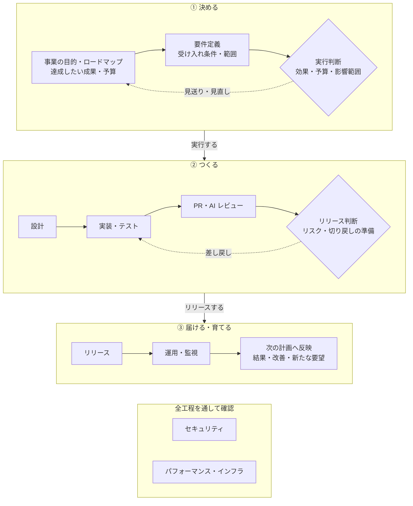

# engineering-notes

開発全般で役立つ知見・チェックリスト・進め方をまとめたノートです。
要件定義からリリース後の運用まで、実務で得た知見を、AI を活用した開発を前提に整理しています。

## このノートの考え方

- **工程ごとに、確認すべき観点を漏れなく持つ**：各工程のチェックリストで、確認の漏れを防ぎます
- **網羅は AI に任せ、判断は人が行う**：各ドキュメントに AI への依頼テンプレートを用意しています。AI に漏れやリスクを洗い出させ、予算・影響範囲・優先度を踏まえた判断は人が行います
- **障害・性能劣化・移行・運用のボトルネックを先回りして見つける**：問題が表に出る前に、設計とリリース前の確認で手を打ちます

## 開発の全体像

開発は、事業の目的から始まります。[事業としてのロードマップ（AI 時代の事業運営）](business/roadmap.md)で達成したい成果を決め、要件を定義したうえで、効果・予算・影響範囲を踏まえて実行するかを判断してから、設計・実装に入ります。リリースの前にも、リスクと切り戻しの準備を確認して判断します。運用で得た結果は、次の計画に反映します。

セキュリティとパフォーマンス・インフラは、特定の工程ではなく、すべての工程を通して確認します。

## 目次

### 開発の進め方

- [開発フロー（チケット作成からリリースまで）](process/development-flow.md)
  チケット作成・要件定義・設計・実装・テスト・プルリクエスト・CI/CD によるリリースまでを、工程ごとの終わる条件で確実に進める方法
- [AI を前提にしたプルリクエストの判断方法](process/ai-pr-review.md)
  AI が受け入れ条件ごとに根拠を示したサマリーを作り、人はリスクの高い部分と最終判断に集中するレビューの進め方
- [AI 時代のスクラム開発](process/scrum-in-ai-era.md)
  実装が速くなったときに、バックログの準備・完成の定義・レビューへ重心を移すスクラムの進め方

### 工程ごとのチェックリスト

- [要件定義チェックリスト](requirements/checklist.md)
  目的・利用者・機能要件・非機能要件・範囲・合意の確認
- [設計チェックリスト](design/checklist.md)
  全体構成・データ設計・API 設計・処理方式・認証・運用を見据えた設計・テスト方針
- [実装チェックリスト](implementation/checklist.md)
  コードの品質・エラー処理・性能・テスト・データベースの変更・AI が生成したコードの確認
- [セキュリティチェックリスト](security/checklist.md)
  認証・認可・入出力・データの保護・秘密情報・クラウド・依存パッケージ・AI の利用
- [リリース前パフォーマンス・インフラチェックリスト](performance/release-checklist.md)
  本番を想定した計測、インフラの確認、リアルタイム処理とバッチ処理の見極め、キャッシュの費用対効果、必要スペックと予算の試算
- [リリースチェックリスト](release/checklist.md)
  リリースの準備・切り戻し・関係者への連絡・当日とリリース後の確認
- [リリース後の運用・監視チェックリスト](operations/checklist.md)
  監視・アラート・ログ・障害対応・バックアップ・定期的な見直し

### インフラ

- [インフラ選定（AWS のサービス）](infrastructure/aws-service-selection.md)
  実行環境・データベース・キャッシュ・非同期処理・認証・ネットワーク・監視で、AWS のどのサービスを選ぶか

### 事業

- [事業としてのロードマップ（AI 時代の事業運営）](business/roadmap.md)
  事業の目標・資金・体制と結びつけたロードマップの作り方。AI 時代に加えるべき原価と価格、守りの源泉とモデル提供元への依存、組織と人数、AI の品質と評価、規制とガバナンス

### 情報収集

- [情報のキャッチアップ方法](learning/catch-up.md)
  一次情報を中心に、技術の情報を無理なく継続して追いかける方法
- [AI 周りの情報収集](learning/ai-information.md)
  AI モデル・ツールの情報を追い、自分の作業で試して比べる仕組み
