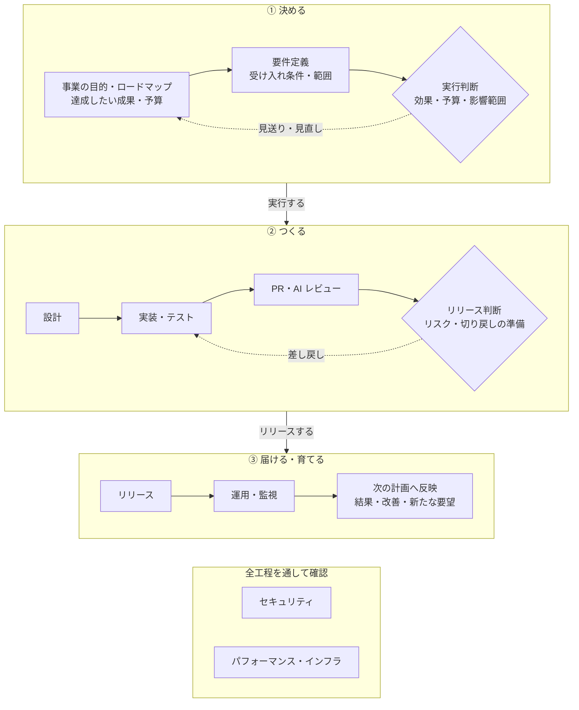

# engineering-notes

> 最終確認日：2026年11月15日

開発全般で役立つ知見・チェックリスト・進め方をまとめたノートです。
要件定義からリリース後の運用まで、実務で得た知見を、AI を活用した開発を前提に整理しています。

## このノートの考え方

- **工程ごとに、確認すべき観点を漏れなく持つ**：各工程のチェックリストで、確認の漏れを防ぎます
- **網羅は AI に任せ、判断は人が行う**：各ドキュメントに AI への依頼テンプレートを用意しています。AI に漏れやリスクを洗い出させ、予算・影響範囲・優先度を踏まえた判断は人が行います
- **障害・性能劣化・移行・運用のボトルネックを先回りして見つける**：問題が表に出る前に、設計とリリース前の確認で手を打ちます
- **検証を自動化し、人は意図とリスクの判断に集中する**：AI に自分で検証させ、人が動作確認やレビューの係にならないようにします。ボトルネックは移動するため、流れ全体を定期的に見直します

内容は 2026年11月時点の動向（OWASP Top 10:2025、AI エージェントのセキュリティ、AI を前提にしたレビューと開発の進め方、AWS の更新など）を踏まえています。

## 開発の全体像

開発は、事業の目的から始まります。[事業としてのロードマップ（AI 時代の事業運営）](business/roadmap.md)で達成したい成果を決め、要件を定義したうえで、効果・予算・影響範囲を踏まえて実行するかを判断してから、設計・実装に入ります。リリースの前にも、リスクと切り戻しの準備を確認して判断します。運用で得た結果は、次の計画に反映します。

セキュリティとパフォーマンス・インフラは、特定の工程ではなく、すべての工程を通して確認します。

## はじめに

- [PDF 版（AI 時代の開発ナレッジ集 2026年11月版）](pdf/engineering-notes-2026-11.pdf)
  全ノートを1冊にまとめた PDF（A4・141ページ）。社内共有やプレゼンに。内容を更新したら `python3 scripts/pdf/build.py` で作り直せます
- [規模別の使い方](guide/how-to-use.md)
  PoC・小規模な本番・成長期の本番で、どのチェックリストをどこまで使うかの目安
- [テンプレート集](templates/README.md)
  チケット、プルリクエスト、ADR（設計判断の記録）、ポストモーテム、AGENTS.md のひな形

## 目次

### 開発の進め方

- [開発フロー（チケット作成からリリースまで）](process/development-flow.md)
  チケット作成・要件定義・設計・実装・テスト・プルリクエスト・CI/CD によるリリースまでを、工程ごとの終わる条件で確実に進める方法
- [AI を前提にしたプルリクエストの判断方法](process/ai-pr-review.md)
  AI が受け入れ条件ごとに根拠を示したサマリーを作り、人はリスクの高い部分と最終判断に集中するレビューの進め方
- [AI 時代のスクラム開発](process/scrum-in-ai-era.md)
  実装が速くなったときに、バックログの準備・完成の定義・レビューへ重心を移すスクラムの進め方
- [既存プロジェクトへの参画・引き継ぎ](process/project-onboarding.md)
  参画初日から1か月で確認すること、AI を使ったコードベースの把握、離任時の引き継ぎ
- [技術的負債とリファクタリング](process/tech-debt.md)
  負債の見える化と優先度の付け方、テストで守るリファクタリング、AI を使った大規模な整理

### 工程ごとのチェックリスト

- [要件定義チェックリスト](requirements/checklist.md)
  目的・利用者・機能要件・非機能要件・範囲・合意の確認
- [設計チェックリスト](design/checklist.md)
  全体構成・データ設計・API 設計・処理方式・認証・運用を見据えた設計・テスト方針
- [実装チェックリスト](implementation/checklist.md)
  コードの品質・エラー処理・性能・テスト・データベースの変更・AI が生成したコードの確認
- [テスト戦略](testing/strategy.md)
  テストの種類と配分、テストそのものの信頼性、AI の機能の評価（evals）
- [セキュリティチェックリスト](security/checklist.md)
  OWASP Top 10:2025 への対応、サプライチェーン（CI/CD・依存パッケージ）、AI エージェント・LLM を組み込む場合
- [データ移行・スキーマ変更](data/migration.md)
  サービスを止めない Expand-Contract の手順、ロックとバックフィル、検証と切り戻し
- [リリース前パフォーマンス・インフラチェックリスト](performance/release-checklist.md)
  本番を想定した計測、インフラの確認、リアルタイム処理とバッチ処理の見極め、キャッシュの費用対効果、必要スペックと予算の試算
- [リリースチェックリスト](release/checklist.md)
  リリースの準備・切り戻し・関係者への連絡・当日とリリース後の確認
- [リリース後の運用・監視チェックリスト](operations/checklist.md)
  監視・SLO とアラート・ログ・バックアップ・定期的な見直し・AI の機能の監視
- [障害対応とポストモーテム](operations/incident-response.md)
  影響を止めることを優先した障害対応の流れ、重大度の目安、個人を責めない振り返り

### 画面

- [フロントエンド・UX・アクセシビリティチェックリスト](frontend/checklist.md)
  表示の速さ（Core Web Vitals）、使いやすさ、アクセシビリティと法令、AI が作った画面の確認

### AI 機能

- [AI 機能（LLM）を組み込むときの設計](ai/llm-feature-design.md)
  LLM を使うかの判断、プロンプトとモデルの管理、RAG、出力の検証と失敗への備え、評価・費用・安全性

### インフラ

- [インフラ選定（AWS のサービス）](infrastructure/aws-service-selection.md)
  実行環境・データベース・キャッシュ・非同期処理・認証・ネットワーク・監視で、AWS のどのサービスを選ぶか
- [コスト管理（クラウドと AI の利用料）](infrastructure/cost-management.md)
  費用の見える化、予算と通知、見落としやすい費用、削減の手段

### 事業・法務

- [事業としてのロードマップ（AI 時代の事業運営）](business/roadmap.md)
  事業の目標・資金・体制と結びつけたロードマップの作り方。AI 時代に加えるべき原価と価格、守りの源泉とモデル提供元への依存、組織と人数、AI の品質と評価、規制とガバナンス
- [見積もり・提案](business/estimation.md)
  工程全体と不確実性を含めた見積もり、AI による効率化の見込み方、前提と範囲の明文化
- [法務・ライセンス](legal/license-and-compliance.md)
  OSS のライセンス、AI が生成したコードの扱い、個人情報の保護、業務委託の契約

### 情報収集

- [情報のキャッチアップ方法](learning/catch-up.md)
  一次情報を中心に、技術の情報を無理なく継続して追いかける方法
- [AI 周りの情報収集](learning/ai-information.md)
  AI モデル・ツールの情報を追い、自分の作業で試して比べる仕組み
