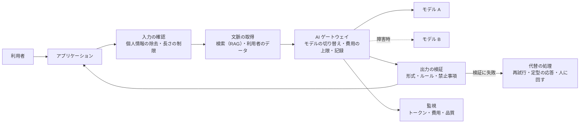

# AI 機能（LLM）を組み込むときの設計

> 最終確認日：2026年11月15日

自社のサービスに、LLM を使った機能（要約、分類、チャット、検索、AI エージェントなど）を組み込むときに、最初に確認するノートです。
LLM の機能は、出力が毎回変わり、費用が使った分だけかかり、外部のモデル提供元に依存します。通常の機能と同じ感覚で作ると、品質・費用・安全性のどこかで問題が起きやすいため、それぞれを設計の段階で決めておくことを重視しています。

---

## 基本方針

1. **LLM を使うべきかを先に判断する**
   - ルールや通常の処理で解決できるなら、そのほうが安く、速く、確実。LLM は、あいまいな入力や文章の理解・生成が必要な部分に絞る
2. **プロンプトとモデルの設定を、コードと同じように管理する**
   - プロンプト、モデル、パラメーター、ツールの定義、検索の設定をバージョン管理し、レビューとテストを通してから変える
3. **評価を先に作る**
   - 評価用のデータと基準を、機能を作る前に用意する。評価がないと、改善したのか悪化したのか分からない
4. **失敗する前提で作る**
   - 誤った出力、形式の崩れ、タイムアウト、モデル提供元の障害を前提に、検証と代替手段を用意する
5. **費用と安全性を設計に含める**
   - 1回あたりの費用、上限、個人情報の扱い、プロンプトインジェクション対策を最初から決める

---

## 構成の例



---

## チェックリスト

### 1. 使うかどうかの判断

- [ ] 解決したい課題と、LLM を使う理由が明確か（ルールや通常の処理では難しい理由）
- [ ] 誤った出力が出た場合の影響（利用者、業務、法令）を確認したか
- [ ] 1回あたりの費用と、想定の利用量から、月額の費用を試算したか
- [ ] 応答時間の要件（リアルタイムか、非同期でよいか）を決めたか

### 2. プロンプトとモデル

- [ ] プロンプト、モデル、パラメーター、ツールの定義を、バージョン管理しているか
- [ ] プロンプトの変更を、レビューと評価を通してから反映しているか
- [ ] 用途ごとに、モデルを使い分けているか（簡単な処理は小さく安いモデル、難しい処理は高性能なモデル）
- [ ] モデルの切り替え（別の提供元、新しいバージョン）を、設定の変更でできるか
- [ ] モデルの提供終了の予定を把握しているか

### 3. 文脈の与え方（RAG・利用者のデータ）

- [ ] 検索の対象、文書の分け方、取得する件数を決め、検索の精度を別に評価しているか
- [ ] 利用者が見る権限のない文書が、文脈に入らないようにしているか
- [ ] 文書が古くならないよう、更新の仕組みがあるか
- [ ] 出力に、根拠となる文書を示せるか

### 4. 出力の検証と失敗への備え

- [ ] 構造化された出力（JSON など）を、スキーマで検証しているか
- [ ] 業務のルール（金額の範囲、禁止事項など）を、コードで確認しているか
- [ ] 検証に失敗したときの扱い（再試行、定型の応答、人に回す）を決めたか
- [ ] タイムアウトと、モデル提供元の障害時の代替手段（別のモデル、機能の一時停止）があるか
- [ ] 影響の大きい操作（送金、削除、外部への送信）の前に、人の確認を挟んでいるか

### 5. 評価

- [ ] 実際の利用に近い入力を集めた評価用のデータと、合格の基準があるか
- [ ] プロンプト・モデルの変更ごとに評価を実行し、基準を下回ったらリリースしないか
- [ ] 本番の出力の一部を、定期的に評価・確認しているか
- [ ] 詳しくは [テスト戦略](../testing/strategy.md) の「AI の機能の評価」を参照する

### 6. 費用

- [ ] 利用者ごと・機能ごとの費用を記録しているか
- [ ] 利用量の上限や、費用が急に増えたときに止める仕組みがあるか
- [ ] 入力の長さを制限し、不要な文脈を送らないようにしているか
- [ ] キャッシュ（同じ入力への応答、プロンプトの共通部分）を活用しているか
- [ ] 価格の設計（定額・従量・組み合わせ）と、粗利への影響を確認したか（[事業としてのロードマップ（AI 時代の事業運営）](../business/roadmap.md)）

### 7. 安全性と法令

- [ ] 外部の文章（利用者の入力、文書、Web ページ）を、指示ではなくデータとして扱っているか
- [ ] 個人情報や機密情報を、モデル提供元に送ってよいかの基準を決め、契約（学習に使われない設定など）を確認したか
- [ ] AI が応答していることを、利用者に示しているか
- [ ] 提供する国・地域の規制（EU AI Act など）の対象になるかを確認したか
- [ ] 詳しくは [セキュリティチェックリスト](../security/checklist.md) の「AI エージェント・LLM を組み込む場合」を参照する

### 8. 監視

- [ ] トークン数、費用、応答時間、エラー率を見られるか
- [ ] 出力の質（評価の結果、利用者の評価、人による修正の割合）を見られるか
- [ ] 使ったプロンプトとモデルのバージョンを、リクエストごとに記録しているか
- [ ] 詳しくは [リリース後の運用・監視チェックリスト](../operations/checklist.md) の「AI の機能・AI エージェントの監視」を参照する

---

## AI への依頼テンプレート

```markdown
あなたは LLM を使った機能の設計に詳しいエンジニアです。
以下の機能の設計をレビューしてください。

## 機能の概要
{ 目的、利用者、入力と出力、想定の利用量、応答時間の要件 }

## 設計
{ 使うモデル、プロンプトの概要、文脈の与え方、出力の検証、代替の処理 }

## 依頼内容
1. 添付のチェックリストと照らし合わせ、検討が漏れている項目を洗い出してください。
2. LLM を使わずに解決できる部分がないか、確認してください。
3. 誤った出力・形式の崩れ・モデル提供元の障害が起きたときの影響と、対策を挙げてください。
4. 月額の費用を試算し、費用を下げる方法（モデルの使い分け、キャッシュ、入力の短縮）を提案してください。
5. 評価用のデータの作り方と、合格の基準の案を出してください。
6. プロンプトインジェクションや情報漏えいのリスクと、対策を挙げてください。

## 出力形式
- 漏れ・リスク一覧（項目、内容、影響度：高・中・低、対策）
- 月額の費用の試算と、削減の方法
- 評価の方法と合格基準の案
```

---

## 人が判断すること

- [ ] LLM を使うかどうか、どこまで任せるか
- [ ] 誤った出力の影響を、どこまで受け入れるか
- [ ] 費用の上限と、価格への反映
- [ ] 個人情報や機密情報を、モデル提供元に送るかどうか

---

## 参考情報（2026年11月時点）

- [How to Run AI Software Development for LLM Apps（PromptLayer）](https://blog.promptlayer.com/how-to-run-ai-software-development-for-llm-apps/)
- [How to Build an LLM Evaluation Framework（PromptLayer）](https://blog.promptlayer.com/suggestion-pending-k574tttdwg-2/)
- [What Is LLM Observability? The Complete 2026 Guide（OpenObserve）](https://openobserve.ai/blog/what-is-llm-observability/)
