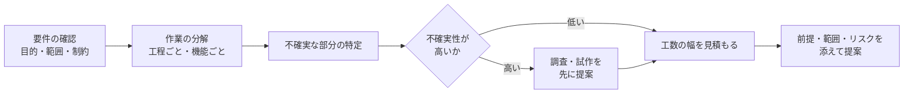

# 見積もり・提案

> 最終確認日：2026年11月15日

要件から工数と費用を見積もり、提案にまとめるためのノートです。
AI によって実装の手間は大きく減りましたが、要件の確認、検証、レビュー、運用の準備、関係者との調整の手間は減っていません。実装だけを見て見積もると、全体を過小に見積もりやすいため、工程全体と不確実性を見積もりに含めることを重視しています。

---

## 基本方針

1. **工程全体を見積もる**
   - 実装だけでなく、要件の確認、設計、テスト、レビュー、リリース、運用の準備、打ち合わせを含める
2. **不確実性を数字で示す**
   - 1つの数字ではなく、幅（最小〜最大）と、その前提を示す
3. **前提と範囲を明文化する**
   - 何が含まれ、何が含まれないか、どの前提が崩れたら見積もりが変わるかを書く
4. **不確実性が高い部分は、先に小さく検証する**
   - 技術的に分からない部分は、試作や調査を先に行い、その結果で見積もりを確定する
5. **AI による効率化は、効果が確かな部分にだけ見込む**
   - 定型的な実装やテストの作成では効率化を見込み、要件の確認や判断の時間は減らさない

---

## 見積もりの進め方



---

## 工程ごとの見積もりの観点

| 工程 | 含める作業 | AI による効率化 |
|---|---|---|
| 要件の確認 | 打ち合わせ、質問、受け入れ条件の整理 | 小さい（論点の洗い出しは速くなる） |
| 設計 | 構成、データ、API、リスクの整理 | 中くらい |
| 実装 | 機能の実装 | 大きい（定型的な部分ほど大きい） |
| テスト | テストの作成、実行、修正 | 中〜大 |
| レビュー・検証 | プルリクエストの確認、受け入れの確認 | 小さい（人の判断が必要） |
| リリース | 手順書、移行、リリース作業 | 小〜中 |
| 運用の準備 | 監視、ログ、手順書、引き継ぎ | 小〜中 |
| 管理・調整 | 定例、報告、関係者との調整 | 小さい |

---

## チェックリスト

### 1. 要件と範囲

- [ ] 目的と、成功の基準を確認したか
- [ ] 含まれる作業と、含まれない作業を明文化したか
- [ ] 非機能要件（性能、セキュリティ、運用）を確認したか
- [ ] 既存システムとの連携や、データ移行の有無を確認したか

### 2. 見積もり

- [ ] 作業を工程ごと・機能ごとに分解したか
- [ ] 実装以外の工程（要件の確認、テスト、レビュー、リリース、運用の準備、打ち合わせ）を含めたか
- [ ] 不確実な部分を特定し、幅（最小〜最大）で見積もったか
- [ ] 技術的に分からない部分は、調査・試作を別の段階として提案したか
- [ ] 過去の実績と比べて、見積もりが大きくずれていないか確認したか

### 3. 提案

- [ ] 前提（体制、稼働時間、提供される情報や環境、相手側の確認の速さ）を書いたか
- [ ] 前提が崩れた場合や、範囲が変わった場合の扱いを書いたか
- [ ] 契約の形態（準委任、請負）と、成果物・責任の範囲を明確にしたか
- [ ] 段階的に進める案（試作→本開発など）を示したか
- [ ] 運用・保守の費用（インフラ、AI の利用料、保守の工数）を、別に示したか

### 4. 進行中の管理

- [ ] 見積もりと実績の差を、定期的に確認しているか
- [ ] 範囲の変更を、見積もりの見直しと合意を経てから受けているか
- [ ] 完了後に、見積もりと実績の差の原因を振り返っているか

---

## AI への依頼テンプレート

```markdown
あなたはソフトウェア開発の見積もりに詳しいエンジニアです。
以下の要件の見積もりを手伝ってください。

## 要件
{ 目的、機能の一覧、非機能要件、期限、体制 }

## 依頼内容
1. 作業を工程ごと（要件の確認、設計、実装、テスト、レビュー、リリース、運用の準備、管理）と
   機能ごとに分解してください。
2. それぞれの工数を、幅（最小〜最大）で見積もり、根拠を書いてください。
   AI による効率化は、効果が確かな部分にだけ見込んでください。
3. 不確実性が高い部分と、先に調査・試作すべき部分を挙げてください。
4. 見積もりの前提と、前提が崩れたときの影響を書いてください。
5. 確認すべき質問を挙げてください。推測の部分は「推測」と明記してください。

## 出力形式
- 作業の分解と工数の幅
- 不確実な部分と、調査・試作の提案
- 前提とリスク
- 確認すべき質問
```

---

## 人が判断すること

- [ ] 最終的な見積もりの金額と、幅の扱い
- [ ] 契約の形態と、引き受ける責任の範囲
- [ ] 不確実な部分を、調査の段階に分けるか
