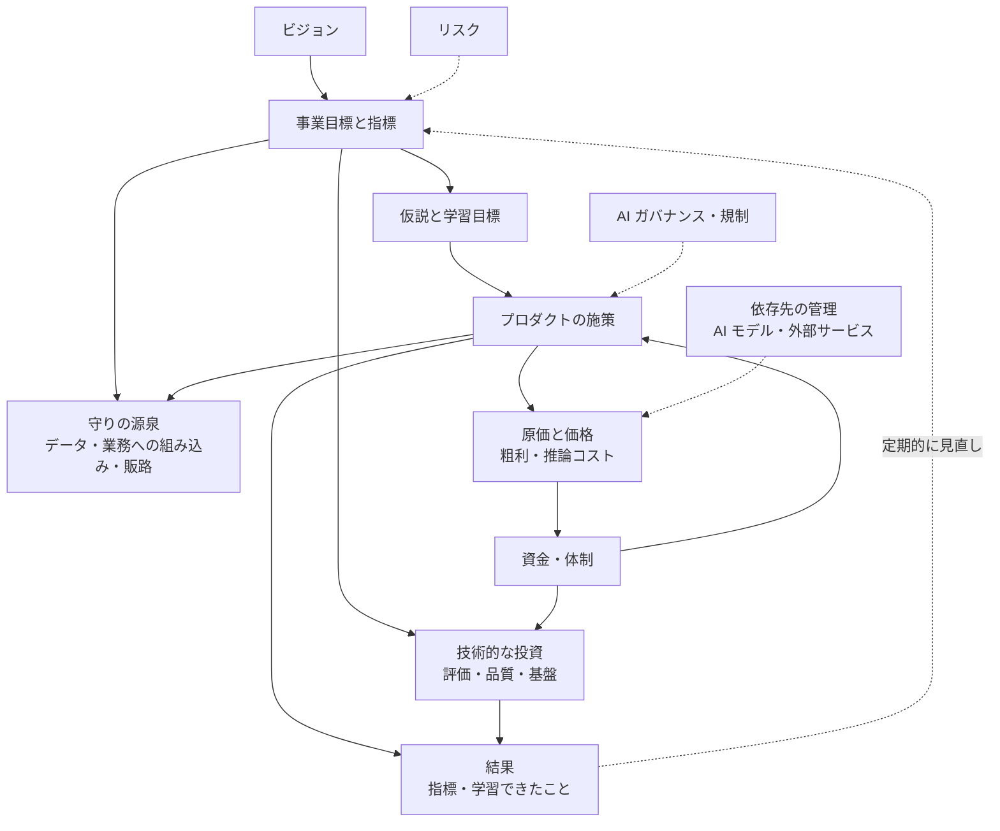
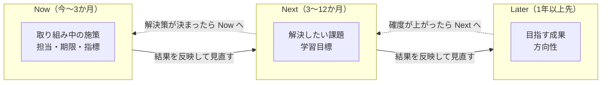
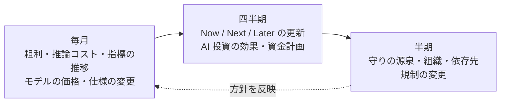

# 事業としてのロードマップ（AI 時代の事業運営）

> 最終確認日：2026年11月15日

プロダクト開発を、事業の目標・資金・組織と結びつけて計画するためのノートです。
機能をいつ作るかの一覧ではなく、「事業として何をいつまでに達成するか」から逆算して、開発の優先度と投資を判断できるようにすることを目的にしています。
あわせて、AI によって事業運営の前提がどう変わったかを踏まえ、ロードマップに追加で組み込むべき領域を整理しています。

> 数値や制度は 2026年11月時点で公開されている情報をもとにしています。出典は末尾の「参考情報」にまとめています。ベンチマークの多くは海外の調査や、一部の企業の公表値に基づくため、自社にそのまま当てはめず、方向性をつかむ参考として使ってください。

---

## AI 時代に何が変わったか

| 観点 | これまで | AI 時代 |
|---|---|---|
| 開発の速さ | 作ること自体に時間がかかり、速さが競争力になった | 誰でも速く作れるため、速さだけでは差がつきにくい |
| 組織の規模 | 売上の成長に合わせて人を増やす | 少人数のまま伸ばし、AI でできない仕事だけに人を増やす |
| 原価の構造 | ソフトウェアの追加原価はほぼゼロで、粗利は高い | AI の推論（モデルの利用料）が使われた分だけかかり、粗利が下がりやすい |
| 価格の設計 | 利用者数（席数）に応じた月額が中心 | 利用量や成果に応じた料金、またはその組み合わせが広がっている |
| 競争優位 | 機能と実装力 | 独自データ、業務への深い組み込み、販路。機能はモデル提供元や競合にすぐ追いつかれる |
| 依存先 | クラウドやライブラリ | 加えて、AI モデルの提供元（価格・仕様・提供終了の影響を直接受ける） |
| 計画の確度 | ある程度、日付で約束できる | AI の性能や外部環境の変化が速く、日付での約束が外れやすい |
| 規制 | 個人情報保護など既存の法令 | AI に関する法律やガイドラインが段階的に整備されている |

---

## 評価：これまでのロードマップの考え方は今もベストプラクティスか

**引き続き有効なもの**

- **機能ではなく成果から逆算する**：成果（アウトカム）を軸にした計画は、AI 時代にはむしろ必須になっています。AI の機能は予定どおりに完成するとは限らないため、作るものではなく、達成したい状態で計画する必要があります
- **確度に応じて書き分ける**：直近は具体的に、先ほど大まかに書く考え方は、Now / Next / Later の形式として広く使われています
- **資金・体制と一体で考える**：資本効率が重視される流れの中で、さらに重要になっています

**不足していたもの**

- AI の推論コストを含めた粗利と、価格設計の計画
- 機能がすぐに真似される前提での、守りの源泉（独自データ・業務への組み込み・販路）の計画
- AI モデルの提供元への依存と、その管理
- 人数ではなく、1人あたりの成果と資本効率で組織を計画する視点
- AI の品質を測る評価の仕組みを、先に作っておくこと
- AI に関する規制とガバナンスへの対応
- 「いつまでに動かす」ではなく「いつまでに何を学ぶか」で約束する考え方

このノートは、これらを加えて改訂したものです。

---

## 基本方針

1. **成果から逆算し、時間軸は確度に応じて書く**
   - 「いつまでに、どの指標を、どこまで伸ばすか」を先に決め、Now / Next / Later で確度に応じて書き分ける
2. **AI の取り組みは「何を学ぶか」で約束する**
   - AI の機能は、試すまで実現できるか分からないことが多い。「いつまでに完成させる」ではなく、「いつまでに何を検証するか」を約束する
3. **粗利と推論コストを最初から計画に入れる**
   - AI の利用料は売上に比例して増える原価になる。価格設計と原価の管理を、施策と同じ重さで計画する
4. **真似されにくい守りの源泉を育てる**
   - 機能は真似される前提で、独自データ、業務への組み込み、販路のどれを育てるかを計画に入れる。モデル提供元への依存も管理する
5. **人数ではなく、1人あたりの成果と資本効率で組織を考える**
   - 人を増やす前に、AI や仕組みで対応できないかを検討する。ただし少人数であること自体を目的にしない
6. **評価とガバナンスを先に作る**
   - AI の品質を測る仕組み（評価）と、AI の利用に関するルールを、AI の機能を出す前に用意する
7. **変化の速さに合わせて、見直しの周期を短くする**
   - モデルの価格や性能、規制は数か月単位で変わる。月次・四半期・半期で見るものを分けて見直す

---

## ロードマップの構成

| 要素 | 内容 | 例 |
|---|---|---|
| ビジョン | 目指す姿 | 地域の店舗の予約と顧客管理を、手間なくオンラインにする |
| 事業目標 | 期間ごとの達成目標と指標 | 1年後に有料店舗数 ○○、ARR ○○ 万円、継続率 ○○% |
| 仮説と学習目標 | 各段階で確かめたいこと | AI による予約の自動応答で、店舗の対応時間が半分になるか |
| プロダクトの施策 | 目標と仮説に対応する機能・改善 | 予約の自動応答、来店履歴をもとにした再来店の案内 |
| 原価と価格 | 1顧客あたりの売上・原価・粗利、価格の形 | 月額の基本料金 ＋ 自動応答の件数に応じた従量課金 |
| 守りの源泉 | 真似されにくい強みをどう育てるか | 店舗ごとの予約・来店データの蓄積、予約台帳としての定着 |
| 依存先の管理 | AI モデルや外部サービスへの依存と代替手段 | 複数のモデルを切り替えられる構成、データを学習に使わない契約 |
| 技術的な投資 | 成長と品質を支える基盤 | AI の評価の仕組み、性能改善、監視、セキュリティ |
| 資金・体制 | 予算と人、採用・調達の計画 | 資金の残り期間 18か月、AI で対応できない領域に限った採用 |
| AI ガバナンス | AI の利用ルール、規制への対応 | AI が応答していることの表示、個人情報の扱い、人による確認の範囲 |
| リスク | 計画を崩す要因と対策 | モデルの値上げ、大手の同種機能の提供、主要顧客の解約、規制の変更 |

**要素のつながり**



施策と技術的な投資は、どちらも事業目標から導き、資金と体制の範囲で優先度を決めます。AI 時代は、施策が原価と価格（粗利）に直接影響し、モデル提供元への依存や規制が施策の制約になるため、これらを同じ図の中で扱います。

---

## 時間軸の書き方：Now / Next / Later

日付を細かく約束する代わりに、確度で3つに分けて書きます。確度が低い段階で日付を約束すると、外れたときに計画全体の信頼を損なうためです。

| 区分 | 期間の目安 | 書く内容 | 確度 |
|---|---|---|---|
| Now | 今〜3か月 | 取り組み中の施策、担当、期限、成果の指標 | 高い。約束できる |
| Next | 3〜12か月 | 解決したい課題と、学習目標。解決策はまだ確定しない | 中くらい。方向性を共有する |
| Later | 1年以上先 | 目指す成果と方向性 | 低い。変わる前提で示す |



- 日付を約束する必要があるもの（契約、法対応、イベントなど）だけは、別に一覧にして明示します
- AI の機能は、Now に入れる前に「検証で何が分かれば進めるか」を決めます
- 社外向け（投資家・顧客）には Now / Next / Later、社内の開発向けには施策の詳細、経営向けには指標と資金のように、1つのロードマップから見る人に合わせた見せ方を用意します

---

## AI 時代に計画へ加える5つの領域

### 1. 原価と価格設計（ユニットエコノミクス）

AI の利用料は、使われるほど増える原価です。従来のソフトウェアと同じ感覚で価格を決めると、使う顧客ほど赤字になることがあります。

**押さえておきたい傾向**

- AI を中心にした製品の粗利は、従来の SaaS（70〜85% 程度）より低く、50% 前後という調査があります
- AI の売上のうち、推論の費用が 2割強を占めるという調査があります
- 定額の料金では、一部の利用量の多い顧客が推論の費用の大半を占めることがあります
- 価格の形は、利用者数に応じた月額だけでなく、利用量に応じた従量課金や、成果（問題の解決件数など）に応じた課金を組み合わせる企業が増えています
- 一方で、従量課金だけにした場合は粗利が最も低くなりやすい、従量課金の導入直後に解約が増えた、という調査もあり、従量課金にすれば解決するわけではありません

**価格の形の比較**

| 価格の形 | 向いている場合 | 注意点 |
|---|---|---|
| 利用者数に応じた月額 | 利用量が利用者数に比例する | 利用量の多い顧客で赤字になりやすい |
| 利用量に応じた従量課金 | 利用量の差が大きい | 請求額が読めず、顧客が使い控える・解約することがある |
| 基本料金 ＋ 従量課金（組み合わせ） | 多くの AI 製品 | 料金体系の説明を分かりやすくする必要がある |
| 成果に応じた課金 | 成果を明確に定義・計測できる | 失敗した処理の費用を自社が負担する |

**計画に入れること**

- 顧客1社・利用者1人あたりの推論の費用を、標準的な利用（中央値）と多い利用（上位 10% など）で試算する
- 目標とする粗利を決め、そこから価格と利用量の上限を決める
- モデルの価格改定や、より安いモデルへの切り替えによる原価の変化を見込む
- 原価の推移を毎月確認し、価格の見直しの基準を決めておく

### 2. 守りの源泉とモデル提供元への依存

AI を使った機能は、競合やモデル提供元にすぐ追いつかれます。モデル提供元が同じ機能を自社製品に組み込むと、それだけで事業が成り立たなくなることもあります。

**簡単な確認方法**

- 自社製品の中心となるプロンプトを、汎用の AI チャットにそのまま貼り付けたときに、同じ結果の大半が得られてしまわないか
- 主要なモデル提供元が料金を大幅に上げた場合や、同じ機能を出した場合に、翌月も事業が成り立つか

**育てるべき守りの源泉**

| 源泉 | 内容 | 例 |
|---|---|---|
| 独自データ | 製品を使うほど蓄積され、他社が手に入れられないデータ | 店舗ごとの予約・来店・キャンセルの履歴 |
| 業務への組み込み | 顧客の業務の「正式な記録」になり、乗り換えにくくなる | 予約台帳・顧客台帳として日々使われている |
| 販路 | 顧客に届く独自の経路 | 業界団体や既存の取引網との連携 |
| 業界の専門性・規制への対応 | 業界特有のルールや規制に対応していること | 業界の規制や監査に対応した記録・承認の仕組み |

**依存先の管理**

- 複数のモデルを切り替えられる構成にし、特定の提供元に価格や機能で縛られないようにする
- モデル提供元との契約で、入力したデータが学習に使われないことを確認する
- モデルの提供終了（廃止予定）の告知を受け取り、切り替えの手順を用意しておく

### 3. 組織と人数の計画

AI を前提にした企業は、少人数で高い売上を上げる例が増えており、投資家も「従業員1人あたりの売上」や資本効率を重視するようになっています。

**押さえておきたい傾向**

- AI を前提にしたスタートアップは、同規模の企業より人数が少ない傾向がある
- 急成長している AI 企業の中には、1人あたりの年間売上が 100万ドルを超える例がある
- 一方で、初期の AI 企業の1人あたりの売上は従来の SaaS とほぼ同じという調査や、規模が大きくなると差が縮まるという指摘もある
- 少人数のまま伸びられるのは 3〜5年程度で、その先も成長を続けるには、再び採用が必要になるという見方もある
- 1人あたりの売上が高くても、利益が出るとは限らない

**計画に入れること**

- 人を増やす前に、その業務を AI や仕組みで対応できないかを確認する
- 人が担う役割を、判断・顧客との関係・品質の責任・AI の運用（指示や流れの改善、AI と人の受け渡しの管理）に絞る
- 1人あたりの売上だけでなく、バーンマルチプル（資金の純流出額 ÷ 新たに増えた年間経常収益（ARR））と組み合わせて見る
- 少人数ほど、判断と責任、精神的な負荷が特定の人に集中しやすい。メンバーの負荷と状態に気を配り、属人化を避ける
- AI で生まれた余力を、利益として残すのか、新しい市場やプロダクトに再投資するのかを決める

### 4. AI の品質と評価

AI の機能は、改善しているのか、悪化しているのかが分かりにくいものです。評価の仕組みがないまま機能を出すと、気づかないうちに品質が下がります。

**計画に入れること**

- AI の機能を出す前に、評価の仕組み（評価用のデータ、合格の基準、自動での計測）を作る
- 通常の機能開発と、AI の機能の検証を、別の流れとして計画する（AI の機能は不確実性が高いため）
- 利用者が AI の出力を役立ったと感じているかを計測する仕組みを入れる
- AI への投資の効果（作業時間の削減、解決率、売上への影響）を四半期ごとに確認し、計画を見直す

### 5. 規制とガバナンス

AI に関する法律やガイドラインは段階的に整備されています。罰則のない指針であっても、取引先から対応状況を聞かれる場面が増えています。

**日本**

- AI 推進法（人工知能関連技術の研究開発及び活用の推進に関する法律）が 2025年9月1日に全面施行。罰則はなく、事業者には AI の活用などの努力義務がある
- AI 事業者ガイドラインは 2026年3月31日に第1.2版が公表され、AI エージェントやフィジカル AI に関する事項が追加された

**EU（EU の利用者に提供する場合）**

- AI と対話していることの表示や、AI が生成したコンテンツの表示に関する義務（第50条）は、2026年8月2日から適用されている。すでに提供中のシステムでの電子透かし（ウォーターマーク）などには、2026年12月2日までの猶予がある
- 高リスク AI のうち、採用、与信、教育などの用途の義務は 2027年12月2日に、規制対象の製品に組み込まれる AI の義務は 2028年8月2日に延期された

**計画に入れること**

- 提供する国・地域と、AI の用途（高リスクに当たる可能性があるか）を確認する
- AI が応答していることの表示、AI が生成したコンテンツの扱いを決める
- AI に任せる範囲と、人が確認・承認する範囲を決める（特に、AI エージェントが自動で操作する場合）
- 個人情報や機密情報を、AI モデルに渡してよいかの基準を決める
- 規制の変更を定期的に確認し、ロードマップに反映する

---

## 指標の組み合わせ

1つの指標だけを追うと、判断を誤ります。成長・効率・収益性・顧客・AI の品質を組み合わせて見ます。

| 分類 | 指標 | 見る理由 |
|---|---|---|
| 成長 | ARR（年間経常収益）、成長率 | 事業が伸びているか |
| 効率 | 従業員1人あたりの売上、バーンマルチプル | 少ない資金と人数で成長できているか |
| 収益性 | 粗利率、売上に対する推論コストの割合 | 使われるほど利益が出る構造になっているか |
| 顧客 | 継続率、売上継続率（NRR）、顧客の成果指標 | 顧客が価値を感じて使い続けているか |
| AI の品質 | 評価の合格率、人による修正・差し戻しの割合 | AI の機能が実際に役立っているか、悪化していないか |

ベンチマークの数値は、事業の段階や業種によって大きく異なります。他社の数値を目標にするより、自社の推移を見て改善しているかを確認することを優先します。

---

## 見直しの周期



| 周期 | 見るもの |
|---|---|
| 毎月 | 粗利と推論コストの推移、主要な指標、モデルの価格・仕様・提供終了の告知 |
| 四半期 | Now / Next / Later の更新、学習目標の達成状況、AI への投資の効果、資金計画 |
| 半期 | 守りの源泉が育っているか、組織と採用の方針、依存先、規制の変更 |

---

## チェックリスト

### 1. 目標と指標

- [ ] ビジョンと、期間ごとの事業目標がつながっているか
- [ ] 目標が、測れる指標（売上、継続率、顧客の成果指標など）で書かれているか
- [ ] 成長・効率・収益性・顧客・AI の品質の指標を組み合わせて見ているか
- [ ] 指標を計測する仕組み（データの取得、ダッシュボード）があるか
- [ ] 目標を達成したかどうかを、いつ・誰が判断するかを決めたか

### 2. 施策と時間軸

- [ ] 各施策が、どの目標・仮説に対応しているかが明確か
- [ ] Now / Next / Later で、確度に応じて書き分けているか
- [ ] 日付を約束する必要があるものを、別に一覧にしているか
- [ ] AI の機能について、「いつまでに何を学ぶか」と、進めるかどうかの判断基準を決めたか
- [ ] 施策の優先度を、効果、確度、費用（開発・運用・推論）で比べて決めたか
- [ ] やらないことを決め、記録しているか

### 3. 原価と価格

- [ ] 顧客1社・利用者1人あたりの推論の費用を、標準的な利用と多い利用で試算したか
- [ ] 目標とする粗利を決め、価格の形と利用量の上限を決めたか
- [ ] 利用量の多い顧客で赤字にならないか確認したか
- [ ] モデルの価格改定や切り替えによる原価の変化を見込んでいるか
- [ ] 料金体系が、顧客にとって分かりやすく、請求額が読みやすいか

### 4. 守りの源泉と依存先

- [ ] 中心となる機能が、汎用の AI や競合にすぐ置き換えられないか確認したか
- [ ] 独自データ、業務への組み込み、販路、専門性のうち、どれを育てるかを決めたか
- [ ] 守りの源泉を育てる施策が、ロードマップに入っているか
- [ ] 複数のモデルを切り替えられるか、特定の提供元に依存しすぎていないか
- [ ] モデル提供元との契約で、データの扱い（学習に使われないことなど）を確認したか

### 5. 組織と資金

- [ ] 資金の残り期間（ランウェイ）と、その間に達成すべきことが明確か
- [ ] 開発費・推論の費用・インフラ費・人件費の見込みが、資金計画と合っているか
- [ ] 人を増やす前に、AI や仕組みで対応できないかを確認しているか
- [ ] 1人あたりの売上とバーンマルチプルを、組み合わせて確認しているか
- [ ] 判断や作業が特定の人に集中していないか、メンバーの負荷や状態に気を配っているか
- [ ] AI で生まれた余力を、利益と再投資のどちらに回すかを決めたか

### 6. AI の品質とガバナンス

- [ ] AI の機能を出す前に、評価の仕組みを用意しているか
- [ ] AI への投資の効果を、四半期ごとに確認しているか
- [ ] 提供する国・地域の規制と、AI の用途のリスクを確認したか
- [ ] AI が応答していることの表示や、生成したコンテンツの扱いを決めたか
- [ ] AI に任せる範囲と、人が確認・承認する範囲を決めたか

### 7. リスクと見直し

- [ ] 計画を崩す要因（市場、競合、モデル提供元、取引先、規制、技術、人）を洗い出したか
- [ ] 大きなリスクに、対策または代替案を用意しているか
- [ ] 毎月・四半期・半期で見るものと、計画を変える基準を決めたか
- [ ] 外部の視点（投資家、顧問、利用者）から意見をもらう機会があるか

### 8. 共有と合意

- [ ] 経営、開発、営業、サポートが、同じロードマップを見ているか
- [ ] 見る人に合わせた見せ方（社外向け、開発向け、経営向け）を用意しているか
- [ ] 開発メンバーが、施策の目的と事業の目標を理解しているか
- [ ] 変更があったとき、関係者に理由とともに共有しているか

---

## AI への依頼テンプレート

```markdown
あなたは AI を活用したスタートアップの事業計画とプロダクト開発に詳しいアドバイザーです。
以下のロードマップを確認し、AI 時代の事業運営として妥当かを評価してください。

## 事業の概要
{ サービスの内容、顧客、収益モデル、価格、現在の指標 }

## ロードマップ
{ ビジョン、事業目標、Now / Next / Later の施策、学習目標、技術的な投資、資金・体制の計画 }

## 原価の情報
{ 利用している AI モデル、1顧客あたりの推論の費用、粗利の現状 }

## 依頼内容
1. 添付のチェックリストと照らし合わせ、検討が漏れている項目を洗い出してください。
2. 目標と施策のつながりが弱いもの、目標に対して施策が不足しているものを挙げてください。
3. 推論の費用を含めた粗利を試算し、価格の形と利用量の上限が妥当か評価してください。
   利用量の多い顧客で赤字にならないかも確認してください。
4. 中心となる機能が、汎用の AI や競合、モデル提供元に置き換えられるリスクを評価し、
   育てるべき守りの源泉と、そのための施策を提案してください。
5. 資金と体制の計画で、無理がある部分（予算の超過、人手の不足、特定の人への集中）を挙げてください。
6. 提供する国・地域で対応が必要な AI の規制と、その時期を挙げてください。
7. 計画を崩す可能性が高いリスクと、その対策を挙げてください。
8. 数値や制度は変わるため、最新の情報で確認が必要な箇所を「要確認」と書いてください。
   推測で補った部分は「推測」と明記してください。

## 出力形式
- 漏れ・改善点の一覧（項目、内容、影響度：高・中・低、改善案）
- 粗利と価格の評価
- 守りの源泉と依存先のリスク、提案する施策
- 資金・体制の懸念点
- 対応が必要な規制と時期
- 主なリスクと対策
```

---

## 人が判断すること

- [ ] 目標と、施策の優先度
- [ ] どの守りの源泉に投資するか
- [ ] 価格の形と、目標とする粗利
- [ ] どこに、いくらお金と人を投じるか（人を増やすか、AI と仕組みで対応するか）
- [ ] AI に任せる範囲と、人が責任を持つ範囲
- [ ] 計画を変える・やめる判断
- [ ] 関係者（経営、投資家、メンバー）との合意

---

## 参考情報（2026年11月時点）

**ロードマップの形式**

- [Product Roadmaps: How the Best Product Teams Plan for Uncertainty（Product Talk）](https://www.producttalk.org/product-roadmaps/)
- [Product Roadmap: Prioritization, Planning & AI's Impact（Scaler）](https://www.scaler.com/blog/what-is-product-roadmap/)
- [Product Roadmap for AI Products（IdeaPlan）](https://www.ideaplan.io/blog/product-roadmap-for-ai-products)

**原価と価格**

- [How to Calculate the Inference Efficiency Ratio（The SaaS CFO）](https://www.thesaascfo.com/how-to-calculate-the-inference-efficiency-ratio/)
- [AI Gross Margins: Inference Costs and Pricing for Startups（1752vc）](https://www.1752.vc/learn/ai-gross-margins-and-inference-costs)
- [SaaS Pricing Models for AI: Cost and Margin（Resourcifi）](https://www.resourcifi.com/insights/saas-ai-cost-pricing/)
- [Generative AI Pricing for SaaS: Tokens vs Outcomes（Usage Billing Report）](https://usage-billing-report.contentwave.net/article/pricing-generative-ai-in-saas-tokens-prompts-and-outcome-fees)

**守りの源泉と依存先**

- [Moat Or Wrapper? The 2026 Test For AI Founders（Foundra）](https://www.foundra.ai/key-reads/ai-product-moat-or-wrapper-defensibility-test-2026)
- [Proprietary Data Moats and AI Startup Defensibility in 2026（The Innovation Attorney）](https://theinnovationattorney.com/proprietary-data-moats-and-ai-startup-defensibility-in-2026/)

**組織と人数**

- [Startup ARR Per Employee Benchmarks 2026（Stealth Agents）](https://stealthagents.com/research/startup-arr-per-employee-benchmarks-2026)
- [AI-Native Companies 2026（Report AI）](https://report-ai.org/indexes/ai-economics/ai-native-companies-2026/)
- [The next billion-dollar company might only need 50 people（Eversund）](https://eversund.com/content/ai-native-startups/)
- [「AIで会社は小さくなる」は、どこまで本当か（Coral Capital）](https://coralcap.co/2026/08/ai-wont-make-your-company-smaller/)

**規制とガバナンス**

- [AI事業者ガイドライン検討会（経済産業省）](https://www.meti.go.jp/shingikai/mono_info_service/ai_shakai_jisso/index.html)
- [AI事業者ガイドラインの令和7年度更新内容（総務省・経済産業省）](https://www.soumu.go.jp/main_content/001059300.pdf)
- [AI推進法とは（Uravation）](https://uravation.com/media/japan-ai-promotion-act-guide/)
- [The AI Act implementation timeline: What changes under the AI Omnibus?（Future of Privacy Forum）](https://fpf.org/blog/the-ai-act-implementation-timeline-what-changes-under-the-ai-omnibus/)
- [Digital AI Omnibus Delays Key Deadlines, Introduces New Rules（Cooley）](https://cdp.cooley.com/digital-ai-omnibus-delays-key-deadlines-introduces-new-rules/)
