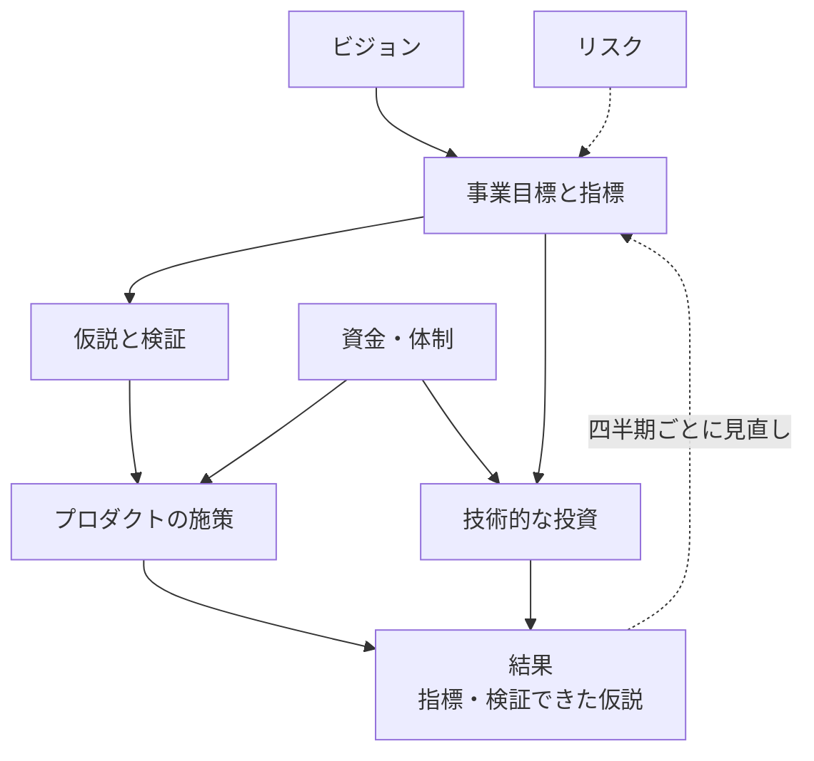

# 事業としてのロードマップ

プロダクト開発を、事業の目標・資金・組織と結びつけて計画するためのノートです。
機能をいつ作るかの一覧ではなく、「事業として何をいつまでに達成するか」から逆算して、開発の優先度と投資の判断をできるようにすることを目的にしています。

---

## 基本方針

1. **機能ではなく、事業の成果から考える**
   - 「何を作るか」の前に、「いつまでに、どの指標を、どこまで伸ばすか」を決める
2. **資金と人の計画と一体で考える**
   - 開発の計画は、使えるお金（資金の残り期間、調達・売上の見込み）と、使える人で決まる
3. **確度に応じて書き分ける**
   - 直近は具体的に、先の期間ほど大まかに書き、定期的に見直す
4. **検証したい仮説を明確にする**
   - 各段階で「何がわかれば次に進むか」を決め、結果に応じて計画を変える
5. **技術的な投資も、事業の言葉で説明する**
   - 性能改善、基盤の刷新、セキュリティ対策などを、事業へのリスクと効果で説明して優先度を決める

---

## ロードマップの構成

| 要素 | 内容 | 例 |
|---|---|---|
| ビジョン | 目指す姿 | 地域の店舗の予約と顧客管理を、手間なくオンラインにする |
| 事業目標 | 期間ごとの達成目標と指標 | 1年後に利用店舗 1万、月次売上 ○○ 万円 |
| 仮説と検証 | 各段階で確かめたいこと | 無料プランから有料プランに切り替える店舗が一定の割合を超えるか |
| プロダクトの施策 | 目標と仮説に対応する機能・改善 | 予約リマインドの自動送信、顧客ごとの来店履歴 |
| 技術的な投資 | 成長を支える基盤・品質への投資 | 性能改善、監視の強化、セキュリティ対策 |
| 資金・体制 | 使える予算と人、採用・調達の計画 | 資金の残り期間 18か月、エンジニア 2名の採用 |
| リスク | 計画を崩す要因と対策 | 競合の参入、主要な取引先の解約、法改正 |

**要素のつながり**



施策と技術的な投資は、どちらも事業目標から導き、資金と体制の範囲で優先度を決めます。結果を定期的に目標へ戻して見直します。

---

## 期間ごとの書き方

- **直近の3か月**：具体的な施策、担当、期限、成果の指標まで書く
- **3〜12か月**：達成したい目標と、主な施策の候補まで書く
- **1〜3年**：目指す姿と、大きな方向性を書く

四半期ごとなど、決まった周期で見直します。見直しのたびに、前の期間の結果（目標の達成度、検証できた仮説）を反映します。

---

## チェックリスト

### 1. 目標と指標

- [ ] ビジョンと、期間ごとの事業目標がつながっているか
- [ ] 目標が、測れる指標（利用者数、売上、継続率、獲得単価など）で書かれているか
- [ ] 指標を計測する仕組み（データの取得、ダッシュボード）があるか
- [ ] 目標を達成したかどうかを、いつ・誰が判断するかを決めたか

### 2. 施策と優先度

- [ ] 各施策が、どの目標・仮説に対応しているかが明確か
- [ ] 施策の優先度を、効果の大きさ、確度、費用（開発・運用）で比べて決めたか
- [ ] 実装だけでなく、検証・運用・サポートの手間も費用に含めたか
- [ ] やらないことを決め、記録しているか

### 3. 技術的な投資

- [ ] 性能・セキュリティ・運用の課題を、事業への影響（障害による損失、解約、対応工数）で説明しているか
- [ ] 利用者やデータが増えたときに、いつ・どの部分が限界になるかの見込みがあるか
- [ ] 技術的な負債の返済に、一定の割合の時間を確保しているか
- [ ] インフラの費用が、利用者の増加に対してどう増えるかを把握しているか

### 4. 資金と体制

- [ ] 資金の残り期間（ランウェイ）と、その間に達成すべきことが明確か
- [ ] 開発費・インフラ費・人件費の見込みが、資金計画と合っているか
- [ ] 支出が計画を超えていないかを、定期的に確認しているか
- [ ] 必要な人数・役割と、採用・外部委託の計画があるか
- [ ] 特定の人に知識や作業が集中していないか
- [ ] メンバーの負荷や状態（長時間労働、モチベーションの低下など）に気を配っているか

### 5. リスクと見直し

- [ ] 計画を崩す要因（市場、競合、取引先、法令、技術、人）を洗い出したか
- [ ] 大きなリスクに、対策または代替案を用意しているか
- [ ] 見直しの周期と、計画を変える基準を決めたか
- [ ] 外部の視点（投資家、顧問、利用者）から意見をもらう機会があるか

### 6. 共有と合意

- [ ] 経営、開発、営業、サポートが、同じロードマップを見ているか
- [ ] 開発メンバーが、施策の目的と事業の目標を理解しているか
- [ ] 変更があったとき、関係者に理由とともに共有しているか

---

## AI への依頼テンプレート

```markdown
あなたはスタートアップの事業計画とプロダクト開発に詳しいアドバイザーです。
以下のロードマップを確認し、改善点を出してください。

## 事業の概要
{ サービスの内容、顧客、収益モデル、現在の指標 }

## ロードマップ
{ ビジョン、期間ごとの目標、施策、技術的な投資、資金・体制の計画 }

## 依頼内容
1. 添付のチェックリストと照らし合わせ、検討が漏れている項目を洗い出してください。
2. 目標と施策のつながりが弱いもの、目標に対して施策が不足しているものを挙げてください。
3. 資金と体制の計画で、無理がある部分（予算の超過、人手の不足、時期の重なり）を挙げてください。
4. 利用者やデータの増加にともない、技術面で投資が必要になる時期の見込みを挙げてください。
5. 計画を崩す可能性が高いリスクと、その対策を挙げてください。
6. 推測で補った部分は「推測」と明記してください。

## 出力形式
- 漏れ・改善点の一覧（項目、内容、影響度：高・中・低、改善案）
- 資金・体制の懸念点
- 技術的な投資が必要になる時期の見込み
- 主なリスクと対策
```

---

## 人が判断すること

- [ ] 目標と、施策の優先度
- [ ] どこに、いくらお金と人を投じるか
- [ ] 計画を変える・やめる判断
- [ ] 関係者（経営、投資家、メンバー）との合意
