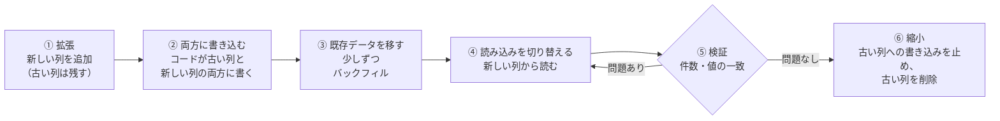

# データ移行・スキーマ変更

> 最終確認日：2026年11月15日

本番のデータベースのスキーマ変更や、データの移行を、サービスを止めずに安全に行うためのノートです。
移行は「戻しにくい変更」の代表です。障害の原因になりやすく、データ量が増えるほど難しくなるため、手順と切り戻しを先に設計することを重視しています。

---

## 基本方針

1. **互換性を壊す変更を、一度に行わない**
   - 列の名前の変更、削除、NOT NULL の追加などは、古いコードと新しいコードが同時に動いても壊れない手順に分ける（Expand-Contract）
2. **スキーマの変更と、コードの変更を別々にリリースする**
   - デプロイ中は古いコードと新しいコードが並んで動くため、どちらでも動くスキーマを経由する
3. **本番のデータ量で試してから実行する**
   - 件数が少ない環境では、ロックや処理時間の問題に気づけない
4. **戻せない手順を最後に回す**
   - 古い列やテーブルの削除は、新しい構造で問題がないことを確かめてから行う
5. **移行の前後でデータを検証する**
   - 件数、合計値、サンプルの突き合わせで、データが失われていないかを確認する

---

## Expand-Contract（拡張と縮小）の進め方

列の名前を変える例です。1回のリリースで変えるのではなく、複数のリリースに分けます。



| 段階 | 戻せるか | 注意点 |
|---|---|---|
| ① 拡張 | 戻せる | NULL を許す列として追加する。既定値の付け方によってはテーブル全体が書き換わるため、DB ごとの挙動を確認する |
| ② 両方に書き込む | 戻せる | 書き込みの片方だけが失敗したときの扱いを決める |
| ③ バックフィル | 戻せる | 少量ずつ処理し、負荷を見ながら速度を調整する。途中から再開できるようにする |
| ④ 読み込みの切り替え | 戻せる | フィーチャーフラグで切り替えると、すぐに戻せる |
| ⑤ 検証 | － | 件数、合計値、サンプルの突き合わせ |
| ⑥ 縮小 | 戻せない | 十分な期間、問題がないことを確かめてから削除する。削除前にバックアップを取る |

---

## チェックリスト

### 1. 計画

- [ ] 変更の種類が、互換性を壊すものか（列の削除・名前の変更・型の変更・NOT NULL の追加など）を確認したか
- [ ] 互換性を壊す変更を、Expand-Contract の手順に分けたか
- [ ] 各段階で、古いコードと新しいコードの両方が動くことを確認したか
- [ ] 戻せない手順（削除、変換）を特定し、最後に回したか
- [ ] 切り戻しの手順と、切り戻しを判断する基準を決めたか

### 2. ロックと処理時間

- [ ] 本番相当のデータ量で、マイグレーションの所要時間を計測したか
- [ ] 大きなテーブルへの変更で、長時間のロックが発生しないか確認したか
- [ ] インデックスの作成を、テーブルをロックしない方法で行うか（PostgreSQL の CONCURRENTLY など）
- [ ] DDL にロック待ちのタイムアウトを設定し、他の処理を巻き込んで止めないようにしたか
- [ ] 必要に応じて、オンラインでスキーマを変更するツールを検討したか

### 3. バックフィル（既存データの移行）

- [ ] 一度に全件ではなく、少量ずつ処理しているか
- [ ] DB の負荷やレプリカの遅延を見ながら、速度を調整できるか
- [ ] 途中で止まっても、続きから再開できるか（冪等性）
- [ ] 処理中に更新されたデータを、取りこぼさないか

### 4. 検証

- [ ] 移行の前後で、件数・合計値・サンプルの値を突き合わせたか
- [ ] 新しい構造を読む処理の、エラー率と応答時間を監視しているか
- [ ] 一定期間、問題がないことを確かめてから、古い構造を削除しているか

### 5. 別のシステムやデータベースへの移行

- [ ] 移行の対象（テーブル、ファイル、外部連携）と、移行しないものを決めたか
- [ ] 変換のルール（文字コード、日時のタイムゾーン、コードの対応表）を文書にしたか
- [ ] 本番相当のデータで、移行のリハーサルを行ったか
- [ ] 切り替えの方式（一括、段階的、並行稼働）を決めたか
- [ ] 切り替え中の書き込みの扱い（停止する、差分を後で移す）を決めたか
- [ ] 移行後に、古いシステムへ戻す手順と期限を決めたか

### 6. AI を使う場合

- [ ] AI が作ったマイグレーションが、互換性を壊す変更を一度に行っていないか確認したか
- [ ] 本番のデータ量での所要時間とロックの有無を、AI に推測させるのではなく、計測して確かめたか
- [ ] マイグレーションの変更は、リスク「高」として人がコードまで確認しているか（[AI を前提にしたプルリクエストの判断方法](../process/ai-pr-review.md)）

---

## AI への依頼テンプレート

```markdown
あなたはデータベースの運用に詳しいエンジニアです。
以下のスキーマ変更・データ移行を、サービスを止めずに行う手順を作ってください。

## 現状
{ 対象のテーブル定義、件数、1秒あたりの読み書きの量、使っている DB とバージョン }

## やりたいこと
{ 例：users.name を full_name に変更したい }

## 依頼内容
1. 互換性を壊す変更かどうかを判定し、Expand-Contract の段階に分けた手順を作ってください。
2. 各段階で、リリースするコードの変更と、スキーマの変更を分けて書いてください。
3. 各段階で、ロックの有無、所要時間の見込み、戻せるかどうかを書いてください。
4. バックフィルの方法（一度に処理する件数、速度の調整、再開の方法）を提案してください。
5. 検証の方法（件数・値の突き合わせ）と、切り戻しの手順を書いてください。
6. DB やバージョンによって挙動が異なる部分は「要確認」と書いてください。

## 出力形式
- 段階ごとの手順（スキーマの変更、コードの変更、戻せるか、注意点）
- バックフィルの方法
- 検証の方法
- 切り戻しの手順
- 要確認事項
```

---

## 人が判断すること

- [ ] 各段階に進んでよいか（特に、戻せない削除や変換）
- [ ] 移行の日時と、利用者への影響
- [ ] 問題が起きたときに、切り戻すか、修正して進めるか

---

## 参考情報（2026年11月時点）

- [Zero-Downtime Database Migrations（Harness）](https://www.harness.io/blog/zero-downtime-database-migrations-safe-schema-changes)
- [Zero-Downtime Database Schema Migration Strategies（Bytebase）](https://www.bytebase.com/blog/zero-downtime-database-schema-migration/)
- [Database Migration Strategies for Zero-Downtime Deployments（DeployHQ）](https://deployhq.com/blog/database-migration-strategies-for-zero-downtime-deployments-a-step-by-step-guide)
