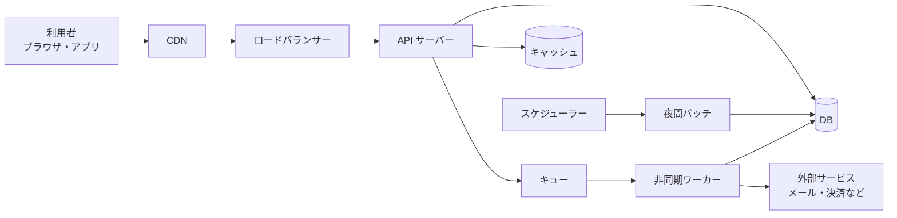
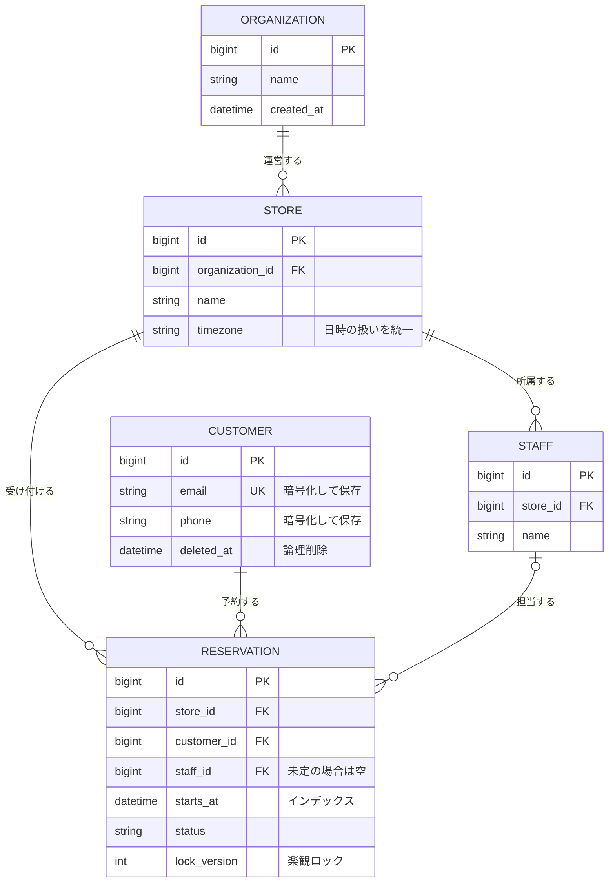
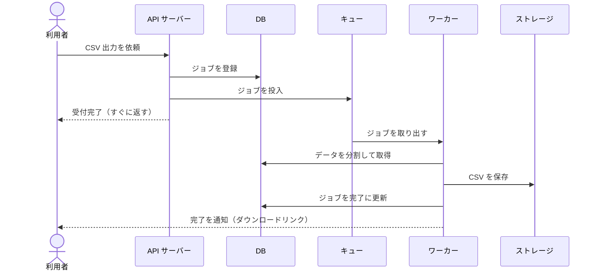

# 設計チェックリスト

要件を、実装できる形に落とし込む段階のチェックリストです。
設計の段階で、障害・性能劣化・データ移行・運用のボトルネックになりそうな箇所を先に見つけておくことを重視しています。

---

## 基本方針

1. **後から変えにくいものから決める**
   - データモデル、API の仕様、認証の方式、インフラの構成は、後から変えるほど費用がかかる
2. **データ量が増えたときを想定する**
   - 現在のデータ量ではなく、1年後・3年後の量で問題が出ないかを確認する
3. **リアルタイムで返す処理と、非同期・バッチに回す処理を分ける**
   - 即時性が必要な処理だけを API の応答内で行い、それ以外はキューや夜間バッチに回す
4. **設計の判断と理由を記録する**
   - なぜその構成にしたかを残しておくと、後の変更や引き継ぎの判断が速くなる

---

## チェックリスト

### 1. 全体構成

- [ ] システム構成図（クライアント、API、DB、外部サービス、インフラ）があるか
- [ ] 構成の選定理由と、検討して採用しなかった案を記録したか（ADR など）
- [ ] 単一障害点がないか、あっても許容する理由が明確か
- [ ] 環境（開発、ステージング、本番）の分け方と、本番との差分を決めたか
- [ ] インフラをコードで管理するか（Terraform、CDK など）を決めたか

**構成図の例（一般的な Web サービス）**



### 2. データ設計

- [ ] エンティティと関連（ER 図）を整理したか
- [ ] 主キー、外部キー、一意制約、NOT NULL などの制約を決めたか
- [ ] 検索・並べ替え・結合に使う列と、必要なインデックスを洗い出したか
- [ ] 1年後・3年後のデータ件数を見込み、テーブルごとの増え方を把握したか
- [ ] 論理削除と物理削除のどちらにするか、履歴をどう残すかを決めたか
- [ ] 日時のタイムゾーン、金額・数値の精度、文字コードの扱いを統一したか
- [ ] 個人情報・機密情報を持つ列を特定し、暗号化やマスキングの方針を決めたか
- [ ] 既存データの移行方法（変換ルール、移行の手順、切り戻し）を設計したか

**ER 図の例（店舗の予約サービス）**



検索に使う列のインデックス、個人情報の暗号化、論理削除、同時更新への対策（楽観ロック）など、チェックリストの観点を図にも書き込んでおくと、レビューで確認しやすくなります。

### 3. API 設計

- [ ] エンドポイント、リクエスト・レスポンスの形式を、仕様書（OpenAPI など）にまとめたか
- [ ] 命名規則、エラー形式、ステータスコードの使い方を統一したか
- [ ] 一覧を返す API にページングがあり、件数の上限を決めているか
- [ ] 更新系の API で、二重送信や再試行への対策（冪等性）を考えたか
- [ ] 同じデータを同時に更新した場合の扱い（楽観ロックなど）を決めたか
- [ ] バージョン管理と、互換性を壊す変更の扱いを決めたか
- [ ] 外部に公開する API の場合、レート制限と認証の方式を決めたか

### 4. 処理方式

- [ ] 各処理を、リアルタイム・非同期・夜間バッチに分類したか
- [ ] 非同期処理の仕組み（キュー、ジョブ、リトライ、失敗時の扱い）を決めたか
- [ ] 夜間バッチの処理時間を見積もり、データ量が増えても時間内に終わるか確認したか
- [ ] 外部サービスが遅い・止まっている場合の動き（タイムアウト、リトライ、代替手段）を決めたか
- [ ] キャッシュを使う箇所、置き場所（アプリ内、ElastiCache、CDN）、無効化の条件を決めたか

**シーケンス図の例（大量データの CSV 出力を非同期にする）**



利用者を待たせる必要のない処理は、受付だけを API の応答内で行い、重い処理はワーカーに任せます。

### 5. 認証・権限

- [ ] 認証の方式（ID・パスワード、SSO、外部の ID 基盤など）を決めたか
- [ ] 権限の単位（役割、組織、データの持ち主）と、確認する場所を決めたか
- [ ] セッションやトークンの有効期限、失効の方法を決めたか
- [ ] 詳細は [セキュリティチェックリスト](../security/checklist.md) で確認する

### 6. 運用を見据えた設計

- [ ] ログの出力内容と形式（構造化ログ、リクエスト ID など）を決めたか
- [ ] 監視する指標と、アラートの条件を決めたか
- [ ] 設定値を環境変数や設定ファイルに分け、コードを変えずに変更できるか
- [ ] 機能を段階的に公開できる仕組み（フィーチャーフラグなど）が必要か検討したか
- [ ] バックアップの取得と復旧の手順を設計したか

### 7. テスト方針

- [ ] テストの種類（単体、結合、E2E、負荷）と、どこまで自動化するかを決めたか
- [ ] 本番相当のデータ量を用意して試験する方法を決めたか
- [ ] 外部サービスとの連携をテストする方法（モック、サンドボックス環境）を決めたか

---

## AI への依頼テンプレート

```markdown
あなたはバックエンドとインフラの設計に詳しいレビュアーです。
以下の設計をレビューし、リスクと改善案を出してください。

## 要件の概要
{ 目的、利用者数、データ量の見込み、性能目標、予算など }

## 設計
{ 構成図、ER 図、API 仕様、処理方式、インフラ構成など }

## 依頼内容
1. 添付のチェックリストと照らし合わせ、検討が漏れている項目を洗い出してください。
2. データ量が1年後・3年後に増えたとき、障害・性能劣化・運用上の問題に
   なりそうな箇所を挙げてください。
3. データ移行やスキーマ変更で、リスクが高いものを挙げてください。
4. 各処理を、リアルタイム・非同期・夜間バッチに分類し直すべきものがあれば
   理由とともに挙げてください。
5. 改善案ごとに、実装の手間と費用の目安、採用しない場合のリスクを書いてください。

## 出力形式
- 漏れ・リスク一覧（項目、内容、影響度：高・中・低、改善案、手間・費用の目安）
- 処理の分類の見直し案
- 要確認事項
```

---

## 人が判断すること

- [ ] AI が挙げたリスクのうち、今対応するもの・許容するもの・後で対応するものの切り分け
- [ ] 改善案の手間と費用が、予算と期限に見合うか
- [ ] 後から変えにくい部分（データモデル、API、認証、インフラ構成）を確定してよいか
