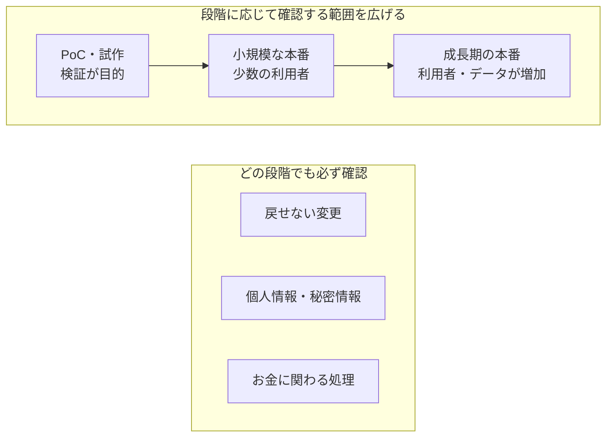

# 規模別の使い方

> 最終確認日：2026年11月15日

このノートのチェックリストを、プロジェクトの規模や段階に合わせてどこまで使うかの目安です。
すべての項目を毎回確認するのは現実的ではありません。「戻せない変更」と「利用者・データ・お金に関わる変更」だけは規模に関わらず確認し、それ以外は段階に応じて増やしていくことを基本にしています。

---

## 規模ごとの目安

| ノート | PoC・試作 | 小規模な本番 | 成長期の本番 |
|---|---|---|---|
| [事業としてのロードマップ（AI 時代の事業運営）](../business/roadmap.md) | 仮説と学習目標だけ | Now / Next / Later と原価 | 全体 |
| [要件定義チェックリスト](../requirements/checklist.md) | 目的と受け入れ条件 | 全体（非機能は主要なもの） | 全体 |
| [設計チェックリスト](../design/checklist.md) | データ設計の基本 | 全体 | 全体 |
| [AI 機能（LLM）を組み込むときの設計](../ai/llm-feature-design.md) | 使うかどうかの判断・費用 | 全体（評価は小さく） | 全体 |
| [実装チェックリスト](../implementation/checklist.md) | AI が生成したコードの確認 | 全体 | 全体 |
| [テスト戦略](../testing/strategy.md) | 主要な流れの確認 | 単体・結合・CI | 全体（評価・契約テストを含む） |
| [AI を前提にしたプルリクエストの判断方法](../process/ai-pr-review.md) | 自己レビュー | リスク別の判断 | 全体 |
| [セキュリティチェックリスト](../security/checklist.md) | 秘密情報・個人情報・権限 | 全体（診断は必要に応じて） | 全体 |
| [データ移行・スキーマ変更](../data/migration.md) | － | 互換性を壊す変更の手順 | 全体 |
| [リリース前パフォーマンス・インフラチェックリスト](../performance/release-checklist.md) | － | 前提条件と主要な計測 | 全体 |
| [リリースチェックリスト](../release/checklist.md) | － | 準備と切り戻し | 全体 |
| [リリース後の運用・監視チェックリスト](../operations/checklist.md) | － | 監視・アラート・バックアップ | 全体（SLO を含む） |
| [障害対応とポストモーテム](../operations/incident-response.md) | － | 連絡体制と切り戻し | 全体 |
| [コスト管理（クラウドと AI の利用料）](../infrastructure/cost-management.md) | 予算の通知 | 見える化と予算 | 全体 |
| [フロントエンド・UX・アクセシビリティチェックリスト](../frontend/checklist.md) | 主要な画面の動作 | 全体（アクセシビリティは基本） | 全体 |
| [法務・ライセンス](../legal/license-and-compliance.md) | AI ツールの利用条件 | 全体 | 全体 |

---

## 規模に関わらず必ず確認すること

- [ ] 秘密情報（API キー、パスワード）をコードやリポジトリに含めていないか
- [ ] 個人情報を扱う場合、保存する場所と、渡してよい外部サービスを決めたか
- [ ] お金（決済、課金、AI の利用料）に関わる処理に、上限と確認があるか
- [ ] 戻せない変更（データの削除・変換、外部への一斉送信）の前に、バックアップと人の確認があるか
- [ ] 本番環境への権限を、必要最小限にしているか

---

## 段階を上げる目安

| 次の段階へ進む目安 | 追加で確認するノート |
|---|---|
| 外部の利用者に公開する | セキュリティ、リリース、運用・監視、法務 |
| 有料の利用者が増える | 障害対応、コスト管理、パフォーマンス |
| データ量が増え、処理が遅くなり始める | パフォーマンス、データ移行、技術的負債 |
| 開発者や AI エージェントが増える | 開発フロー、AI を前提にした PR の判断、テスト戦略 |
