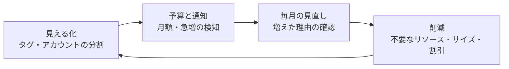

# コスト管理（クラウドと AI の利用料）

> 最終確認日：2026年11月15日

クラウドのインフラ費用と、AI モデルの利用料（推論の費用）を、見える化して管理するためのノートです。
費用は、気づいたときには大きく膨らんでいることが多く、特に AI の利用料は使われるほど増えます。「誰が・何に・いくら使っているか」を常に分かる状態にし、予算を超える前に気づける仕組みを重視しています。
事業としての粗利や価格の考え方は [事業としてのロードマップ（AI 時代の事業運営）](../business/roadmap.md) を参照してください。

---

## 基本方針

1. **見える化を最初に行う**
   - 環境・サービス・機能ごとに費用が分かるよう、タグや請求の分け方を最初に決める
2. **予算とアラートを設定する**
   - 月の予算を決め、超えそうなときに通知が届くようにする
3. **固定費と従量の費用を分けて見る**
   - 常時かかる費用（NAT ゲートウェイ、DB、ElastiCache など）と、使った分だけかかる費用（Lambda、AI の利用料など）を分ける
4. **1顧客・1処理あたりの費用で考える**
   - 合計額だけでなく、売上や利用量あたりの費用で、効率が悪化していないかを見る
5. **削減は、効果の大きいものから行う**
   - 使っていないリソースの削除、サイズの見直し、割引の活用の順に、手間の少ないものから進める

---

## 費用管理の流れ



---

## チェックリスト

### 1. 見える化

- [ ] 本番・ステージング・開発で、アカウントまたはタグを分けているか
- [ ] サービスや機能ごとに、タグを付けて費用を分けて見られるか
- [ ] AI の利用料を、機能ごと・顧客ごとに記録しているか
- [ ] 毎月の費用を、前月や予算と比べて確認しているか

### 2. 予算と通知

- [ ] 月の予算を決め、一定の割合（50%・80%・100% など）で通知が届くようにしているか
- [ ] 費用の急な増加を検知する仕組み（AWS Cost Anomaly Detection など）を設定したか
- [ ] AI の利用料に、上限や急増時の停止の仕組みがあるか
- [ ] 開発者の検証用アカウントにも、予算と通知を設定しているか

### 3. 見落としやすい費用

- [ ] NAT ゲートウェイの時間料金と通信料（VPC エンドポイントで減らせる場合がある）
- [ ] データ転送の費用（リージョン間、インターネットへの送信）
- [ ] ログの保存と取り込みの費用（保存期間を決める）
- [ ] 古いスナップショット、使っていないボリューム、停止中のインスタンス、固定 IP
- [ ] 開発・検証環境の、夜間や休日の稼働
- [ ] AI の利用料のうち、長いプロンプトや不要な文脈、失敗による再試行

### 4. 削減の手段

- [ ] 使っていないリソースを定期的に削除しているか
- [ ] 実際の使用率を見て、インスタンスやタスクのサイズを見直しているか
- [ ] 安定して使い続けるものに、Savings Plans やリザーブドインスタンスを検討したか
- [ ] 開発・検証環境を、使わない時間に止めているか
- [ ] S3 のライフサイクルルールで、古いデータを安い保存方式へ移すか削除しているか
- [ ] AI の利用料を、モデルの使い分け、キャッシュ、入力の短縮で下げられないか確認したか

### 5. 指標

- [ ] 売上に対するインフラ費用と AI の利用料の割合を見ているか
- [ ] 1顧客あたり・1処理あたりの費用の推移を見ているか
- [ ] 利用者やデータが増えたときの費用の増え方を、見込んでいるか

---

## AI への依頼テンプレート

```markdown
あなたは AWS と AI の利用料の管理に詳しいエンジニアです。
以下の費用の内訳を見て、削減の余地と、管理の仕組みの改善点を挙げてください。

## 費用の内訳
{ サービスごとの月額、前月との比較、AI の利用料の内訳 }

## 構成と利用状況
{ 構成、利用者数、データ量、主な処理 }

## 依頼内容
1. 費用が大きい項目と、増えている項目について、考えられる理由を挙げてください。
2. 削減の方法を、効果の大きさと手間で並べて挙げてください。
3. 見落としやすい費用（通信料、ログ、使っていないリソースなど）がないか確認してください。
4. 予算と通知の設定、見える化の改善案を出してください。
5. 料金は変わるため、公式の料金ページで確認が必要な箇所を「要確認」と書いてください。
```

---

## 人が判断すること

- [ ] 予算の金額と、超えたときの対応
- [ ] 削減と、性能・可用性・開発の手間のどちらを優先するか
- [ ] 割引（Savings Plans など）の契約期間
