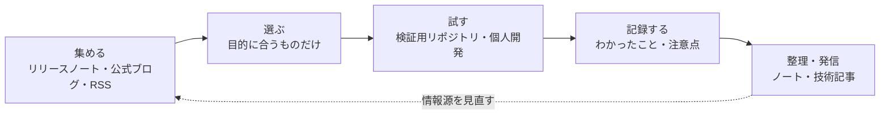

# 情報のキャッチアップ方法

> 最終確認日：2026年11月15日

技術や業界の情報を、無理なく継続して追いかけるための方法をまとめたノートです。
情報は量より、「一次情報に当たること」と「実際に試して自分の判断材料にすること」を重視しています。
AI に関する情報収集は [AI 周りの情報収集](ai-information.md) にまとめています。

---

## 基本方針

1. **一次情報を優先する**
   - 公式ドキュメント、リリースノート、公式ブログ、論文、ソースコードを優先し、解説記事は理解の補助として使う
2. **目的を決めて集める**
   - 「今の案件で使う」「次の半年で身につける」「動向を把握しておく」など、目的ごとに追う深さを変える
3. **集めるだけで終わらせず、試して記録する**
   - 小さく動かして確かめ、わかったことを短く記録する。記録が自分の判断材料と発信の素材になる
4. **時間を決めて、習慣にする**
   - 毎日・毎週の決まった時間で処理し、情報を追うこと自体に時間を取られすぎないようにする

## 情報を活かす流れ

---

## 情報源の種類と使い方

| 情報源 | 例 | 使い方 |
|---|---|---|
| 公式ドキュメント・リリースノート | 言語、フレームワーク、クラウドの公式サイト、変更履歴 | 使っている技術の変更を確実に把握する。最優先で確認する |
| 公式ブログ・お知らせ | クラウド事業者の新機能のお知らせ、ツールの開発元のブログ | 新機能や方針の変化を把握する |
| GitHub | 使っているライブラリのリリース、Issue、Discussions | 不具合、移行の注意点、今後の予定を把握する |
| 技術コミュニティ | 技術記事の投稿サイト、Hacker News、技術系のポッドキャスト | 実際に使った人の知見や、話題になっている技術を知る |
| 論文・カンファレンス | arXiv、各分野のカンファレンスの発表資料・動画 | 技術の背景や、数年先の方向性を知る |
| SNS | 開発者や開発元の発信 | 速報や、議論の流れを知る。真偽は一次情報で確かめる |
| 人とのつながり | 勉強会、コミュニティ、案件で関わる人 | 現場での使われ方や、公開されていない実情を知る |

---

## 仕組みづくり

- [ ] 使っている主要な技術の、リリースノートやリリースを自動で受け取っているか（GitHub の Watch、RSS、メールの購読など）
- [ ] 情報を一か所に集める仕組みがあるか（RSS リーダー、メールのフォルダ、読みたいものを保存するツール）
- [ ] 毎日・毎週の確認の時間を決めているか
- [ ] 試す時間（検証用のリポジトリ、小さな個人開発など）を確保しているか
- [ ] わかったことを記録する場所があるか（このリポジトリ、メモ、技術記事など）

---

## 日々の進め方の例

- **毎日（15〜30分）**：集めた情報の見出しを確認し、読むものを選ぶ。急ぎのもの（使っている技術の重大な変更、脆弱性）だけはすぐ確認する
- **毎週（1〜2時間）**：保存しておいた記事や資料を読む。気になったものを小さく試す
- **毎月**：追いかけている情報源を見直す（役に立たないものを外し、新しいものを加える）。試した結果をまとめて記録する
- **半年〜1年**：身につける技術の方針を見直す。案件の傾向や、市場で求められている技術と照らし合わせる

---

## 情報を判断するときの観点

- [ ] 一次情報（公式の発表、ドキュメント、論文）で確認したか
- [ ] いつの情報か（古い情報や、すでに変わった仕様ではないか）
- [ ] 誰が、どの立場で書いたものか（開発元、利用者、宣伝目的など）
- [ ] 自分の案件や環境でも同じことが言えるか（規模、構成、制約の違い）
- [ ] 実際に試して確かめたか

---

## 記録と発信

- わかったことは、短くてもその場で記録する（何を試したか、結果、注意点）
- 記録がたまったら、チェックリストやノートとして整理し、このリポジトリに追加する
- 外部への発信（技術記事、勉強会での発表）は、自分の理解を深めると同時に、仕事の相談を受けるきっかけにもなる
