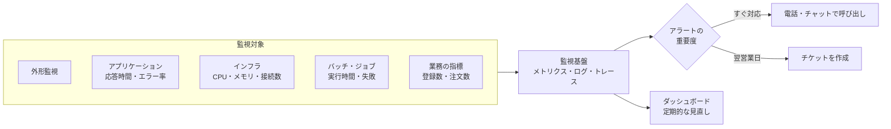
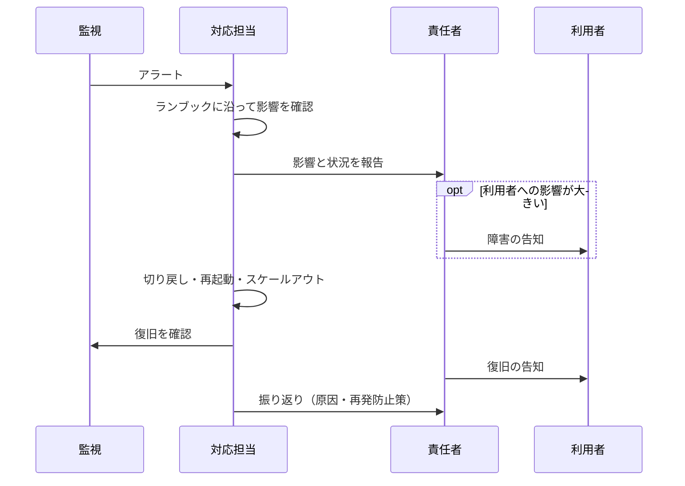

# リリース後の運用・監視チェックリスト

> 最終確認日：2026年11月15日

リリースした後、サービスを安定して動かし続けるためのチェックリストです。
性能劣化や障害の多くは、リリース直後ではなく、データや利用者が増えた数か月後に表面化します。日々の監視に加え、定期的な見直しを重視しています。

---

## 基本方針

1. **利用者への影響を基準に監視する**
   - サーバーの数値だけでなく、利用者が使えているか（エラー率、応答時間、主要な操作の成功率）を見る
   - 目標（SLO）を決め、許容できる失敗の量（エラーバジェット）の減り方でアラートや判断を行う
2. **アラートは、対応が必要なものだけに絞る**
   - 鳴っても対応しないアラートが多いと、本当に重要なものを見逃す
3. **障害の対応手順を、起きる前に用意しておく**
   - 誰が、何を見て、どう判断し、誰に連絡するかを決めておく
4. **増え方を定期的に見直す**
   - データ量、利用者数、処理時間、コストの増え方を定期的に確認し、問題になる前に手を打つ
5. **AI の機能は「動いているか」だけでなく「正しく役立っているか」を見る**
   - AI の機能は、エラー率や応答時間が正常でも、出力の質が下がっていることがある。品質と費用も監視する

---

## チェックリスト

### 1. 監視

- [ ] 外部から、サービスが動いているかを定期的に確認しているか（外形監視）
- [ ] API ごとの応答時間（p50 / p95 / p99）とエラー率を見られるか
- [ ] CPU、メモリ、ディスク、DB の接続数、キューの滞留数を監視しているか
- [ ] 夜間バッチと非同期ジョブの、実行時間・処理件数・失敗を監視しているか
- [ ] 外部サービス（決済、メール配信、外部 API など）の失敗を検知できるか
- [ ] SSL 証明書やドメインの期限切れを検知できるか
- [ ] 主要な業務の指標（登録数、注文数など）が急に減っていないかを見ているか

**監視の全体像**



### 2. アラート

- [ ] 主要な機能ごとに、目標（SLO。例：月間の成功率 99.9%）と、許容できる失敗の量（エラーバジェット）を決めたか
- [ ] 個々の数値のしきい値ではなく、エラーバジェットが減る速さ（バーンレート）でアラートしているか
- [ ] アラートの条件と、重要度（すぐ対応・翌営業日対応など）を決めたか
- [ ] アラートを受け取る人と、連絡の手段（Slack、電話など）を決めたか
- [ ] 夜間・休日にアラートが鳴った場合の対応方針を決めたか
- [ ] 対応しないアラートや、誤検知の多いアラートを定期的に見直しているか

### 3. ログ

- [ ] ログを一か所に集約し、検索できるか
- [ ] リクエスト ID などで、1つの処理の流れを追跡できるか
- [ ] OpenTelemetry など標準的な仕組みで、ログ・メトリクス・トレースを関連付けて見られるか
- [ ] ログに個人情報や秘密情報を出力していないか
- [ ] ログの保存期間と費用を決めているか

### 4. 障害対応

- [ ] 障害時の連絡体制（担当者、エスカレーション先、利用者への告知方法）を決めたか
- [ ] よくある障害について、確認する場所と対応手順をまとめているか（ランブック）
- [ ] 切り戻し、再起動、スケールアウトなどの手順を、すぐに実行できるか
- [ ] 障害の後に振り返りを行い、原因と再発防止策を記録しているか
- [ ] 振り返りでは、個人を責めず、仕組みの改善に焦点を当てているか

**障害対応の流れ**


- [ ] 詳しい進め方とポストモーテムは [障害対応とポストモーテム](incident-response.md) で確認する

### 5. バックアップと復旧

- [ ] バックアップが計画通りに取得されているか、定期的に確認しているか
- [ ] バックアップから実際に復旧できるかを、定期的に試しているか
- [ ] 復旧にかかる時間が、目標（RTO）に収まるか

### 6. 定期的な見直し

- [ ] データ件数と、増え方の見込みを定期的に確認しているか
- [ ] 応答時間や夜間バッチの処理時間が、徐々に長くなっていないか
- [ ] スロークエリを定期的に確認し、改善しているか
- [ ] クラウドの費用を毎月確認し、想定との差を把握しているか
- [ ] 使っていないリソース（古いスナップショット、停止中のインスタンスなど）を削除しているか
- [ ] 依存パッケージ、ランタイム、OS のサポート期限を把握し、更新の計画を立てているか
- [ ] 問い合わせや利用状況から、改善すべき点を洗い出しているか

### 7. 運用の引き継ぎと記録

- [ ] システム構成、監視の設定、対応手順を、ドキュメントにまとめているか
- [ ] 特定の人しか対応できない作業がないか
- [ ] 定期的な作業（証明書の更新、データの削除、レポートの作成など）を一覧にしているか

### 8. AI の機能・AI エージェントの監視

- [ ] リクエストごとのトークン数と費用、モデル提供元ごとの応答時間を見られるか
- [ ] 出力の質を測っているか（評価の合格率、利用者の評価、人による修正・差し戻しの割合）
- [ ] AI エージェントのツール呼び出しの失敗や、同じ処理の繰り返し（ループ）を検知できるか
- [ ] 費用が急に増えたときに止める仕組み（上限の設定）があるか
- [ ] 使っているモデルとプロンプトのバージョンを記録し、変更前後で比べられるか
- [ ] モデル提供元の障害や遅延のときの代替手段（別のモデル、機能の一時停止）を用意しているか
- [ ] プロンプトや出力に含まれる個人情報を、ログに残さないようにしているか

---

## AI への依頼テンプレート

```markdown
あなたは Web サービスの運用（SRE）に詳しいエンジニアです。
以下のサービスの運用・監視の体制を確認してください。

## サービスの概要
{ サービスの内容、構成、利用者数、データ量、重要な業務 }

## 現在の運用・監視
{ 監視している項目、アラートの設定、障害対応の手順、バックアップの方法など }

## 直近の状況
{ 応答時間、エラー率、データ件数、バッチの処理時間、月額費用の推移など }

## 依頼内容
1. 添付のチェックリストと照らし合わせ、監視や手順が漏れている項目を洗い出してください。
   主要な機能ごとの SLO とエラーバジェットの案も出してください。
2. 直近の数値の推移から、今後問題になりそうな箇所（性能劣化、容量、コスト）と、
   問題になる時期の見込みを挙げてください。
3. アラートの条件と重要度の案を出してください。
4. 改善案ごとに、手間と費用の目安、対応しない場合のリスクを書いてください。

## 出力形式
- 漏れ・リスク一覧（項目、内容、影響度：高・中・低、改善案、手間・費用の目安）
- 今後問題になりそうな箇所と時期の見込み
- アラートの案（条件、重要度、通知先）
```

---

## 人が判断すること

- [ ] どこまでの監視・対応体制（夜間・休日の対応など）を、どの費用で用意するか
- [ ] AI が挙げた将来のリスクに、いつ・どこまで投資するか
- [ ] 障害時に、利用者へいつ・どう告知するか

---

## 参考情報（2026年11月時点）

- [What Is LLM Observability? The Complete 2026 Guide（OpenObserve）](https://openobserve.ai/blog/what-is-llm-observability/)
- [Observability for LLM Systems（Rost Glukhov）](https://glukhov.org/observability/observability-for-llm-systems/)
- [AI Observability: The Current State（TekStream）](https://www.tekstream.com/blog/ai-observability-for-ai-agents/)
