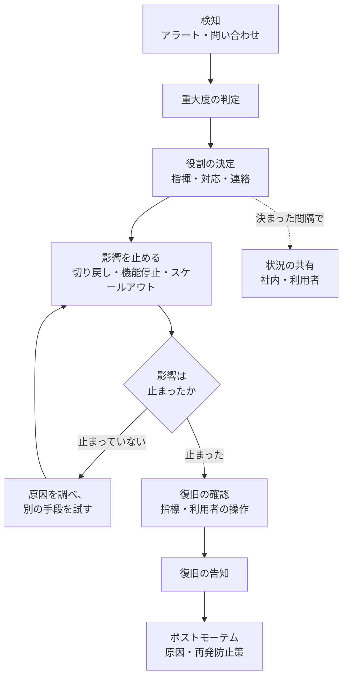

# 障害対応とポストモーテム

> 最終確認日：2026年11月15日

障害が起きたときの進め方と、障害の後の振り返り（ポストモーテム）のためのノートです。
障害対応で最も大切なのは、原因の特定より先に、利用者への影響を止めることです。そのうえで、個人を責めずに仕組みを改善し、同じ障害を繰り返さないことを重視しています。
日々の監視については [リリース後の運用・監視チェックリスト](checklist.md) を参照してください。

---

## 基本方針

1. **影響を止めることを最優先にする**
   - 原因の調査より先に、切り戻し・機能の停止・スケールアウトなどで影響を抑える
2. **役割を分ける**
   - 指揮する人、調査・対応する人、連絡する人を分け、全員が同じ作業に集中しないようにする
3. **こまめに状況を共有する**
   - 分かっていないことも含めて、決まった間隔で関係者と利用者に伝える
4. **記録を残しながら対応する**
   - 時刻と行ったこと、判断の理由を残すと、振り返りと再発防止に使える
5. **個人ではなく仕組みを改善する**
   - 「誰が間違えたか」ではなく、「なぜ間違えられる仕組みだったか」を問う

---

## 障害対応の流れ



---

## 重大度の目安

| 重大度 | 例 | 対応 |
|---|---|---|
| 高 | サービス全体が使えない、データの消失・漏えい、決済の失敗 | すぐに対応。責任者に連絡し、利用者へ告知 |
| 中 | 一部の機能が使えない、応答が大幅に遅い | 営業時間外でも対応を検討。影響範囲に応じて告知 |
| 低 | 回避方法がある不具合、一部の利用者だけの問題 | 翌営業日以降に対応 |

---

## チェックリスト

### 1. 事前の準備

- [ ] 重大度の基準と、重大度ごとの対応（連絡先、告知の要否）を決めたか
- [ ] 連絡体制（対応担当、エスカレーション先、夜間・休日の扱い）を決めたか
- [ ] よくある障害の確認場所と対応手順（ランブック）をまとめたか
- [ ] 切り戻し、機能の停止（フィーチャーフラグ）、スケールアウトを、すぐに実行できるか
- [ ] 利用者への告知の手段（ステータスページ、お知らせ、メール）と文面のひな形があるか

### 2. 障害の発生時

- [ ] 重大度を判定し、役割（指揮・対応・連絡）を決めたか
- [ ] 影響の範囲（利用者、機能、データ）を確認したか
- [ ] 原因の調査より先に、影響を止める手段を試したか
- [ ] 直前の変更（リリース、設定変更、外部サービスの障害）を確認したか
- [ ] 時刻と行ったこと、判断の理由を記録しているか
- [ ] 決まった間隔で、社内と利用者に状況を共有しているか
- [ ] データの消失・漏えいの可能性がある場合、責任者と法務に連絡したか

### 3. 復旧後

- [ ] 指標と、実際の利用者の操作で、復旧を確認したか
- [ ] 復旧を告知したか
- [ ] 一時的な対応（手作業の修正、設定の変更）を記録し、恒久的な対応の予定を立てたか

### 4. ポストモーテム

- [ ] 重大度が中以上の障害は、数日以内に振り返りを行っているか
- [ ] 時系列（発生、検知、対応、復旧）を整理したか
- [ ] 直接の原因だけでなく、なぜ防げなかったか・なぜ検知が遅れたかまで掘り下げたか
- [ ] 再発防止策に、担当者と期限を決めたか
- [ ] 個人を責める表現になっていないか
- [ ] 振り返りの結果を、チームで共有し、ランブックやチェックリストに反映したか

### 5. AI を使う場合

- [ ] ログやエラーの分析、原因の候補の洗い出し、時系列の整理に AI を使っているか
- [ ] AI が提案した対応を、そのまま本番で実行せず、影響を確認してから実行しているか
- [ ] AI に渡すログから、個人情報や秘密情報を取り除いているか

---

## ポストモーテムのテンプレート

テンプレート集の [ポストモーテム](../templates/postmortem.md) を使います。

---

## AI への依頼テンプレート（障害の調査）

```markdown
あなたは Web サービスの障害対応に詳しいエンジニアです。
以下の障害の原因の候補と、影響を止める手段を挙げてください。

## 状況
{ 症状、発生時刻、影響の範囲、直前の変更 }

## ログ・指標
{ エラーログ、応答時間・エラー率の推移（個人情報は除く） }

## 依頼内容
1. 影響をすぐに止めるための手段を、効果とリスクの順に挙げてください。
2. 原因の候補を、可能性の高い順に挙げ、それぞれの確かめ方を書いてください。
3. 追加で確認すべきログや指標を挙げてください。
4. 推測の部分は「推測」と明記してください。
```

---

## 人が判断すること

- [ ] 重大度と、利用者への告知の要否
- [ ] 切り戻すか、修正して進めるか
- [ ] 再発防止策に、どこまで投資するか
