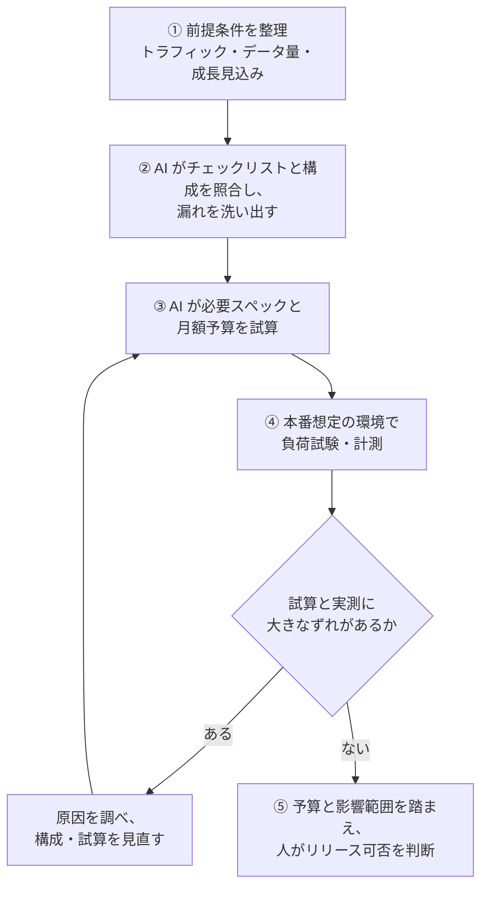
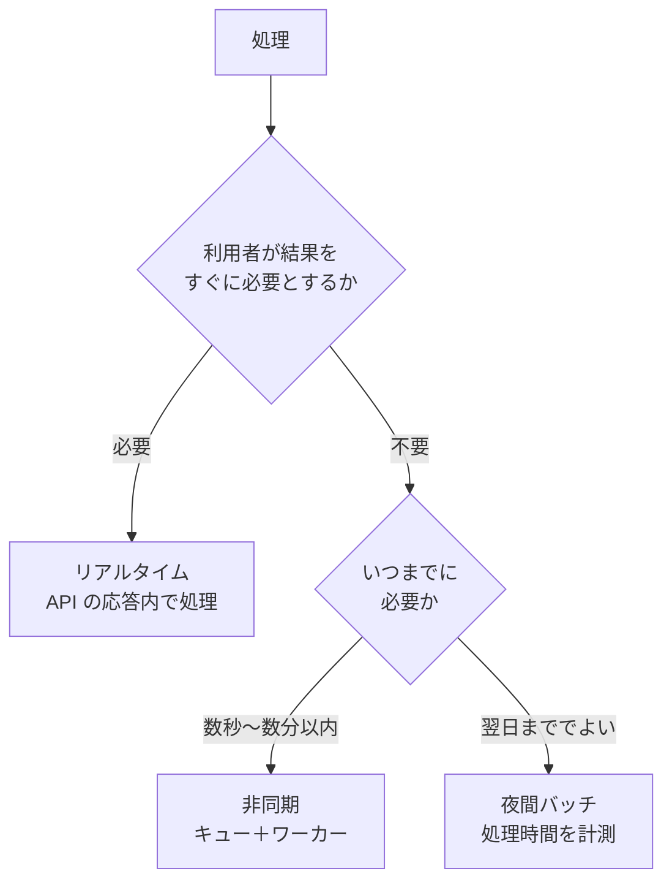
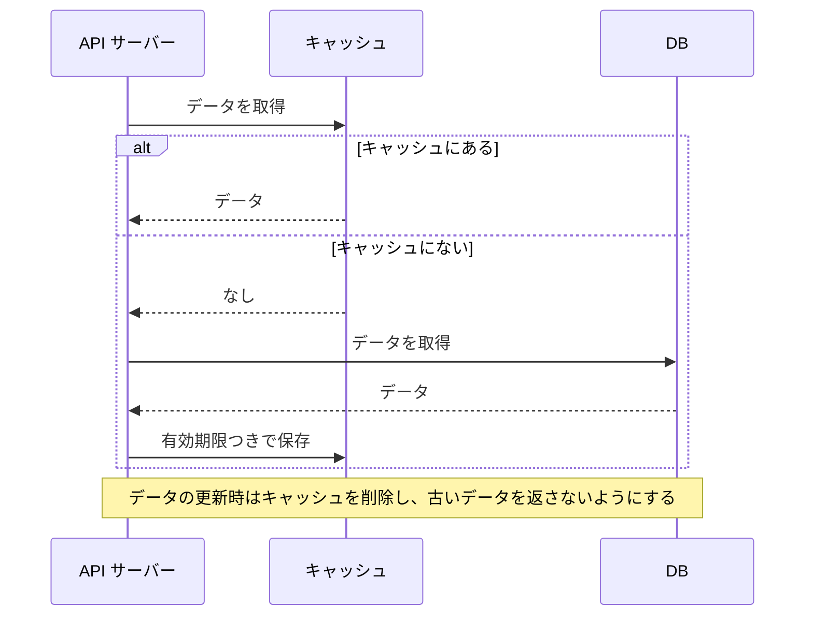

# リリース前パフォーマンス・インフラチェックリスト

> 最終確認日：2026年11月15日

本番を想定したパフォーマンス計測とインフラ確認を、リリース前に漏れなく行うためのチェックリストです。
チェックポイントをもとに AI に漏れを洗い出させ、必要スペックと予算を試算させたうえで、人がリリース可否を判断する運用を想定しています。

---

## 基本方針

1. **リリース前に、本番を想定した条件で計測する**
   - 推測で直さず、計測してからボトルネックを特定する
   - 開発環境の数値ではなく、本番相当のデータ量・トラフィック・構成で測る
2. **アプリだけでなくインフラまで確認する**
   - 性能劣化はリリース直後より、データが増えた数か月後に表面化することが多い
   - スケーリング、接続数、サービス上限（クォータ）まで含めて確認する
3. **リアルタイムで返すべき処理か、バッチに回せる処理かを見極める**
   - すべてを API の応答内で処理しようとせず、即時性が不要な処理は非同期・夜間バッチに逃がす
   - 夜間バッチに回す場合は、本番相当のデータ量で処理時間を計測し、時間内に終わることを確認する
4. **チェックは AI に網羅させ、判断は人が行う**
   - AI にチェックリストの漏れを洗い出させ、必要スペックと月額予算を試算させる
   - 予算と影響範囲を踏まえて Go / No-Go を決めるのは人の役割

---

## 進め方



---

## チェックリスト

### 1. 前提条件

- [ ] 想定ユーザー数（通常時・ピーク時）
- [ ] 想定リクエスト数（RPS / RPM、時間帯ごとの偏り）
- [ ] ピークの要因（キャンペーン、月末処理、メール配信直後など）
- [ ] 現在のデータ件数と、1年後・3年後の想定件数
- [ ] 1リクエストあたりのデータサイズ（ペイロード、ファイル、CSV など）
- [ ] 性能目標（SLO）：p50 / p95 / p99 の応答時間、エラー率、可用性
- [ ] 外部サービスの制約（レート制限、応答時間、SLA）

### 2. 本番を想定した計測

- [ ] 計測環境が本番と同じ構成・スペックになっているか（インスタンス種別、タスク数、DB クラス）
- [ ] 本番相当の件数のテストデータを用意しているか（数件では N+1 や全件取得に気づけない）
- [ ] 実際の利用に近いシナリオになっているか（読み書きの比率、ログイン後の画面遷移など）
- [ ] 通常時・ピーク時・ピークの数倍の負荷で試験しているか
- [ ] 長時間の負荷試験（ソーク試験）で、メモリリークや接続の枯渇がないか
- [ ] 計測指標：p50 / p95 / p99 の応答時間、スループット、エラー率、CPU・メモリ使用率
- [ ] 合格基準を事前に決めているか（例：p95 が 500ms 以内、エラー率 0.1% 未満）
- [ ] 改善前後を同じ条件で比較できるよう、結果を記録しているか
- [ ] 使用ツール：k6、Locust、JMeter など

### 3. データベース

- [ ] N+1 クエリがないか（Rails：includes / preload、SQLAlchemy：selectinload / joinedload）
- [ ] WHERE・JOIN・ORDER BY の対象列にインデックスがあるか（EXPLAIN で確認）
- [ ] 全件取得、OFFSET によるページング、重い COUNT(*) がないか
- [ ] 大量データの出力・取り込みはストリーミングやバッチ分割になっているか
- [ ] スロークエリログを有効にし、閾値を設定しているか
- [ ] コネクションプールの上限と、アプリ側の同時接続数が合っているか
- [ ] Lambda から接続する場合、RDS Proxy などで接続数の急増に備えているか
- [ ] ロックの競合、長時間のトランザクションがないか
- [ ] 読み取りが多い場合、リードレプリカの利用を検討したか
- [ ] マイグレーションが本番データ量で現実的な時間に終わるか（テーブルロックの有無）

### 4. リアルタイム処理とバッチ処理の見極め

- [ ] 各処理について、利用者が結果を即座に必要とするかを確認したか（画面表示、決済、予約など）
- [ ] 即時性が不要な処理を洗い出したか（集計、レポート作成、大量データの出力・取り込み、通知の一斉送信、外部連携の同期など）
- [ ] 数秒〜数分の遅延が許容される処理は、キューと非同期ジョブ（SQS、Celery、Sidekiq など）に回しているか
- [ ] 日次で足りる処理は、夜間バッチに回しているか
- [ ] 非同期・バッチにした場合、利用者への見せ方を決めているか（処理中の表示、完了通知、ダウンロードリンクなど）

**処理の分類の考え方**



#### 夜間バッチに回す場合

- [ ] 本番相当のデータ量で処理時間を計測したか
- [ ] 1年後・3年後のデータ量でも、処理が時間内（翌朝の業務開始前など）に終わるか
- [ ] 処理時間がデータ量にどう比例するかを把握しているか（件数が2倍になったときの処理時間）
- [ ] 日中の処理や他のバッチと、DB などのリソースを取り合わないか
- [ ] 途中で失敗した場合に、再実行やリトライができるか（冪等性、途中再開）
- [ ] 実行時間、処理件数、失敗を監視し、遅延や失敗をアラートで検知できるか
- [ ] 処理時間が延び続けた場合の対策を用意しているか（分割実行、並列化、差分処理への変更）

### 5. アプリケーション

- [ ] 外部 API や DB の I/O 待ちを、非同期処理や並列化で短くできないか
- [ ] 重い処理をキューやバックグラウンドジョブに逃がしているか
- [ ] 外部サービス呼び出しにタイムアウト・リトライ・サーキットブレーカーがあるか
- [ ] キャッシュを使う場合、無効化の条件を決めているか
- [ ] キャッシュの置き場所を、効果とコストで選んでいるか
  - アプリ内キャッシュ：費用はかからないが、タスク間で共有できない
  - ElastiCache（Redis / Valkey）：タスク間で共有でき効果が大きいが、常時稼働のため月額コストがかかる
  - CDN（CloudFront）：静的ファイルや、共通で返せるレスポンスに向く
- [ ] ElastiCache を導入する前に、効果を見積もったか（キャッシュ対象のアクセス頻度、ヒット率、DB 負荷の削減量）
- [ ] レスポンスのサイズが過大でないか（不要な項目、ページング、圧縮）
- [ ] AI が生成したコードに、性能面の抜けがないか（ループ内のクエリ、不要な全件取得、重複呼び出し）
- [ ] クエリ数や処理時間を確認するテストを入れているか

**キャッシュの基本的な使い方**



### 6. インフラ

サービスの選び方は [インフラ選定（AWS のサービス）](../infrastructure/aws-service-selection.md) にまとめています。

- [ ] **ECS**：タスク数、CPU・メモリ割り当て、オートスケーリングの指標と閾値
- [ ] **Lambda**：メモリ設定（CPU 性能はメモリに比例）、タイムアウト、同時実行数の上限、コールドスタート
- [ ] **RDS**：インスタンスクラス、ストレージ容量と IOPS、最大接続数、マルチ AZ
- [ ] **ネットワーク**：ロードバランサーの設定、NAT ゲートウェイの通信量、VPC 内外の通信経路
- [ ] **CDN・静的ファイル**：CloudFront などで静的ファイルを配信しているか、S3 の利用方法
- [ ] **サービス上限（クォータ）**：Lambda の同時実行数、API のレート制限、各種上限緩和の申請要否
- [ ] **スケーリング**：ピーク時にスケールが間に合うか（起動時間、ウォームアップ）
- [ ] **障害時**：単一障害点がないか、フェイルオーバー時の性能

### 7. 監視・運用

- [ ] APM（Datadog、X-Ray など）で API ごとの応答時間を見られるか
- [ ] CloudWatch などでメトリクスとアラートを設定しているか（応答時間、エラー率、CPU、接続数）
- [ ] ログが構造化されていて、遅いリクエストを追跡できるか
- [ ] データ量の増加にともなう性能劣化を、継続的に確認する仕組みがあるか
- [ ] 性能劣化や障害が起きたときの切り戻し手順があるか

### 8. コスト

- [ ] 通常時・ピーク時の月額コストを試算しているか
- [ ] データ量やユーザー数が増えたとき、コストがどう増えるか把握しているか
- [ ] 通信量（データ転送、NAT ゲートウェイ）やログの保存費用を見落としていないか
- [ ] ElastiCache の費用対効果を確認したか
  - ノードの種類・台数・レプリカの有無による月額費用
  - 同じ費用で DB のスペックを上げる場合や、リードレプリカを追加する場合との比較
  - ElastiCache Serverless など、利用量に応じた料金体系の検討
  - 小さく始めて、効果を確認してから増強する
- [ ] 予約インスタンスや Savings Plans など、費用を抑える手段を検討したか
- [ ] コストのアラート（予算超過の通知）を設定しているか
- [ ] 費用の管理の進め方は [コスト管理（クラウドと AI の利用料）](../infrastructure/cost-management.md) で確認する

---

## AI への依頼テンプレート

以下をそのまま AI に渡して使います。`{ }` の部分は案件に合わせて書き換えてください。

```markdown
あなたはバックエンドとクラウドインフラに詳しいレビュアーです。
リリース前のパフォーマンスとインフラの確認を手伝ってください。

## 前提条件
- サービス概要：{ サービスの内容 }
- 想定ユーザー数：通常 { 人数 }、ピーク { 人数 }
- 想定リクエスト数：通常 { RPS }、ピーク { RPS }
- データ件数：現在 { 件数 }、1年後 { 件数 }
- 性能目標：p95 { ミリ秒 } 以内、エラー率 { % } 未満
- 予算の上限：月額 { 金額 }

## システム構成
{ 構成図、使用サービス、インスタンス種別、主要な API とクエリなど }

## 依頼内容
1. 添付のチェックリストと構成を照らし合わせ、確認が漏れている項目や、
   リスクが高い項目を洗い出してください。
2. 前提条件をもとに、必要なスペック（インスタンス種別、タスク数、DB クラス、
   同時実行数など）を試算してください。
3. 通常時・ピーク時・1年後の月額予算を試算してください。
4. 各処理について、リアルタイムで返すべきか、非同期・夜間バッチに回せるかを
   分類し、理由を添えてください。夜間バッチに回すものは、データ量の増加を
   踏まえた処理時間の見込みと、計測すべき点を挙げてください。
5. キャッシュが必要な箇所と、置き場所（アプリ内、ElastiCache、CDN）の案を
   出してください。ElastiCache を使う場合は、月額費用と期待できる効果
   （DB 負荷の削減など）を比較し、導入すべきかどうかを判断材料つきで示してください。
6. 本番を想定した負荷試験のシナリオと、合格基準の案を出してください。
7. 試算の前提と根拠を明記し、不確かな部分は「要確認」と書いてください。

## 出力形式
- 漏れ・リスク一覧（項目、内容、影響度：高・中・低、対応案）
- 処理の分類一覧（処理、リアルタイム／非同期／夜間バッチ、理由、処理時間の見込み）
- キャッシュの案（対象、置き場所、月額費用、期待効果）
- 必要スペック一覧（リソース、推奨スペック、根拠）
- 月額予算（項目別、通常時・ピーク時・1年後）
- 負荷試験のシナリオと合格基準
- 要確認事項
```

---

## 出力のまとめ方（例）

### 漏れ・リスク一覧

| 項目 | 内容 | 影響度 | 対応案 |
|---|---|---|---|
| DB 接続数 | ピーク時に Lambda の同時実行数が RDS の最大接続数を超える | 高 | RDS Proxy を導入する |
| データ件数 | 1年後に CSV 出力が数十万件になり、タイムアウトする | 中 | 非同期ジョブ化し、完了後にダウンロードさせる |

### 処理の分類

| 処理 | 分類 | 理由 | 処理時間の見込み |
|---|---|---|---|
| 予約状況の表示 | リアルタイム | 利用者が即座に結果を必要とする | p95 300ms |
| 月次レポート集計 | 夜間バッチ | 翌朝までに出ていれば業務に支障がない | 現在 20分、1年後 60分 |

### 必要スペック・月額予算

| リソース | 推奨スペック | 根拠 | 通常時 | ピーク時 | 1年後 |
|---|---|---|---|---|---|
| ECS | { 例 } | { 例 } | { 金額 } | { 金額 } | { 金額 } |
| RDS | { 例 } | { 例 } | { 金額 } | { 金額 } | { 金額 } |
| ElastiCache | { 例 } | { 例 } | { 金額 } | { 金額 } | { 金額 } |
| 合計 | | | { 金額 } | { 金額 } | { 金額 } |

---

## 人が判断すること

AI は網羅的にリスクを洗い出し、スペックと予算を試算できますが、最終判断は人が行います。

- [ ] 洗い出されたリスクのうち、影響度「高」はすべて対応済み、または許容する理由が明確か
- [ ] 負荷試験の結果が合格基準を満たしているか
- [ ] 夜間バッチが、将来のデータ量でも時間内に終わる見込みか
- [ ] ElastiCache などの追加コストが、得られる効果に見合っているか
- [ ] AI の試算と実測値に大きなずれがないか（ずれがあれば原因を確認したか）
- [ ] 必要な予算が上限に収まっているか。超える場合、削る範囲か予算の増額かを決めたか
- [ ] 影響範囲（利用者、関連システム、データ）を踏まえ、切り戻しの準備ができているか
