# AI 駆動開発のベストプラクティス

> 最終確認日：2026年11月25日

AI コーディングエージェント（Claude Code、Codex、Cursor、GitHub Copilot など）を使った開発の進め方を、汎用的な知見として整理したノートです。
ツールの機能・名称は変化が速いため、採用前に必ず公式ドキュメントを確認してください。

---

## 目次

1. [前提：2026年の状況](#1-前提2026年の状況)
2. [全体像：AI駆動開発のライフサイクル](#2-全体像ai駆動開発のライフサイクル)
3. [コンテキストエンジニアリング](#3-コンテキストエンジニアリング)
4. [仕様駆動開発（SDD）](#4-仕様駆動開発sdd)
5. [1タスクの進め方：探索→計画→実装→検証](#5-1タスクの進め方探索計画実装検証)
6. [並列エージェントとワークツリー](#6-並列エージェントとワークツリー)
7. [検証とコードレビュー](#7-検証とコードレビュー)
8. [セキュリティ](#8-セキュリティ)
9. [認証情報（リポジトリ・DB・API キー）の渡し方](#9-認証情報リポジトリdbapi-キーの渡し方)
10. [チーム・組織への導入](#10-チーム組織への導入)
11. [アンチパターン](#11-アンチパターン)
12. [参考資料](#参考資料)

---

## 1. 前提：2026年の状況

- **AI利用は前提になった**：Google の DORA 2025 レポートでは、開発者の約90%が何らかの形で AI を使っています。
- **AIは「増幅器」である**：同レポートの中心的な結論は、AI は強いチームをより強くし、弱いチームの問題をより目立たせる、というものです。ツールの導入だけではデリバリー性能は上がらず、基盤となるエンジニアリング能力（テスト、CI、小さな変更、明確な要件）が成果を左右します。
- **ボトルネックが移った**：コード生成は安くなり、制約は「何を作るかの明確化」と「レビュー・検証・統合」に移っています。
- **品質とセキュリティのリスク**：AI が生成したコードは人間のコードより脆弱性が多い傾向が複数の調査で報告されており、検証の仕組みなしにスループットだけを上げると不安定さが増します。
- **プロンプトから「仕様」と「コンテキスト」へ**：場当たり的な指示（vibe coding）から、仕様駆動開発やエージェント向けコンテキストファイル（AGENTS.md / CLAUDE.md）による構造化へ移っています。

---

## 2. 全体像：AI駆動開発のライフサイクル

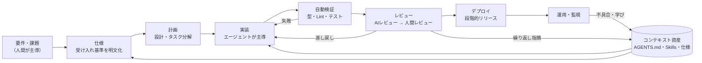

### 人間とエージェントの役割分担

| フェーズ | 人間 | エージェント |
|---|---|---|
| 要件・仕様 | 何を・なぜ作るかを決める、受け入れ基準を承認 | 不明点の洗い出し、仕様の下書き、既存コードの調査 |
| 計画 | 設計判断・トレードオフの承認 | 設計案・タスク分解の提案 |
| 実装 | 方向修正、難所の判断 | コード・テストの作成、自己検証 |
| レビュー | 最終責任、設計意図との整合確認 | 一次レビュー、明らかな不具合・規約違反の検出 |
| 運用 | 障害対応の判断 | ログ調査、修正案の作成 |

最も重要な原則は、**エージェントが書いたコードでも、責任を持つのは人間**であることです。自分でレビューしていないコードを同僚にレビュー依頼しないことが、基本的なマナーとして共有されつつあります。

---

## 3. コンテキストエンジニアリング

プロンプトエンジニアリングが「どう指示するか」に注目するのに対し、コンテキストエンジニアリングは「どの情報をエージェントに渡すか」を設計する考え方です。

### コンテキストの置き場所

Claude Code を例にすると、仕組みごとに役割が分かれています。他のツールにも同様の仕組みがあります。

| やりたいこと | 置き場所 | 理由 |
|---|---|---|
| 毎回必要な最小限の前提（ビルド方法、規約、禁止事項） | AGENTS.md / CLAUDE.md | 常に読み込まれる。短く保つ |
| 特定タスクでだけ必要な手順・知識 | Skills | 関連するときだけ読み込まれ、コンテキストを圧迫しない |
| 調査・レビューを本体から切り離す | Subagents | 独立したコンテキスト・権限・ツールで動く |
| 必ず守らせたいルール（フォーマット、危険コマンドの禁止） | Hooks / 権限設定 | 決定論的に強制できる。指示文は守られない可能性がある |
| 外部システムとの連携 | MCP サーバー | 社内 API・DB・チケット管理などに接続 |
| 永続的な設定 | settings ファイル | チームで共有・バージョン管理できる |

#### 構成図：コンテキストの階層

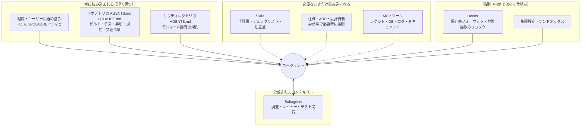

### ベストプラクティス

- **AGENTS.md を起点にする**：複数ツール間の共通フォーマットとして AGENTS.md が定着しつつあります。ツール固有のファイル（CLAUDE.md など）は AGENTS.md を参照する形にすると重複を避けられます。
- **短く、具体的に**：自明な一般論（「きれいなコードを書く」など）は書かず、そのリポジトリ固有の注意点・落とし穴・コマンドを書きます。
- **書くべき内容**
  - ビルド・テスト・Lint・型チェックのコマンド
  - ディレクトリ構成と主要モジュールの責務
  - 命名・エラーハンドリング・ログなどの規約
  - 触ってはいけないもの（生成ファイル、マイグレーション済みファイル、秘密情報）
  - 完了の定義（テストが通る、型エラーがない、など）
- **関心を分離する**：大きな資料は `@参照` などで必要時に読み込ませ、常時読み込むファイルを肥大化させません。
- **「指示」と「強制」を区別する**：絶対に守らせたいことは Hooks や権限設定で強制します。
- **コンテキストを育てる**：レビューで同じ指摘が繰り返されたら、AGENTS.md や Skills に追記します。コンテキストファイルもコードと同様にレビュー・バージョン管理します。
- **コンテキストウィンドウを管理する**：無関係な作業はセッションを分け、長いセッションは要約・圧縮します。調査はサブエージェントに任せ、結論だけを受け取ります。

---

## 4. 仕様駆動開発（SDD）

**仕様を「信頼できる唯一の情報源」とし、コードは仕様から生成・検証される成果物として扱う**開発手法です。エージェントはコードを書くのは得意でも、書かれていない意図を推測するのは苦手なため、2026年に急速に普及しました。

### 主なツール

| ツール | 特徴 |
|---|---|
| GitHub Spec Kit | OSS。仕様 → 計画 → タスク → 実装の段階的プロセスを CLI・テンプレートで提供。多数のエージェントに対応し、エディタを選ばない |
| Kiro（AWS） | 仕様駆動を前提にした IDE / CLI。EARS 記法の要件、Hooks を内蔵 |
| OpenSpec、BMAD-METHOD など | 既存エージェントに組み合わせて使うフレームワーク |
| CLAUDE.md / Cursor rules + カスタムコマンド | 軽量な SDD。専用ツールなしで始められる |

### シーケンス図：SDD の進め方

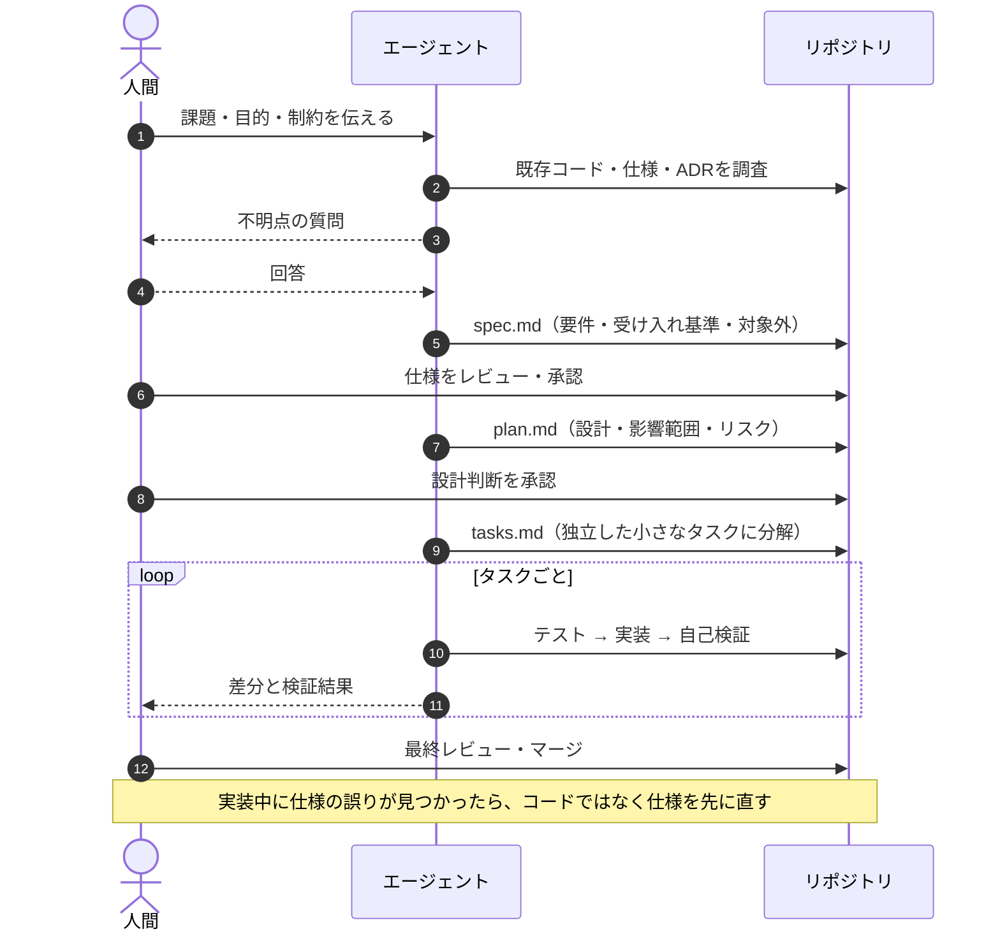

### ER図：仕様から成果物までのトレーサビリティ

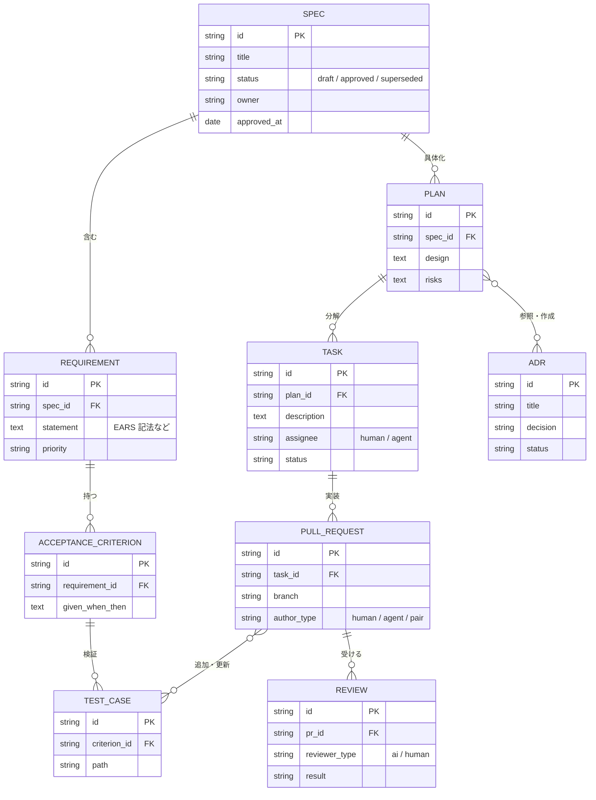

受け入れ基準 → テスト → PR がつながっていると、「仕様のこの項目はどのテストで保証されているか」を辿れます。

### ベストプラクティス

- **仕様には「対象外」を必ず書く**：何を作らないかが曖昧だと、エージェントは過剰に実装します。
- **受け入れ基準をテスト可能な形で書く**：Given / When / Then や EARS 記法など、検証できる形にします。
- **仕様は小さく保つ**：1仕様で巨大な機能を扱わず、独立してリリースできる単位に分けます。
- **規模に応じて使い分ける**：使い捨てのスクリプトやプロトタイプにまで重い SDD は不要です。本番に載る機能、複数人・複数エージェントで扱う機能ほど効果が大きくなります。
- **仕様を更新し続ける**：実装中に分かったことは仕様に戻します。仕様とコードが乖離すると SDD の利点が失われます。

---

## 5. 1タスクの進め方：探索→計画→実装→検証

### 状態遷移図：エージェントとの作業サイクル

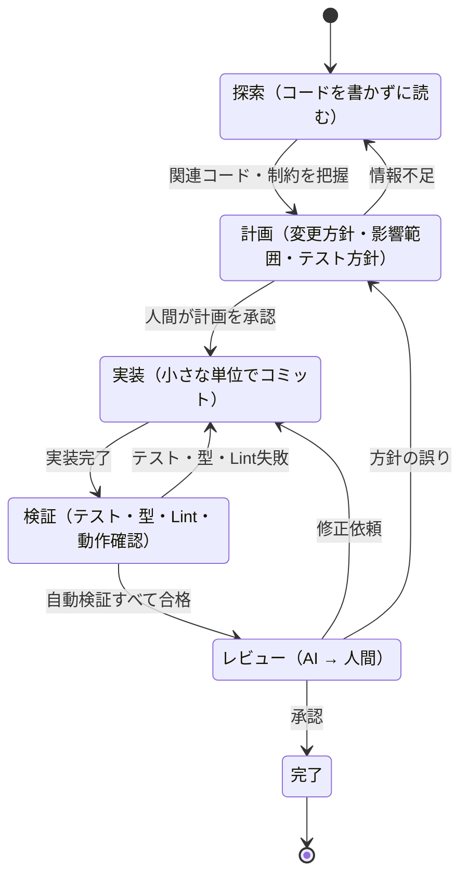

### ベストプラクティス

- **いきなり書かせない**：まず関連コードを読ませ（探索）、計画を出させ、人間が承認してから実装させます。Plan モードなどの機能を使うと、探索・計画中の誤った変更を防げます。
- **検証手段を渡す**：テスト、期待出力、スクリーンショット、再現手順など、エージェントが自分で正しさを確認できる手段を与えると、品質が大きく上がります。
- **テストを先に書かせる**：テスト → 失敗を確認 → 実装、の順にすると、テストを実装に合わせて書き換える「ごまかし」を防ぎやすくなります。
- **小さく区切る**：1回の依頼は、レビューできる大きさの差分に収まる範囲にします。
- **具体的に依頼する**：対象ファイル、既存の類似実装、制約、完了条件を明示します。
- **早めに止めて方向修正する**：誤った方向に進んでいると気づいたら、すぐに中断して指示し直します。長く走らせるほど修正コストが上がります。
- **うまくいかないときはやり直す**：同じセッションで修正を重ねるより、学んだことを指示に反映して新しいセッションで始めたほうが速いことが多いです。

---

## 6. 並列エージェントとワークツリー

2026年には主要なコーディングエージェントのほとんどが git worktree によるタスク分離に対応し、複数エージェントを並列に動かす使い方が一般的になりました。

### 構成図：ワークツリーによる並列実行

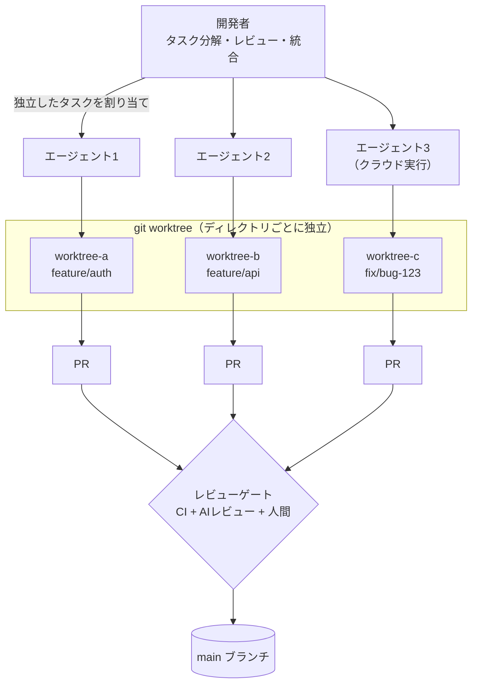

### シーケンス図：並列実行とレビューゲート

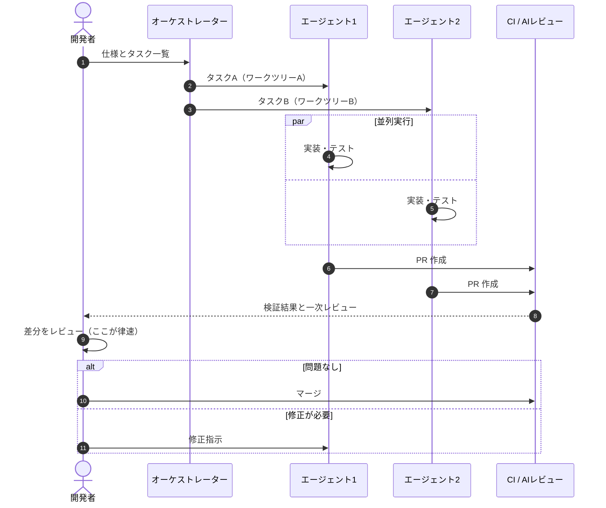

### ベストプラクティス

- **機能単位ではなく、ファイル境界で分ける**：同じファイルを複数エージェントが触るとコンフリクトが起きます。依存関係のない独立したタスクに分解します。
- **2並列から始める**：いきなり多数を走らせず、レビューが追いつく数から始めます。
- **律速はレビューだと認識する**：並列化で増えるのは生成量であり、人間がレビュー・統合できる量は増えません。自動検証と AI による一次レビューで、人間に届く前にふるいにかけます。
- **用途で並列化を使い分ける**
  - 独立したタスクを同時に進める（スループット向上）
  - 同じタスクを複数案で実装させて比較する（探索）
  - 観点別に複数のレビューを並列で行う（品質向上）
- **環境の分離も考える**：ポート、DB、キャッシュなどがワークツリー間で衝突しないようにします。
- **後片付けを自動化する**：不要になったワークツリーとブランチを定期的に削除します。

---

## 7. 検証とコードレビュー

### フロー図：多層の検証パイプライン

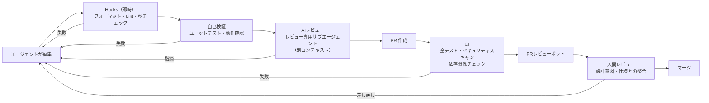

左ほど安く速く、右ほど高価で確実です。**人間のレビュー時間は最も貴重な資源なので、機械で検出できるものは人間に届く前に潰す**のが原則です。

### ベストプラクティス

- **レビューは別コンテキストで行う**：実装したセッション自身にレビューさせると、自分の判断を正当化しがちです。独立したサブエージェントや別のモデルにレビューさせます。
- **観点を分けてレビューする**：セキュリティ、性能、可読性、重複コード、テストの妥当性など、観点ごとのチェックリスト（Skills）を用意します。
- **人間は「意図」をレビューする**：構文や規約は機械に任せ、人間は「仕様を満たしているか」「設計として妥当か」「将来の変更に耐えるか」に集中します。
- **テストそのものをレビューする**：エージェントが書いたテストは、何も検証していない、実装に合わせて期待値を書き換えている、といった問題が起きがちです。
- **PR を小さく保つ**：大きな差分は人間も AI もレビュー精度が落ちます。
- **AI 生成であることを記録する**：コミットや PR に AI が関与したことを残しておくと、後の品質分析に使えます。

---

## 8. セキュリティ

コーディングエージェントは、ファイル読み書き・コマンド実行・ネットワークアクセスという強い権限を持ちます。2025〜2026年には、プロンプトインジェクションによるトークン流出や、意図しないパッケージ公開などの事故が実際に報告されています。

### 脅威モデル：「致命的な三要素（Lethal Trifecta）」

次の3つが揃うと、外部からの指示でデータを持ち出される危険があります。コーディングエージェントは便利さのためにこの3つを満たしてしまいがちです。

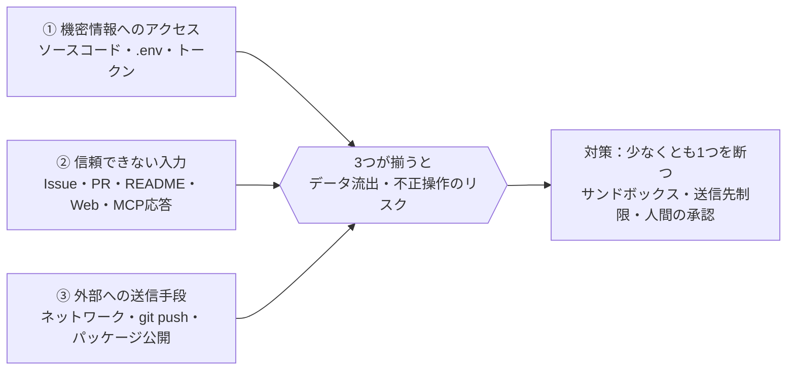

### 主な攻撃経路

- 悪意のあるリポジトリ、Issue、PR、コミット履歴に埋め込まれた指示（間接プロンプトインジェクション）
- 改ざんされた AGENTS.md / CLAUDE.md / ルールファイル
- 悪意のある、または承認後に挙動が変わる MCP サーバー・Skills・プラグイン（サプライチェーン攻撃）
- ツールの説明文やレスポンスに埋め込まれた指示
- エージェントのコンテキストに入った秘密情報の漏洩

### 構成図：多層防御

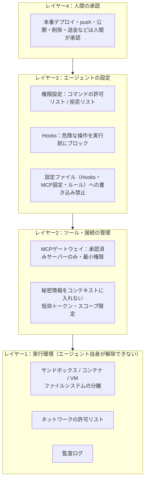

最も重要なのは**レイヤー1**です。指示や設定はプロンプトインジェクションで回避される可能性がありますが、OS・コンテナレベルの分離はエージェント自身が解除できません。

### ベストプラクティス

- **サンドボックスで実行する**：エージェント本体だけでなく、エージェントが起動するプロセス（Hooks、MCP サーバー、ビルドスクリプト）も含めて分離します。
- **ネットワークを許可リスト方式にする**：パッケージレジストリなど必要な送信先だけを許可します。
- **設定ファイルへの書き込みを禁止する**：Hooks・Skills・MCP 設定を書き換えられると、サンドボックス外でコードが実行される恐れがあります。
- **秘密情報を渡さない**：`.env` などを読めないようにし、必要な認証情報は短命・最小権限にします。
- **MCP サーバー・Skills・プラグインを依存関係として管理する**：出所を確認し、バージョンを固定し、更新時に差分を確認します。
- **信頼できない入力を扱うワークフローを分ける**：外部からの Issue や PR を処理する自動化には、書き込み権限や秘密情報を与えません。
- **「自動承認」の範囲を慎重に決める**：読み取りやテスト実行は自動、push・デプロイ・削除・外部公開は人間の承認、のように線を引きます。
- **AI 生成コードに対するセキュリティスキャンを必須にする**：SAST、依存関係の脆弱性スキャン、秘密情報の検出を CI に組み込みます。

---

## 9. 認証情報（リポジトリ・DB・API キー）の渡し方

エージェントに作業させるときは、リポジトリ・DB・API キーを使わせる場面が必ず出てきます。基本の考え方は次の3つです。

- **値は見せず、使わせる**：秘密情報の値がコンテキストに入ると、チャットに貼り付けたのと同じ状態になる。モデルへ送信され、セッションの記録にも残る
- **エージェントを動かす環境に、本番の権限を置かない**：設定で禁止するより、そもそも存在しない状態にするほうが確実
- **指示ではなく仕組みで止める**：CLAUDE.md や AGENTS.md に「読まないで」と書いても、デバッグ中などに読まれることがある

### 環境ごとの方針

| 環境 | エージェントに読ませるか | 条件・方法 |
|---|---|---|
| ローカル（Docker の DB など） | 読ませてよい | 漏れても実害がないことを確認する |
| DEV / STG | 条件つきで読ませてよい | 本番データのコピーがない（またはマスキング済み）、キーから本番のリソースに届かない、利用上限がある、クライアントの規程で認められている |
| 本番 | 読ませない | シークレットマネージャーで管理し、エージェントを動かす環境からは取得できない権限にする |

STG に本番からコピーした顧客データや個人情報がある場合は、STG も本番と同じ扱いにします。また、同じ AWS アカウント・IAM ロール・外部サービスのアカウントを本番と共有していると、STG のキーで本番を操作できてしまうことがあります。

### 構成図：シェル（実行環境）の権限の使い分け

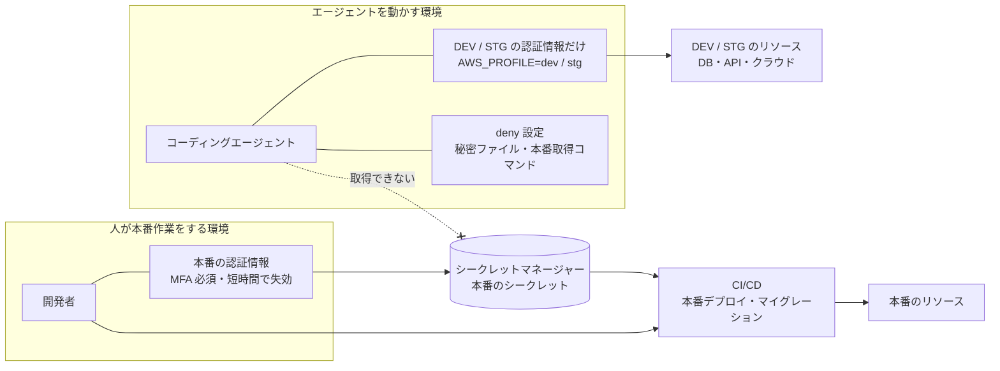

本番の認証情報は、エージェントを動かす環境に存在しない状態にします。本番へのデプロイやマイグレーションは、CI/CD か人の操作で行います。

### シーケンス図：値を見せずに使わせる（実行時の注入）

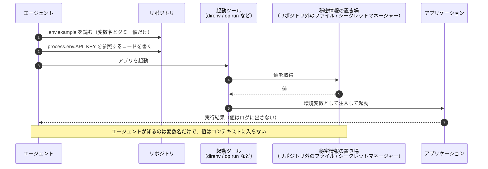

### リポジトリ

- [ ] 秘密ファイル（`.env`、鍵、証明書）を、settings.json の `deny` で読み取り禁止にしているか（例：`Read(**/.env)`、`Read(**/secrets/**)`）
- [ ] シェル経由の読み取りも塞いでいるか。スクリプトや `cat`・`head`・`tail`・`printenv`・`env` を使うと、Read の deny を通らずに読めてしまう
- [ ] サンドボックスを有効にし、外向きの通信を許可したドメインに限っているか
- [ ] 他人のリポジトリを初めて開くときは、コンテナなど隔離した環境で開いているか（CLAUDE.md・AGENTS.md・README へのプロンプトインジェクション対策）
- [ ] チーム共通の禁止事項を、組織で管理する設定（managed settings）で強制しているか

### DB

- [ ] 本番 DB に接続させていないか
- [ ] 読み取り専用で、スキーマやテーブル単位に絞った専用ユーザーを使わせているか
- [ ] 書き込みが必要な場合は、マイグレーションファイルを作らせ、適用は人か CI/CD が行っているか
- [ ] MCP 経由の SQL 実行を、承認が必要な設定（ask）にしているか
- [ ] クエリの結果に個人情報が含まれないか（結果はそのままコンテキストに入る）

### API キー

- [ ] キーの値をチャットに貼ったり、CLAUDE.md・AGENTS.md に書いたりしていないか
- [ ] 開発用・テスト用に、権限が狭く、期限が短く、利用上限のあるキーを発行しているか
- [ ] 会話やログに出たキーは、漏れたものとみなして再発行しているか
- [ ] 秘密情報の検出（gitleaks など）を、pre-commit と CI に入れているか

### リポジトリ外のファイルに置いてパスだけ伝える場合

値をチャットに貼るよりは安全ですが、パスを伝えている以上、エージェントは「確認のため」に開けてしまいます。

- [ ] そのパスを、ユーザー共通の設定（`~/.claude/settings.json`）で deny しているか。リポジトリの外にあるため、プロジェクトの設定では漏れやすい
- [ ] そのフォルダを、作業ディレクトリの外へのアクセス許可（`additionalDirectories`）に追加していないか
- [ ] 読み取りの承認を求められたときに、拒否しているか（「常に許可」を選ぶと、以後は確認なしで読まれる）
- [ ] できれば、パスではなく環境変数名だけを伝え、direnv や `op run` で起動時に注入する形にしているか

### 本番をシークレットマネージャーで管理する場合

シークレットマネージャーに入れるだけでは不十分なことがあります。手元の AWS プロファイルや 1Password のセッションが本番の権限を持っていると、エージェントがシェル経由で取り出せてしまいます。

- [ ] 普段の開発では、本番の権限を持たないプロファイルを使っているか（direnv で `AWS_PROFILE` をディレクトリごとに固定するなど）
- [ ] 本番の認証は、aws-vault・Granted・AWS SSO などで短時間に失効させているか
- [ ] 本番のシークレットを取り出すコマンドを deny にしているか（例：`Bash(aws secretsmanager get-secret-value*)`、`Bash(op read*)`、`Bash(*--profile prod*)`）
- [ ] さらに分離するなら、エージェントを devcontainer や別の OS ユーザーで動かし、ホストの `~/.aws` などが見えない状態にしているか

### settings.json の例

```json
{
  "permissions": {
    "deny": [
      "Read(**/.env)",
      "Read(**/.env.*)",
      "Read(**/secrets/**)",
      "Read(~/.config/myapp/**)",
      "Bash(cat *.env*)",
      "Bash(printenv*)",
      "Bash(env)",
      "Bash(aws secretsmanager get-secret-value*)",
      "Bash(op read*)",
      "Bash(*--profile prod*)"
    ],
    "ask": [
      "Bash(git push*)"
    ]
  }
}
```

パターンの書き方はツールのバージョンで変わることがあるため、公式ドキュメントで確認してください。また、設定したら実際にエージェントに「そのファイルを表示して」と頼み、Read とシェルの両方でブロックされることを確かめます。過去には deny 設定が効かない不具合が報告されたこともあります。

### 考え方のまとめ

権限の分離（OS・認証情報）を主、エージェントの設定（deny・承認）を補助として重ねます。設定は誤りや不具合で抜けることがありますが、存在しない認証情報は使われようがありません。

---

## 10. チーム・組織への導入

### 導入の段階

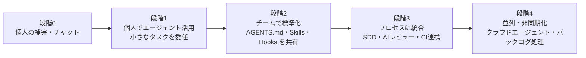

各段階で**基盤（テスト、CI、小さな変更、レビュー文化）が追いついているか**を確認してから次に進みます。DORA の結論の通り、基盤が弱いまま AI を増やすと不安定さが増します。

### 計測のためのデータモデル例

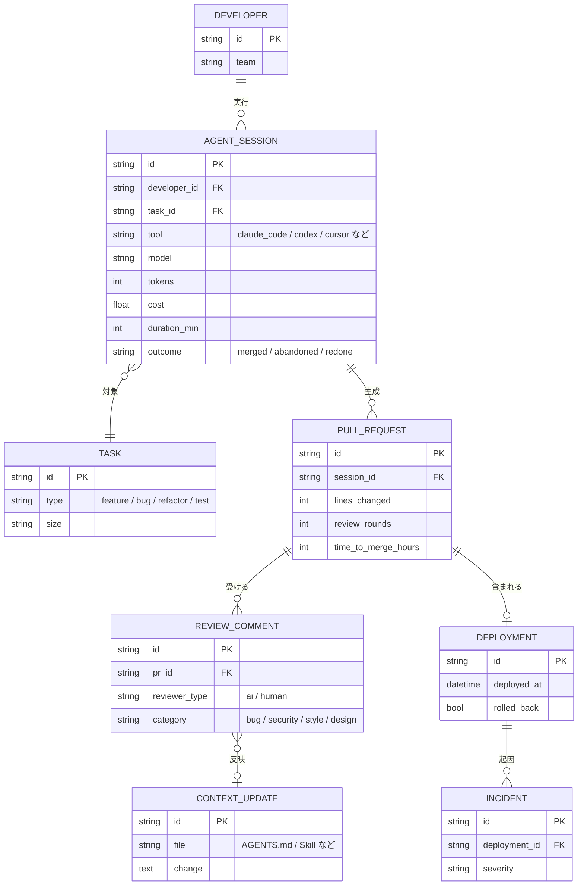

### 見るべき指標

- **スループットと安定性を両方見る**：デプロイ頻度・リードタイムだけでなく、変更失敗率・復旧時間（DORA の4指標）を必ず併せて見ます。
- **やり直し率**：エージェントの作業のうち、破棄・やり直しになった割合。高い場合は仕様やコンテキストに問題があります。
- **レビュー負荷**：PR あたりのレビュー往復回数、マージまでの時間、レビュー待ちの滞留。
- **品質**：AI 関与 PR の不具合・セキュリティ指摘の比率。
- **コスト**：トークン消費・ライセンス費用と、得られた成果の比較。
- **開発者体験**：認知負荷、燃え尽き、学習機会の減少も定性的に確認します。

### ベストプラクティス

- **共有資産としてコンテキストを管理する**：AGENTS.md、Skills、Hooks、サブエージェント定義をリポジトリで管理し、レビュー対象にします。
- **ガイドラインを明文化する**：AI に任せてよい範囲、承認が必要な操作、秘密情報の扱い、ライセンス・著作権の確認方法を決めます。
- **ジュニアの育成を設計する**：AI が書いたコードを読んで理解し、説明できることを求めます。AI 任せで設計力・デバッグ力が育たないリスクに注意します。
- **小さな成功事例から広げる**：テスト追加、リファクタリング、ドキュメント整備など、リスクが低く効果が見えやすいタスクから始めます。

---

## 11. アンチパターン

| アンチパターン | 問題 | 対策 |
|---|---|---|
| 曖昧な指示で大きな機能を丸投げ | 意図とずれた大量のコード | 仕様・受け入れ基準・対象外を明文化 |
| 計画なしでいきなり実装 | 誤った方針で大きく作り込む | 探索 → 計画 → 承認 → 実装 |
| 検証手段を渡さない | 「動くはず」のコード | テスト・期待出力・再現手順を渡す |
| 巨大な AGENTS.md | コンテキストの圧迫、重要な指示が埋もれる | 短く保ち、Skills・参照に分割 |
| 重要ルールを指示文だけで守らせる | 守られないことがある | Hooks・権限・CI で強制 |
| 自分で読まずにレビュー依頼 | レビュアーの負担増、責任の所在が曖昧 | 自分でレビューしてから PR |
| 並列エージェントを増やしすぎる | レビューが追いつかず品質低下 | レビュー能力に合わせて並列数を決める |
| 実装したセッションに自己レビューさせる | 自分の判断を正当化 | 別コンテキストでレビュー |
| 広い権限・秘密情報つきで実行 | プロンプトインジェクションで被害拡大 | サンドボックス・最小権限・許可リスト |
| 「読まないで」と指示するだけで秘密ファイルを置く | デバッグ中などに読まれ、値がコンテキストに入る | deny 設定・実行時の注入・環境の分離 |
| 普段のシェルに本番の権限を置いたまま使う | エージェントが本番のシークレットや資源に届く | エージェント用の環境は DEV / STG の権限だけにする |
| スループットだけを計測 | 不安定さの見落とし | 安定性指標も併せて計測 |

---

## 参考資料

### 調査・レポート
- [DORA 2025: State of AI-assisted Software Development](https://research.google/pubs/dora-2025-state-of-ai-assisted-software-development-report/)
- [Announcing the 2025 DORA Report – Google Cloud](https://cloud.google.com/blog/products/ai-machine-learning/announcing-the-2025-dora-report)
- [AIがソフトウェアエンジニアリング・パフォーマンスを増幅、2025年DORAレポート – InfoQ](https://www.infoq.com/jp/news/2026/07/ai-dora-report/)
- [The State of AI-Native Software Delivery 2026 – Encore](https://encore.dev/assets/library/state-of-ai-native-delivery-2026.pdf)

### コンテキストエンジニアリング・AGENTS.md
- [Context Engineering for AI Agents in Open-Source Software (arXiv 2510.21413)](https://arxiv.org/abs/2510.21413)
- [Configuring Agentic AI Coding Tools: An Exploratory Study (arXiv 2602.14690)](https://arxiv.org/abs/2602.14690)
- [On the Impact of AGENTS.md Files on the Efficiency of AI Coding Agents (arXiv 2601.20404)](https://arxiv.org/abs/2601.20404)
- [AGENTS.md – giving agents project context – Addy Osmani](https://addyosmani.com/agents/15-agents-md/)

### Claude Code の運用
- [Claude Code 公式ドキュメント](https://code.claude.com/docs)
- [Claude Code Security Guide: Permissions, MCP, Sandboxing – DataCamp](https://www.datacamp.com/tutorial/claude-code-security)
- [Claude Code Permissions & Sandboxing – University of Vermont](https://www.uvm.edu/it/kb/article/claude-code-permissions-sandboxing/)
- [Claude Code運用ベストプラクティス上級編（2026年版）– SmartScope](https://smartscope.blog/generative-ai/claude/claude-code-best-practices-advanced-2026/)
- [Claude Code Workflow: Best Practices That Ship Code](https://dev.to/galian/claude-code-workflow-best-practices-that-ship-code-na)

### 仕様駆動開発
- [Spec-driven development with AI – GitHub Blog](https://github.blog/ai-and-ml/generative-ai/spec-driven-development-with-ai-get-started-with-a-new-open-source-toolkit)
- [Spec-Driven Development: From Code to Contract (arXiv 2602.00180)](https://arxiv.org/abs/2602.00180)
- [GitHub Spec Kit vs Kiro vs Claude Code SDD workflows](https://dev.to/rosgluk/github-spec-kit-vs-kiro-vs-claude-code-sdd-workflows-1fi1)
- [4 cutting-edge tools for spec-driven development – InfoWorld](https://infoworld.com/article/4171332/four-cutting-edge-tools-for-spec-driven-development.html)

### 並列エージェント・レビュー
- [Agentic Engineering: Going 10x – Software Mansion](https://agentic-engineering.swmansion.com/becoming-productive/going-10x/)
- [Orchestration topology is the new bottleneck in agentic coding](https://dev.to/terminalblog/orchestration-topology-is-the-new-bottleneck-in-agentic-coding-487g)
- [Parallelizing AI Coding Agents – Tessl](https://tessl.io/blog/how-to-parallelize-ai-coding-agents/)

### セキュリティ
- [Practical Security Guidance for Sandboxing Agentic Workflows – NVIDIA](https://developer.nvidia.com/blog/practical-security-guidance-for-sandboxing-agentic-workflows-and-managing-execution-risk)
- [Sandboxing Agentic AI: Least-Privilege Patterns for MCP and Coding Agents – Cloud Security Alliance](https://labs.cloudsecurityalliance.org/wp-content/uploads/2026/05/CSA_research_note_agentic_ai_sandbox_least_privilege_mcp_20260530-csa-styled.pdf)
- [Beyond MCP: The New Security Playbook for Coding Agents – Endor Labs](https://www.endorlabs.com/learn/beyond-mcp-the-new-security-playbook-for-coding-agents)
- [Agentic Engineering: Security – Software Mansion](https://agentic-engineering.swmansion.com/becoming-productive/security/)
- [Coding Agent Horror Stories – Docker](https://www.docker.com/blog/coding-agent-horror-stories-the-security-crisis-threatening-developer-infrastructure/)
- [Are AI-assisted Development Tools Immune to Prompt Injection? (arXiv 2603.21642)](https://arxiv.org/abs/2603.21642)
