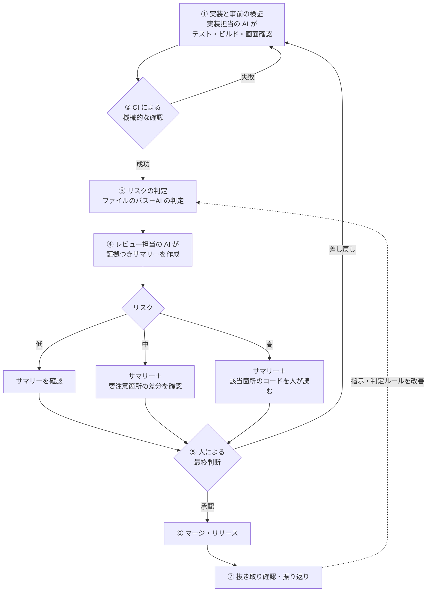
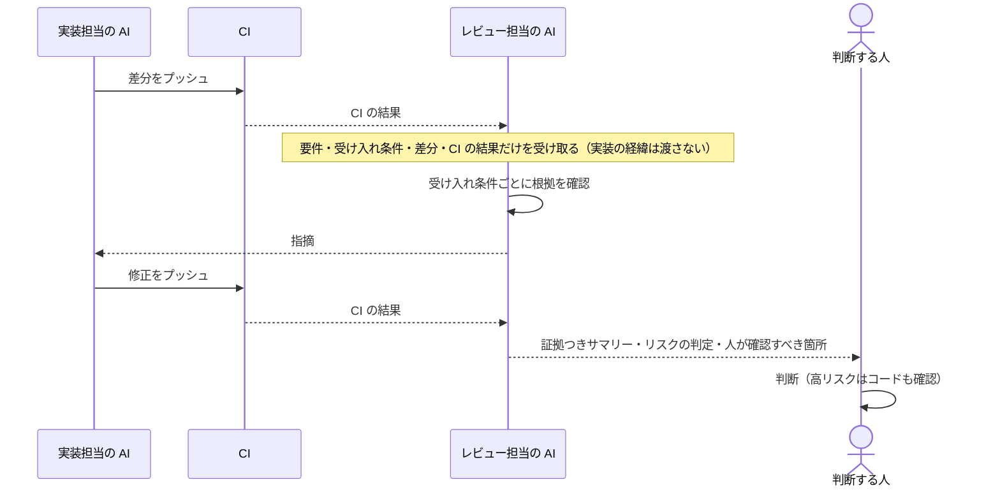

# AI を前提にしたプルリクエストの判断方法

> 最終確認日：2026年11月15日

人がすべてのプルリクエストを1行ずつ読むレビューから、**AI が証拠つきのサマリーを作り、人はリスクの高い部分と最終判断に集中する**レビューへ移るための方法をまとめたノートです。
人がコードを読むことを完全になくすのではなく、「人が読む範囲をリスクで絞る」ことを基本の考え方にしています。

---

## なぜ変えるのか

- **人のレビューがボトルネックになる**：AI で実装の量が増えると、全行を人が読む方式は追いつかない。読まずに承認する「形だけのレビュー」が増え、品質保証の意味が薄れる
- **人が本来やるべきことに集中できる**：「要件を満たしているか」「影響範囲を許容できるか」「出してよいか」の判断は、コードを1行ずつ読むより価値が高い
- **ボトルネックは移動する**：コードを書く速さが上がると、次はレビュー、その次は検証やデプロイが詰まる。レビューだけでなく、前後の工程も合わせて見直す必要がある

**事例**：Claude Code の開発チームは、プルリクエストの作成前に AI 自身にテストやビルドを実行させ、すべてのプルリクエストに AI のレビューを入れたうえで、人の注意をリスクの高い部分に集中させています。マージされるプルリクエストが2倍以上に増える一方で、取り消し（revert）が必要になった割合は 40% 以上減ったと報告されています。

## そのままでは危ない点

| リスク | 内容 | 対策 |
|---|---|---|
| サマリーの誤り | AI が、もっともらしく「満たしている」と書くことがある | 受け入れ条件ごとに、根拠（テスト、CI の結果、コードの箇所）を示させる |
| テストが信用できない | 実装と同じ AI がテストを書くと、実装に合わせた期待値になる | テストを先に作る、または別のエージェントに作らせる。期待値の変更は必ず報告させる |
| 自己採点 | 実装した AI が自分の変更をまとめると、見落としを引き継ぐ | 実装する AI とレビューする AI を分ける |
| 責任の所在 | 障害時に、誰が何を確認して承認したかを説明できない | 人の判断項目を固定し、承認の記録を残す |

---

## 全体の流れ



---

## ベストプラクティス

### 1. サマリーは「主張」ではなく「証拠つき」にする

- [ ] 実装担当の AI に「完了した」と報告させるのではなく、実行した結果（テスト、ビルド、画面のスクリーンショットなど）を示させているか
- [ ] 受け入れ条件ごとに、対応するテスト、その結果（CI へのリンク）、該当するコードの箇所を対応づけているか
- [ ] 根拠を示せない条件を「未確認」と明記しているか
- [ ] 期待値を変えたテスト、削除・スキップしたテストを、理由つきで列挙しているか
- [ ] 要件にない変更（範囲外の変更）を列挙しているか
- [ ] 影響範囲（機能、データ、API、外部連携、利用者）を書いているか

**役割の分担**



### 2. 実装する AI とレビューする AI を分ける

- [ ] レビュー担当は、実装担当とは別のコンテキスト（できれば別の指示・別のモデル）で動かしているか
- [ ] レビュー担当には、要件・受け入れ条件・テスト基準・差分だけを渡し、実装の意図や経緯を渡していないか
- [ ] レビュー担当の指摘に対して、実装担当が対応した結果を、再度レビュー担当が確認しているか
- [ ] 領域ごとのレビューの観点（何を重大とみなすか、指摘しなくてよいこと、対象外のパス）を、ファイル（REVIEW.md など）にまとめてレビュー担当に渡しているか

### 3. テストの信頼性を機械的に担保する

- [ ] 受け入れ条件のテストを、実装より先に作っているか、または別のエージェントに作らせているか
- [ ] 既存テストの期待値の変更・削除・スキップを、CI で検出して人の確認対象にしているか
- [ ] カバレッジの基準を決め、下回った場合に CI を失敗させているか
- [ ] 重要な部分は、ミューテーションテスト（わざとコードを壊してテストが失敗するかを確かめる手法）で、テストが効いているかを確認しているか

### 4. リスクで人の関与を変える

| リスク | 例 | 人の関与 |
|---|---|---|
| 低 | 文言の変更、社内向けの画面、ドキュメント、テストの追加 | サマリーを確認して承認 |
| 中 | 通常の機能追加、API の項目追加、性能の改善 | サマリーに加え、AI が「要注意」とした箇所の差分を確認 |
| 高 | 認証・権限、決済・課金、個人情報、データ移行・削除、インフラ・権限設定、外部への一斉送信 | サマリーに加え、該当箇所のコードを人が読む |

- [ ] 高リスクの判定を、AI の判断だけでなく、変更されたファイルのパスでも機械的に行っているか（例：`auth/`、`billing/`、`migrations/`、`infra/`）
- [ ] 高リスクの変更には、GitHub の CODEOWNERS などで、決まった人の承認を必須にしているか
- [ ] 判定に迷う場合は、高いほうのリスクとして扱っているか

### 5. 機械で確認できるものは、人の判断より前に止める

- [ ] テスト、型チェック、リンター、セキュリティの検査、秘密情報の混入の検査、カバレッジ、マイグレーションの実行確認を、CI で必須にしているか
- [ ] CI が通らないプルリクエストを、人の判断に回さないようにしているか
- [ ] main ブランチの保護で、CI の成功と承認なしにマージできないようにしているか

### 6. 人の判断項目を固定する

人は、次の項目を確認して判断します。

- [ ] 要件の解釈が正しいか
- [ ] 「未確認」の項目と、期待値を変えたテストに問題がないか
- [ ] 範囲外の変更が含まれていないか、含まれる場合に許容できるか
- [ ] 影響範囲とリスクを許容できるか
- [ ] 今リリースしてよいか（タイミング、切り戻しの準備）

承認したときは、何を確認して判断したかを一言コメントに残します。

### 7. 抜き取り確認と振り返りで、仕組みそのものを検証する

- [ ] 低・中リスクの変更も、一定の割合で人がコードまで確認し、AI のサマリーの精度を測っているか
- [ ] リリース後の不具合について、「サマリーが見逃した」「テストが不足していた」「リスクの判定を誤った」のどれかまで振り返っているか
- [ ] 振り返りの結果を、AI への指示、リスクの判定ルール、チェックリストに反映しているか
- [ ] サマリーの見逃しが続く領域は、人の関与を一段階上げているか
- [ ] AI レビューが見逃したときは、「何が文脈に足りなかったか」を考え、指示ファイル・スキル・自動チェックに反映しているか
- [ ] 人の手間（プルリクエストあたりの人の承認数、コメント数、人を待つ時間）を計測し、取り消し（revert）や障害の割合が増えていないかを、歯止めの指標として見ているか

### 8. レビューを収束させる

AI どうしで指摘と修正を繰り返すと、終わらなくなることがあります。

- [ ] 指摘を重大度（重要・軽微・もともとあった問題）で分け、軽微な指摘やスタイルだけの指摘で差し戻さないようにしているか
- [ ] 指摘には、根拠となるコードの箇所（ファイルと行）を必須にしているか。根拠のない指摘や同意で終わらせないようにしているか
- [ ] AI どうしのやり取りの回数に上限を決め、超えた場合は人に回しているか
- [ ] 複数の AI で指摘を出す場合、誤検知を除く仕組み（別の AI による確認など）を入れているか

### 9. 承認と責任のルールを決める

- [ ] AI の承認を、人の承認の代わりに数えないようにしているか
- [ ] AI エージェントが作ったプルリクエストは、そのエージェントを動かした人を責任者（必須のレビュー担当）にしているか
- [ ] 承認は、確認したコミットに対してだけ有効にしているか（承認後に新しいコミットが入ったら、承認し直す）
- [ ] セキュリティの指摘が解決されるまで、マージできないようにしているか（誤検知の場合は理由を書いて閉じる）
- [ ] CI のワークフローの定義や、重要と指定したパスの変更は、必ず人の承認を必要にしているか

### 10. 問題が起きてもすぐに戻せるようにする

レビューは1つの関門ではなく、何層もの確認の1つです。すり抜けた問題をすぐに戻せることも、仕組みの一部として用意します。

- [ ] マージキューで、main に取り込む直前の状態でもテストしているか
- [ ] フィーチャーフラグや段階的な公開で、影響を小さく抑えられるか
- [ ] 取り消し（revert）を、すぐに・簡単に行えるか

---

## サマリーの形式

```markdown
## 判定
- リスク：{ 低・中・高 }（判定の理由：{ 例：認証まわりのファイルを変更 }）
- 総合：{ 要件をすべて満たす / 一部未確認 / 満たしていない }

## 受け入れ条件の確認
| 受け入れ条件 | 結果 | 根拠（テスト・CI・コードの箇所） |
|---|---|---|
| { 条件 } | 満たす / 未確認 / 満たさない | { テスト名、CI へのリンク、ファイル:行 } |

## テストの変更
- 追加：{ テスト名 }
- 期待値の変更・削除・スキップ：{ テスト名と理由。なければ「なし」 }

## 範囲外の変更
- { 要件にない変更。なければ「なし」 }

## 影響範囲
- { 機能、データ、API、外部連携、利用者 }

## 人が確認すべき箇所
- { ファイル:行 と、確認すべき理由 }

## リリース時の作業
- { マイグレーション、環境変数の追加など。なければ「なし」 }
```

---

## AI への依頼テンプレート（レビュー担当）

```markdown
あなたは、このプルリクエストの実装には関わっていないレビュー担当です。
要件と差分だけをもとに、要件を満たしているかを検証してください。

## 要件・受け入れ条件
{ チケットの内容、受け入れ条件、テスト基準 }

## 差分
{ プルリクエストの差分 }

## CI の結果
{ テスト、カバレッジ、検査の結果 }

## 依頼内容
1. 受け入れ条件ごとに、満たしているかを判定し、根拠（テスト名、CI の結果、
   コードの箇所）を示してください。根拠を示せないものは「未確認」としてください。
   推測で「満たす」と判定しないでください。
   指摘には、根拠となるファイルと行を必ず書いてください。
2. 期待値を変更・削除・スキップしたテストをすべて挙げ、その変更が妥当かを評価してください。
3. 要件にない変更を挙げてください。
4. 実装チェックリストとセキュリティチェックリストの観点で、問題のある箇所を挙げてください。
5. 変更のリスク（低・中・高）を判定し、理由を書いてください。迷う場合は高いほうにしてください。
6. 人が実際にコードを読んで確認すべき箇所を、理由とともに挙げてください。
7. 指定のサマリーの形式で出力してください。
```

---

## 人が判断すること

- [ ] サマリーをもとに、マージしてよいか
- [ ] 高リスクの変更の、コードの中身が問題ないか
- [ ] リスクの判定ルールと、人の関与の度合いを見直すか
- [ ] 抜き取り確認と振り返りの結果を、仕組みにどう反映するか

---

## 参考情報（2026年11月時点）

- [How the Claude Code team does code review（Addy Osmani、X）](https://x.com/addyosmani/status/2114604912520921136)
- [What Comes After the Pull Request（X）](https://x.com/TheNoahHein/article/2037573208707137639)
- [AI Coding Agents Are Fast. Your Review Process Is Not Ready（X）](https://x.com/viveky259259/article/2084927344066932962)
- [2025 State of AI-assisted Software Development（DORA）](https://services.google.com/fh/files/misc/2025_state_of_ai_assisted_software_development.pdf)
