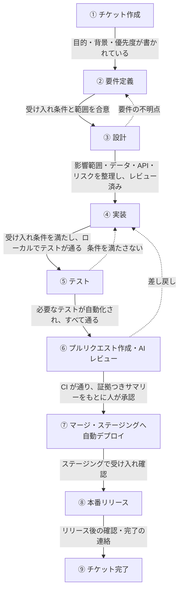
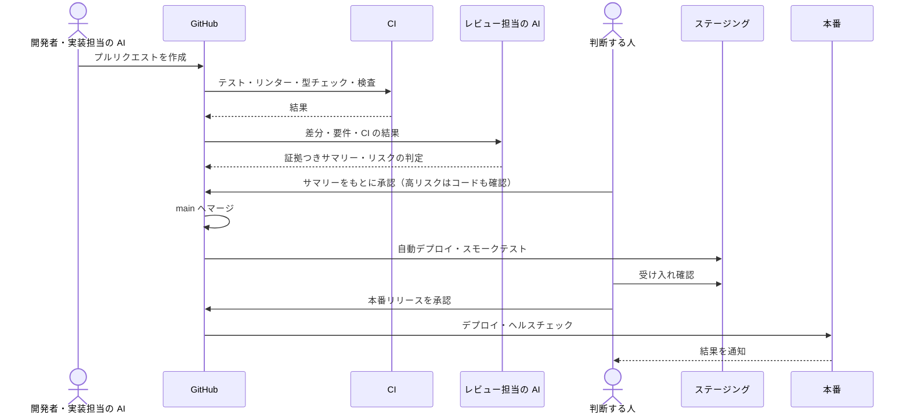

# 開発フロー（チケット作成からリリースまで）

> 最終確認日：2026年11月15日

チケットの作成から、要件定義・設計・実装・テスト・プルリクエスト・CI/CD によるリリースまでを、漏れなく確実に進めるための開発フローです。
各工程の「入る条件」と「終わる条件」を決め、条件を満たさないまま次へ進まないようにすることを基本にしています。AI を使って工程を速くしても、この条件は変えません。

---

## 全体の流れ



矢印のラベルが、次の工程へ進むための「終わる条件」です。点線は、条件を満たさない場合に前の工程へ戻る流れです。

---

## 基本方針

1. **すべての作業をチケットから始める**
   - チケットのない作業をしない。チケット・ブランチ・プルリクエスト・リリースを紐づけ、後から経緯を追えるようにする
2. **工程ごとに「終わる条件」を決める**
   - 条件を満たしてから次の工程へ進む。満たせない場合は、前の工程に戻る
3. **確認できることは自動化する**
   - テスト、リンター、型チェック、セキュリティの検査、デプロイを CI/CD で自動化し、人の確認は判断が必要な箇所に集中させる
4. **AI に任せる部分と、人が判断する部分を分ける**
   - 設計・実装・テスト・ドキュメント・レビューは AI で速くし、範囲・影響・リリースの判断は人が行う
5. **小さく分けて、頻繁にリリースする**
   - 変更を小さくすると、レビューしやすく、問題が起きたときに戻しやすい。AI は大きな変更を一度に作りやすいため、AI を使うほど小さく分けることが重要になる
6. **AI が自分で検証できるようにする**
   - 完了の報告ではなく、テスト・ビルド・画面確認の結果を AI に示させる。人が動作確認の係になると、そこがボトルネックになる
7. **AI に渡す文脈を整える**
   - 仕様は実装後も残る成果物として管理し、エージェント向けの指示ファイルは短く保つ（下の「AI に渡す文脈の整え方」を参照）
8. **ボトルネックは移動する前提で、流れ全体を見直す**
   - 実装が速くなると、レビュー、検証、デプロイ、判断の順に詰まりやすい。1か所だけでなく、流れ全体を定期的に見直す

---

## 各工程のチェックリスト

### ① チケット作成

- [ ] 目的（なぜ必要か）と背景が書かれているか
- [ ] 種類（新機能、改善、不具合、技術的な対応）が分かるか
- [ ] 優先度と期限（ある場合）が決まっているか
- [ ] 不具合の場合、再現手順、期待する動き、実際の動き、発生環境が書かれているか
- [ ] 関連するチケットや資料へのリンクがあるか
- [ ] 大きすぎる場合、分割したか

**チケットのテンプレート**

```markdown
## 目的
{ なぜ必要か、誰のどんな課題を解決するか }

## 背景
{ 経緯、関連する情報 }

## 受け入れ条件
- [ ] { 何ができたら完了か }

## 対象外
{ 今回はやらないこと }

## 関連
{ 関連するチケット、資料、画面 }
```

### ② 要件定義

- [ ] 受け入れ条件が、正常系・例外・境界のケースまで具体的に書かれているか
- [ ] 範囲（やること・やらないこと）が明確か
- [ ] 非機能要件（性能、セキュリティ、運用）で考慮すべき点を確認したか
- [ ] 不明点を関係者に確認し、回答をチケットに記録したか
- [ ] 不確実性が高い部分は、AI で試作して確かめてから、受け入れ条件を確定したか
- [ ] 詳細は [要件定義チェックリスト](../requirements/checklist.md) で確認する

### ③ 設計

- [ ] 影響範囲（関連する機能、データ、外部連携、利用者）を整理したか
- [ ] データモデル、API、処理方式（リアルタイム・非同期・バッチ）の変更を整理したか
- [ ] データ移行やスキーマ変更がある場合、手順と切り戻しを設計したか（[データ移行・スキーマ変更](../data/migration.md)）
- [ ] 性能・セキュリティのリスクを確認したか
- [ ] 影響の大きい変更は、実装の前に設計のレビューを受けたか
- [ ] 詳細は [設計チェックリスト](../design/checklist.md) で確認する

### ④ 実装

- [ ] チケットの番号を含むブランチ名で作業しているか（例：`feature/123-add-csv-export`）
- [ ] 変更を小さく分け、意味のある単位でコミットしているか
- [ ] コミットメッセージに、何を・なぜ変えたかを書いているか
- [ ] 設定値や秘密情報をコードに書いていないか
- [ ] 完了を報告する前に、AI 自身にテスト・ビルド・リンター・画面確認を実行させ、結果を示させたか
- [ ] 仕様と実装がずれた場合、仕様の側も更新したか
- [ ] 詳細は [実装チェックリスト](../implementation/checklist.md) で確認する

### ⑤ テスト

- [ ] 単体テストで、正常系・異常系・境界値を確認しているか
- [ ] 結合テストで、DB や外部サービスとの連携を確認しているか
- [ ] 権限のない利用者がアクセスできないことを確認しているか
- [ ] 不具合の修正では、その不具合を再現するテストを追加したか
- [ ] 性能に影響する変更では、クエリ数や処理時間を確認したか
- [ ] 画面の変更では、主要な画面・端末で表示と操作を確認したか

### ⑥ プルリクエスト作成・レビュー

- [ ] プルリクエストに、チケットへのリンク、変更の目的、変更点、確認方法、影響範囲を書いたか
- [ ] リリース時に必要な作業（マイグレーション、環境変数、データ投入）を書いたか
- [ ] 画面の変更では、変更前後のスクリーンショットを付けたか
- [ ] CI（テスト、リンター、型チェック、セキュリティの検査）がすべて通っているか
- [ ] 実装とは別の AI が、受け入れ条件ごとに根拠（テスト、CI の結果、コードの箇所）を示したサマリーを作成したか
- [ ] AI レビューの指摘に対応したか、対応しない理由を書いたか
- [ ] 期待値を変更・削除・スキップしたテストを、理由つきで明示したか
- [ ] 変更のリスク（低・中・高）を判定し、高リスクの箇所は人がコードを確認したか
- [ ] 人がサマリーをもとに、要件の解釈・影響範囲・リスクを確認して承認したか
- [ ] 詳細は [AI を前提にしたプルリクエストの判断方法](ai-pr-review.md) で確認する

**プルリクエストのテンプレート**

```markdown
## 関連チケット
{ チケットへのリンク }

## 目的
{ なぜこの変更が必要か }

## 変更点
- { 主な変更 }

## 確認方法
- { レビューする人が確認する手順 }

## 影響範囲
{ 影響する機能、データ、外部連携、利用者 }

## リスク
{ 低・中・高 と、その理由 }

## リリース時の作業
- [ ] { マイグレーション、環境変数の追加など。なければ「なし」 }

## チェック
- [ ] 受け入れ条件を満たしている
- [ ] テストを追加・更新した
- [ ] ドキュメントを更新した
```

### ⑦ マージ・ステージング環境への自動デプロイ

- [ ] マージ後、ステージング環境へ自動でデプロイされたか
- [ ] ステージング環境で、受け入れ条件を確認したか（必要に応じて、依頼者やプロダクトオーナーも確認）
- [ ] マイグレーションが、ステージング環境で問題なく実行されたか

### ⑧ 本番リリース

- [ ] [リリースチェックリスト](../release/checklist.md) の準備が終わっているか
- [ ] 影響の大きい変更は、[リリース前パフォーマンス・インフラチェックリスト](../performance/release-checklist.md) の確認が終わっているか
- [ ] 承認を得てから本番へデプロイしたか
- [ ] リリース後に、主要な機能と監視の数値を確認したか

### ⑨ リリース後の確認・チケットの完了

- [ ] リリース後、一定時間の監視で問題がないことを確認したか
- [ ] 関係者に完了を連絡したか
- [ ] チケットに、リリースした日時とプルリクエストを記録し、完了にしたか
- [ ] 運用の確認は [リリース後の運用・監視チェックリスト](../operations/checklist.md) で行う

---

## ブランチとリリースの進め方

- **main ブランチ**：常にリリースできる状態に保つ。直接コミットせず、プルリクエストでのみ変更する
- **作業ブランチ**：チケットごとに main から作成し、短い期間でマージする
- **ブランチの保護**：main へのマージには、CI の成功と承認を必須にする。高リスクの変更は、CODEOWNERS などで決まった人の承認を必須にする
- **リリース**：タグを付けてリリースし、どのバージョンに何が含まれるかを記録する
- **段階的な公開**：大きな機能は、フィーチャーフラグで本番に入れたまま非公開にしておき、準備ができたら公開する
- **マージキュー**：変更が多い場合は、main に取り込む直前の状態でテストし、他の変更との組み合わせで壊れないことを確かめる

---

## AI に渡す文脈の整え方

AI の出力の質は、渡す文脈で大きく変わります。役割の異なるファイルを分けて管理します。

| ファイル | 読む人 | 書く内容 |
|---|---|---|
| README | 人 | プロジェクトの説明、使い方 |
| 仕様（spec） | 人と AI | 意図、受け入れ条件、対象外。実装後も残す |
| 指示ファイル（AGENTS.md・CLAUDE.md など） | AI | ビルドとテストのコマンド、プロジェクト固有の規約、禁止事項。短く保つ |
| スキル | AI | 特定の作業の詳しい手順。必要なときだけ読み込ませる |
| フック・CI | 仕組み | 必ず守らせたい制約（テスト、検査、禁止操作の防止） |

- [ ] 指示ファイルは、人が書き、短く保っているか（一般的な心得や、リンターで守れる規約は書かない）
- [ ] 指示ファイルに、Web などから取得した文章をそのまま入れていないか
- [ ] 仕様に「対象外」を書き、AI が範囲外の作業を始めないようにしているか
- [ ] AI レビューや障害で見逃しがあったとき、指示ファイル・スキル・自動チェックのどれかに反映しているか

AI に自動生成させた長い指示ファイルは、かえって作業の成功率を下げ、費用を増やすという調査もあります。最初は短く書き、問題が起きたところだけを足していきます。

---

## CI/CD で自動化する項目

**CI/CD の流れ**



### CI（プルリクエストごと）

- [ ] 依存パッケージのインストールとビルド
- [ ] フォーマッター・リンター・型チェック
- [ ] 単体テスト・結合テスト
- [ ] テストのカバレッジの計測
- [ ] 依存パッケージの脆弱性の検査
- [ ] 外部のアクションをコミット SHA で固定しているかの確認
- [ ] 外部からのプルリクエストで、秘密情報や書き込みの権限が使われない設定（`pull_request_target` を避ける）
- [ ] 秘密情報の混入の検査
- [ ] マイグレーションが実行できることの確認
- [ ] テストの期待値の変更・削除・スキップの検出
- [ ] 変更されたファイルのパスによるリスクの判定（認証、課金、マイグレーション、インフラなど）
- [ ] 実装とは別の AI によるレビューと、証拠つきサマリーの作成

### CD（マージ後・リリース時）

- [ ] main へのマージで、ステージング環境へ自動デプロイ
- [ ] クラウドへのデプロイは、長期間有効なキーではなく、OIDC による一時的な権限で行う
- [ ] ステージング環境でのスモークテスト（主要な機能が動くかの自動確認）
- [ ] 承認を得てから、本番環境へデプロイ（手動の承認を挟む）
- [ ] デプロイ後の自動確認（ヘルスチェック、スモークテスト）
- [ ] 問題があった場合の自動、または手順化された切り戻し
- [ ] デプロイの結果を、チャットツールに通知

---

## AI を使って工程を速くする方法

| 工程 | AI に任せること | 人が行うこと |
|---|---|---|
| チケット作成 | 目的・背景の整理、受け入れ条件の下書き | 優先度の決定 |
| 要件定義 | 不明点・例外ケースの洗い出し、関係者への質問の作成 | 範囲と仕様の決定 |
| 設計 | 影響範囲の調査、設計案とリスクの洗い出し | 設計の採用の判断 |
| 実装 | コードの作成、ドキュメントの更新 | 方針の確認 |
| テスト | テストケースの洗い出しと作成 | 不足の確認 |
| プルリクエスト | 説明文の作成、証拠つきサマリーの作成（実装とは別の AI） | サマリーをもとにした判断と承認、高リスクの箇所のコード確認 |
| リリース | 手順書と切り戻し手順の下書き、確認項目の洗い出し | リリースの可否と日時の判断 |

要件が確定したあとの、設計・実装・テスト・ドキュメントの更新・プルリクエストの作成・AI レビューは、AI を使って一連の流れとして進められます。その場合も、各工程の「終わる条件」を AI に確認させ、満たしていない場合は次へ進ませないようにします。

---

## AI への依頼テンプレート（チケットからプルリクエストまで）

```markdown
あなたはこのリポジトリの開発を担当するエンジニアです。
以下のチケットを、開発フローに沿って進めてください。

## チケット
{ チケットの内容、受け入れ条件 }

## 進め方
1. 受け入れ条件に不明点があれば、作業を始める前に質問してください。推測で進めないでください。
2. 影響範囲（関連するコード、データ、API、外部連携）を調査し、設計の方針をまとめてください。
3. 方針の確認を受けてから、実装してください。
4. 正常系・異常系・境界値のテストを追加し、すべて通ることを確認してください。
5. 実装チェックリストとセキュリティチェックリストの観点で、自分の変更をレビューし、
   問題があれば修正してください。
6. 関連するドキュメントを更新してください。
7. プルリクエストのテンプレートに沿って、説明文を作成してください。
   リリース時に必要な作業があれば、必ず書いてください。

## 守ること
- チケットの範囲外の変更をしない
- 秘密情報をコードやログに書かない
- 各工程の終わる条件を満たしてから、次の工程へ進む
```

---

## 人が判断すること

- [ ] チケットの優先度と、範囲
- [ ] 設計の採用（特に、影響範囲の大きい変更）
- [ ] プルリクエストの承認（高リスクの変更は、コードの中身も確認）
- [ ] 本番リリースの可否と日時

---

## 参考情報（2026年11月時点）

- [How the Claude Code team does code review（Addy Osmani、X）](https://x.com/addyosmani/status/2114604912520921136)
- [AIで開発速度が上がると、最初にボトルネックになるのは…（広木 大地、X）](https://x.com/hiroki_daichi/status/2030466039000207752)
- [Context Engineering for AI Agents（metaCTO）](https://www.metacto.com/blogs/context-rich-environments-ai-agents)
- [Spec-Driven Development in 2026（DEV Community）](https://dev.to/krlz/spec-driven-development-in-2026-what-it-is-the-tooling-and-how-teams-actually-use-it-2fk2)
- [Securing the open source supply chain across GitHub（GitHub Blog）](https://github.blog/security/supply-chain-security/securing-the-open-source-supply-chain-across-github/)
