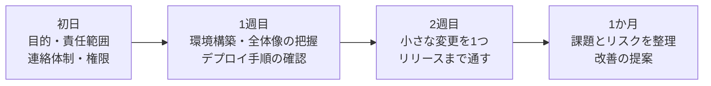

# 既存プロジェクトへの参画・引き継ぎ

> 最終確認日：2026年11月15日

すでに動いているプロジェクトに新しく参画するとき、またはプロジェクトを離れて引き継ぐときに確認するノートです。
業務委託やフリーランスで参画する場合、最初の1〜2週間でどれだけ正確に全体を把握できるかが、その後の成果とリスクを大きく左右します。AI を使ってコードベースを素早く把握しつつ、権限・責任範囲・暗黙の前提を早めに確認することを重視しています。

---

## 基本方針

1. **最初に「期待されている成果」と「責任の範囲」を確認する**
   - 何を任されているか、どこまで判断してよいか、誰に確認すればよいかを、作業を始める前にはっきりさせる
2. **触る前に、壊さない準備をする**
   - 手元で動かせる環境、テスト、デプロイと切り戻しの手順を確認してから変更を始める
3. **AI でコードベースを把握し、人に確かめる**
   - 構成や処理の流れは AI に説明させて素早く把握し、暗黙の前提や過去の経緯は人に確認する
4. **わかったことを書き残す**
   - 参画時に詰まったことは、次の人も詰まる。わかったことを文書や AI 向けの指示ファイルに残す
5. **離れるときは、自分がいなくても回る状態にする**
   - 引き継ぎは最後の数日ではなく、計画して行う

---

## 参画後の進め方



---

## チェックリスト

### 1. 初日：目的と体制

- [ ] プロジェクトの目的と、自分に期待されている成果を確認したか
- [ ] 契約の範囲（業務の内容、稼働時間、成果物、判断してよい範囲）を確認したか
- [ ] 確認や相談の相手（技術・仕様・事業）と、連絡の手段を確認したか
- [ ] 会議の予定と、報告の頻度・形式を確認したか
- [ ] 使ってよい AI ツールと、AI に渡してよい情報の範囲を確認したか

### 2. 権限とアクセス

- [ ] 必要なアクセス権（リポジトリ、クラウド、監視、チケット管理、チャット）を受け取ったか
- [ ] 本番環境への権限は、必要最小限か（読み取りのみで足りる場合は読み取りのみ）
- [ ] 多要素認証を設定したか
- [ ] 受け取った権限の一覧を、離任時に返せるよう記録したか

### 3. 1週目：全体像の把握

- [ ] 手元で開発環境を構築し、アプリケーションとテストを動かせたか
- [ ] システム構成（サービス、DB、外部連携、インフラ）を把握したか
- [ ] 主要な処理の流れ（ログイン、主要な業務、バッチ）を、コードで追えたか
- [ ] AI にコードベースの説明（構成、主要な処理、規約）を作らせ、担当者に確認したか
- [ ] デプロイの手順、切り戻しの手順、リリースの頻度を確認したか
- [ ] 監視・ログ・アラートの見方と、障害時の連絡体制を確認したか
- [ ] 既知の問題、技術的負債、触ると危ない箇所を担当者に確認したか
- [ ] 文書と実態がずれている箇所を、記録したか

### 4. 2週目：小さな変更を通す

- [ ] 小さな変更を1つ選び、チケット作成からリリースまで一通り行ったか
- [ ] 開発フロー（ブランチ、レビュー、CI、承認）の実際の運用を確認したか
- [ ] 詰まった箇所や、手順書にない作業を記録したか

### 5. AI に渡す文脈を整える

- [ ] AI 向けの指示ファイル（AGENTS.md・CLAUDE.md など）があるか。なければ、短く作ることを提案したか
- [ ] ビルドとテストのコマンド、規約、触ってはいけない箇所を、指示ファイルに書いたか
- [ ] 秘密情報や本番のデータを、AI に渡さない運用になっているか

### 6. 1か月：課題の整理と提案

- [ ] 気づいた課題とリスク（性能、セキュリティ、運用、負債）を、影響度とともに整理したか
- [ ] 改善の提案を、効果と費用で優先順位を付けて伝えたか
- [ ] 期待されている成果に対する、進み具合を確認したか

### 7. 離任・引き継ぎ

- [ ] 引き継ぎの計画（相手、期間、内容）を立てたか
- [ ] 担当していた作業、進行中のチケット、未解決の課題を一覧にしたか
- [ ] 自分しか知らない手順や判断の経緯を、文書や指示ファイルに残したか
- [ ] 引き継ぎ先が、実際に作業を一通りできることを確認したか
- [ ] 受け取った権限・アカウント・鍵をすべて返却・削除したか
- [ ] 手元の端末にあるソースコードや資料を、契約に従って削除したか

---

## AI への依頼テンプレート（コードベースの把握）

```markdown
あなたは、このリポジトリに新しく参画したエンジニアの補佐役です。
コードベースを読み、全体像を説明してください。

## 依頼内容
1. システムの構成（主要なディレクトリ、サービス、DB、外部連携）を説明してください。
2. 主要な処理の流れ（{ 例：ログイン、注文、夜間バッチ }）を、関係するファイルとともに説明してください。
3. ビルド、テスト、手元での起動の方法を、実際のファイルから調べて書いてください。
4. コードの規約や、よく使われている共通の仕組みを挙げてください。
5. 複雑な箇所、テストが少ない箇所、変更すると影響が大きそうな箇所を挙げてください。
6. コードから読み取れないこと（仕様の背景、過去の判断）は推測せず、
   担当者に確認すべき質問として挙げてください。

## 出力形式
- 構成の説明
- 主要な処理の流れ
- 起動・テストの方法
- 注意が必要な箇所
- 担当者への質問
```

---

## 人が判断すること

- [ ] 任された範囲を超える判断を、自分で行ってよいか
- [ ] 気づいた課題のうち、どれを優先して提案するか
- [ ] 引き継ぎが十分にできたか
