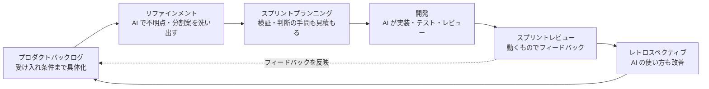

# AI 時代のスクラム開発

AI を使った開発で、スクラムの進め方をどう変えるかをまとめたノートです。
AI によって実装の速度が大きく上がると、ボトルネックは「書くこと」から「何を作るかを決めること」と「正しくできているかを確かめること」へ移ります。スクラムの枠組みはそのまま使いつつ、重心をそちらへ移すことを基本の考え方にしています。

---

## 何が変わるか

| 観点 | これまで | AI を使った開発 |
|---|---|---|
| ボトルネック | 実装にかかる時間 | 要件の明確さ、レビュー、意思決定の速さ |
| 見積もり | 実装の手間で見積もる | 実装の手間が小さくなり、確認・調整・判断の手間が中心になる |
| バックログ | 大まかな項目で、スプリント中に詰めることも多い | 受け入れ条件まで具体的にしておかないと、AI が誤った方向に速く進む |
| レビュー | 一部の変更を重点的に見る | 変更量が増えるため、AI レビューとテストを前提に、人は判断が必要な箇所に集中する |
| 知見の共有 | コードとドキュメントが中心 | プロンプト、AI への指示の型、検証の方法も共有の対象になる |
| スクラムマスターの仕事 | 会議の運営、記録、チケットの整理も多くを占める | 記録やまとめなどの事務作業は AI に任せ、障害の除去とチームの改善に集中する |

DORA の 2025年の調査では、開発者の約9割が AI を使っている一方で、AI は組織の強みも弱みも増幅するものだとされています。小さな単位で進める、バージョン管理やレビューの規律を保つといった、従来の良い習慣があるチームほど、AI の効果を得られます。

## スプリントの流れ



実装が速くなった分、リファインメントで受け入れ条件を具体化することと、レトロスペクティブで AI の使い方を改善することに時間をかけます。

---

## 基本方針

1. **バックログの準備（リファインメント）に時間をかける**
   - 実装が速くなった分、何を作るか・どうなれば完成かを詰める時間を増やす
2. **完成の定義（DoD）に、検証の工程を組み込む**
   - テスト、AI による証拠つきのレビュー、人の判断、ドキュメントの更新までを完成の条件にする
3. **人は判断と確認に集中する**
   - 予算、影響範囲、優先度、リリースしてよいかの判断は人が行う
4. **短い周期で動くものを見せ、方向を早く修正する**
   - 実装が速いぶん、利用者や関係者に早く見せて、フィードバックを次に反映する
5. **AI の使い方そのものも、振り返りで改善する**
   - プロンプトや開発の流れを、チームの資産として改善していく

---

## チェックリスト

### 1. プロダクトバックログ

- [ ] 各項目に、目的（なぜ作るか）と受け入れ条件があるか
- [ ] 受け入れ条件が、AI に渡しても誤解されない具体さになっているか（入力、出力、例外時の動き）
- [ ] 関連する設計・仕様・既存コードの場所が、項目から参照できるか
- [ ] 優先度が、事業上の価値と、実装・検証・運用の手間の両方で決まっているか
- [ ] [要件定義チェックリスト](../requirements/checklist.md) の観点で、漏れがないか

### 2. スプリントプランニング

- [ ] 実装の手間だけでなく、レビュー・テスト・関係者との確認の手間を見積もりに含めたか
- [ ] 人が判断・確認する時間（特に高リスクの変更）が、スプリントの変更量に見合っているか
- [ ] 影響範囲の大きい変更（データ移行、認証、課金など）を、他の変更と分けて計画したか
- [ ] スプリントのゴールが、作る機能の数ではなく、得たい成果で書かれているか
- [ ] ストーリーポイントの精度にこだわらず、リードタイムなどの流れの指標で、計画の見直しをしているか
- [ ] AI が大きな変更を一度に作らないよう、項目を小さく分けているか

### 3. 開発中

- [ ] AI への指示（プロンプト）と、検証の方法をチームで揃えているか
- [ ] 変更を小さく分け、プルリクエストを細かく出しているか
- [ ] 仕様の不明点が出たとき、AI に推測で進めさせず、プロダクトオーナーに確認しているか
- [ ] [実装チェックリスト](../implementation/checklist.md) の観点で AI レビューを行い、人はリスクに応じて確認しているか

### 4. 完成の定義（DoD）

工程ごとの詳しい確認は [開発フロー（チケット作成からリリースまで）](development-flow.md) にまとめています。


- [ ] 受け入れ条件をすべて満たしている
- [ ] 単体テスト・結合テストが CI で通っている
- [ ] 実装とは別の AI が、受け入れ条件ごとに根拠を示したサマリーを作成した
- [ ] AI レビューの指摘に対応したか、対応しない理由を記録した
- [ ] 人がサマリーをもとに、要件の解釈・影響範囲・リスクを確認した（高リスクの変更は、コードも確認した）
- [ ] 性能・セキュリティの観点で、必要な確認をした
- [ ] 仕様書・README などのドキュメントを更新した

### 5. スプリントレビュー

- [ ] 動くものを見せて、利用者や関係者のフィードバックを得たか
- [ ] フィードバックを、バックログの追加・優先度の変更に反映したか
- [ ] 成果を、事業の指標（KPI）と結びつけて確認したか

### 6. レトロスペクティブ

- [ ] 手戻りの原因が、要件のあいまいさ・AI への指示・レビューの漏れのどれだったかを確認したか
- [ ] うまくいったプロンプトや開発の流れを、チームで共有したか
- [ ] AI の利用で時間がかかった作業や、品質の問題が出た作業を洗い出したか
- [ ] 改善策を、次のスプリントで試す具体的な行動にしたか

---

## 計測するとよい指標

- **リードタイム**：バックログの項目に着手してから、リリースするまでの時間
- **手戻りの回数**：レビューやテストで差し戻された回数と、その原因
- **レビュー待ちの時間**：プルリクエストを出してから、承認されるまでの時間
- **サマリーの見逃し**：AI のサマリーが「満たす」と判定したのに、後で不具合が見つかった件数
- **リリース後の不具合**：リリース後に見つかった不具合の数と、その原因の段階（要件・設計・実装）

実装の速さだけでなく、手戻りとレビュー待ちが減っているかを見ることで、AI の活用が成果につながっているかを判断できます。あわせて、取り消し（revert）やリリース後の障害の割合が増えていないかを、歯止めの指標として確認します。

---

## AI への依頼テンプレート（リファインメント）

```markdown
あなたはスクラム開発に詳しいプロダクトオーナーの補佐役です。
以下のバックログ項目を、開発に着手できる状態に整えてください。

## バックログ項目
{ 項目のタイトル、目的、現在わかっていること }

## 関連情報
{ 関連する仕様、画面、既存の機能、制約 }

## 依頼内容
1. 受け入れ条件を、正常系・例外・境界のケースまで具体的に書いてください。
2. 不明点と、プロダクトオーナーや関係者に確認すべき質問を挙げてください。
3. 大きすぎる場合は、1スプリント以内で完了できる単位に分割してください。
4. 影響範囲（関連する機能、データ、外部連携）と、必要な検証を挙げてください。

## 出力形式
- 受け入れ条件
- 確認すべき質問
- 分割案（分割する場合）
- 影響範囲と必要な検証
```

---

## 人が判断すること

- [ ] バックログの優先度と、スプリントのゴール
- [ ] 不明点の答え（仕様の決定）
- [ ] 影響範囲が大きい変更を、このスプリントで進めるか
- [ ] AI の活用方法の変更を、チームとして採用するか

---

## 参考情報（2026年11月時点）

- [2025 State of AI-assisted Software Development（DORA）](https://services.google.com/fh/files/misc/2025_state_of_ai_assisted_software_development.pdf)
- [AI Is Amplifying Software Engineering Performance, Says the 2025 DORA Report（InfoQ）](https://infoq.com/news/2026/03/ai-dora-report/)
- [AIで開発速度が上がると、最初にボトルネックになるのは…（広木 大地、X）](https://x.com/hiroki_daichi/status/2030466039000207752)
