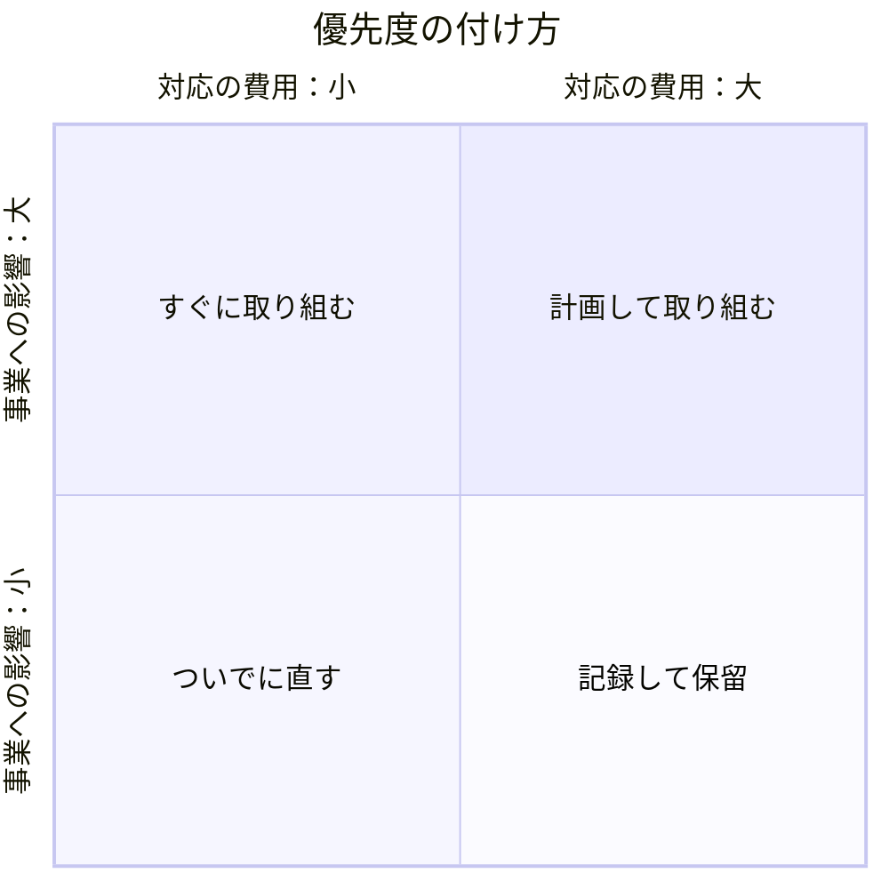

# 技術的負債とリファクタリング

> 最終確認日：2026年11月15日

技術的負債（後回しにした設計・実装の問題）を見える化し、優先度を付けて返していくためのノートです。
AI を使うと、短期間に大量のコードが生まれ、負債も同じ速さでたまります。一方で、AI は大規模な置き換えや整理も得意です。負債を「事業への影響」で説明し、計画的に返すことを重視しています。

---

## 基本方針

1. **負債を見える化する**
   - 頭の中やコードのコメントにとどめず、一覧にして影響と対応の費用を書く
2. **事業への影響で優先度を決める**
   - 「コードが汚い」ではなく、「障害の原因になる」「開発が遅くなる」「費用が増える」で説明する
3. **継続的に返す時間を確保する**
   - 一度にまとめて返すのではなく、スプリントの一定の割合を負債の返済にあてる
4. **リファクタリングは、テストで守ってから行う**
   - 振る舞いを変えないことを、テストで確かめながら進める
5. **大きな置き換えは、段階的に行う**
   - 一度に作り直さず、新旧を並べて少しずつ切り替える

---

## 負債の分類と優先度

| 分類 | 例 | 事業への影響 |
|---|---|---|
| 設計の負債 | 責務が混ざった構成、重複した処理 | 変更のたびに時間がかかり、不具合が出やすい |
| テストの負債 | テストがない、不安定なテスト | 安心して変更できず、AI に任せる範囲も狭まる |
| 依存関係の負債 | サポートが切れたランタイム、古いライブラリ | 脆弱性への対応ができない、移行の費用が膨らむ |
| 運用の負債 | 手作業の手順、監視の不足 | 障害の検知と復旧が遅れる |
| 性能の負債 | N+1、全件取得、データ量の増加への未対応 | データが増えると遅くなり、費用が増える |
| 文書の負債 | 古い文書、AI 向けの指示ファイルがない | 参画や引き継ぎに時間がかかり、AI の出力の質も下がる |



---

## チェックリスト

### 1. 見える化

- [ ] 負債の一覧（内容、場所、事業への影響、対応の費用、期限）があるか
- [ ] 負債を作るときに、理由と返す予定を記録しているか
- [ ] サポートが切れる予定のランタイム・ライブラリ・OS を把握しているか
- [ ] 変更が多く、不具合も多い箇所（直す効果の大きい箇所）を把握しているか

### 2. 優先度と計画

- [ ] 事業への影響と対応の費用で、優先度を付けたか
- [ ] スプリントの一定の割合を、負債の返済にあてているか
- [ ] 機能の開発と合わせて返せる負債は、同じ作業の中で直しているか
- [ ] 返済の効果（変更にかかる時間、不具合の数、費用）を測っているか

### 3. リファクタリングの進め方

- [ ] 対象の振る舞いを守るテストを、先に用意したか
- [ ] 振る舞いの変更と、構造の変更を、別のプルリクエストに分けているか
- [ ] 変更を小さく分け、いつでも止められるようにしているか
- [ ] 大きな置き換えは、新旧を並べて段階的に切り替えているか（ストラングラーパターン）

### 4. AI を使った大規模な整理

- [ ] 置き換えのルール（どう書き換えるか）を明確にし、AI に渡しているか
- [ ] AI に一度に全体を変えさせず、小さな単位で分けて実行しているか
- [ ] 書き換えごとに、テスト・型チェック・ビルドが通ることを自動で確かめているか
- [ ] 機械的に確かめられない部分を、人が抜き取りで確認しているか
- [ ] AI が新たな負債（重複、不要な抽象化、規約から外れた書き方）を作っていないか確認しているか

---

## AI への依頼テンプレート

```markdown
あなたはソフトウェアの設計と保守に詳しいエンジニアです。
以下のコードベースの技術的負債を洗い出してください。

## 対象
{ リポジトリ、対象の範囲、最近の不具合や変更の多い箇所 }

## 依頼内容
1. 技術的負債を、設計・テスト・依存関係・運用・性能・文書の分類で洗い出してください。
2. それぞれについて、事業への影響（障害、開発の遅れ、費用）と、対応の費用の目安を書いてください。
3. 影響と費用から、優先度を付けてください。
4. 優先度の高いものについて、段階的に返す手順を提案してください。
5. 推測の部分は「推測」と明記してください。

## 出力形式
- 負債の一覧（分類、内容、場所、事業への影響、対応の費用、優先度）
- 優先度の高いものの返済手順
```

---

## 人が判断すること

- [ ] どの負債を、いつ返すか
- [ ] 負債の返済に、開発の時間をどれだけ割くか
- [ ] 大きな置き換えを始めるか
