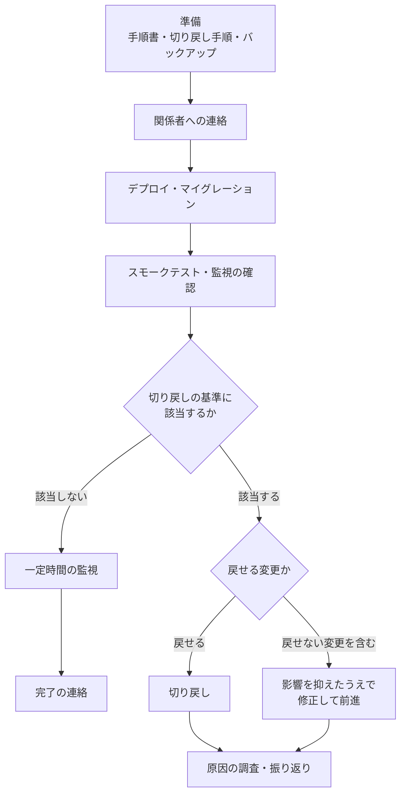

# リリースチェックリスト

本番環境へリリースする前・当日・直後に確認するチェックリストです。
「問題が起きないこと」だけでなく、「問題が起きたときにすぐ戻せること」を重視しています。
性能とインフラの確認は [リリース前パフォーマンス・インフラチェックリスト](../performance/release-checklist.md) で行います。

---

## 基本方針

1. **切り戻しの手順を、リリースの手順と同じ重さで用意する**
   - 戻せない変更（データ移行、外部への通知など）は、特に慎重に扱う
2. **影響範囲を把握してから判断する**
   - 誰に、どの機能に、どのデータに影響するかを、リリースの前に整理する
3. **手順は事前に書き、当日はその通りに進める**
   - 当日に判断や手作業を増やさないことで、ミスを減らす
4. **リリース直後の確認までをリリースの作業に含める**
   - デプロイが終わった時点ではなく、正常に動いていることを確認した時点で完了とする

---

## リリースの流れ



戻せない変更（データの削除・変換、外部への一斉送信など）が含まれる場合は、切り戻しではなく修正で前進することになるため、準備の段階で特に慎重に確認します。

---

## チェックリスト

### 1. リリース前（準備）

- [ ] リリースに含まれる変更の一覧と、それぞれの影響範囲を整理したか
- [ ] 受け入れテストと、ステージング環境での確認が終わっているか
- [ ] [リリース前パフォーマンス・インフラチェックリスト](../performance/release-checklist.md) の確認が終わっているか
- [ ] [セキュリティチェックリスト](../security/checklist.md) で、影響度「高」の指摘が残っていないか
- [ ] リリースの手順書（実行するコマンド、順序、担当者、所要時間の目安）があるか
- [ ] 環境変数・設定値・外部サービスの設定など、コード以外の変更を手順に含めたか
- [ ] 本番のデータ量で、マイグレーションの所要時間とロックの有無を確認したか
- [ ] 本番データのバックアップを取得したか、復旧の手順を確認したか
- [ ] AI の機能を含む場合、評価の結果が基準を満たしているか、使うモデルとプロンプトのバージョンを記録したか

### 2. 切り戻しの準備

- [ ] 切り戻しの手順（前のバージョンへの戻し方、データの戻し方）を書いたか
- [ ] 切り戻しを判断する基準（エラー率、応答時間、重大な不具合など）を決めたか
- [ ] 切り戻しを判断する人と、連絡の方法を決めたか
- [ ] 戻せない変更（データの削除・変換、メールの一斉送信、外部連携など）を洗い出し、扱いを決めたか
- [ ] 必要に応じて、フィーチャーフラグで機能だけを止められるようにしているか

### 3. 関係者への連絡

- [ ] リリースの日時と影響を、社内の関係者（営業、サポート、運用）に伝えたか
- [ ] 停止や仕様変更がある場合、利用者への告知をしたか
- [ ] 外部連携先への影響がある場合、事前に調整したか
- [ ] サポート担当に、変更点と想定される問い合わせを共有したか

### 4. リリースのタイミング

- [ ] 利用の少ない時間帯を選んだか
- [ ] 問題が起きたときに対応できる人がいる時間帯か（金曜の夜や連休の前を避ける）
- [ ] キャンペーンや月末処理など、負荷が高い時期と重なっていないか
- [ ] 大きな変更の場合、一部の利用者から段階的に公開する方法（カナリアリリースなど）を検討したか

### 5. リリース当日

- [ ] 手順書の通りに進め、各手順の完了を記録しているか
- [ ] デプロイ後、主要な機能が動くことを確認したか（スモークテスト）
- [ ] エラー率、応答時間、CPU・メモリ、DB の接続数に異常がないか
- [ ] ログに、想定していないエラーが出ていないか
- [ ] バッチや非同期ジョブが正常に動いているか

### 6. リリース後

- [ ] 一定時間（数時間〜翌営業日）、監視を続けたか
- [ ] 夜間バッチなど、リリース後に初めて動く処理の結果を確認したか
- [ ] 関係者に、リリースの完了と結果を連絡したか
- [ ] 不要になったフィーチャーフラグや一時的な設定を、削除する予定を立てたか
- [ ] 問題があった場合、振り返りを行い、次のリリースの手順に反映したか

---

## AI への依頼テンプレート

```markdown
あなたはリリース管理に詳しいエンジニアです。
以下のリリース計画を確認し、リスクと漏れを洗い出してください。

## リリースの内容
{ 変更の一覧、プルリクエスト、マイグレーション、設定の変更など }

## リリース計画
{ 手順書、日時、担当者、切り戻しの手順 }

## 依頼内容
1. 添付のチェックリストと照らし合わせ、準備が漏れている項目を洗い出してください。
2. 変更ごとの影響範囲（利用者、機能、データ、外部連携）を整理してください。
3. 戻せない変更がないか確認し、ある場合は対策を挙げてください。
4. 切り戻しの判断基準と、リリース直後に確認すべき項目の案を出してください。

## 出力形式
- 漏れ・リスク一覧（項目、内容、影響度：高・中・低、対策案）
- 影響範囲の一覧
- 戻せない変更と対策
- リリース直後の確認項目
```

---

## 人が判断すること

- [ ] 影響範囲と残っているリスクを踏まえ、リリースしてよいか
- [ ] リリースの日時（業務やキャンペーンへの影響、対応できる人の有無）
- [ ] 問題が起きたとき、切り戻すか、修正して進めるか
