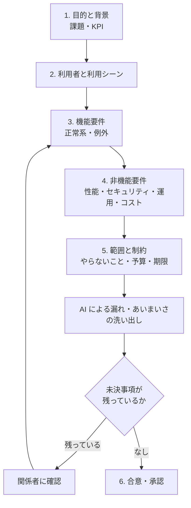

# 要件定義チェックリスト

「何を作るか」と「どこまでやるか」を、開発に入る前に漏れなく決めるためのチェックリストです。
AI を使った開発では実装の速度が大きく上がる一方、要件のあいまいさがそのまま手戻りになります。実装より前の段階で、判断材料をそろえることを重視しています。

---

## 基本方針

1. **「何を作るか」と「なぜ作るか」を先に固める**
   - 機能の一覧より先に、解決したい課題と、成功したと判断する基準を決める
2. **やらないことを明文化する**
   - 対象外の範囲を書いておくと、追加要望の判断と見積もりがぶれにくくなる
3. **非機能要件を後回しにしない**
   - 性能・セキュリティ・運用の要件は、後から入れるほど費用がかかる
4. **AI に漏れを洗い出させ、決めるのは人が行う**
   - 確認すべき観点の網羅は AI に任せ、優先度・予算・スケジュールの判断は人が行う

---

## 進め方



---

## チェックリスト

### 1. 目的と背景

- [ ] 解決したい課題が、一文で説明できるか
- [ ] 誰の、どの業務・体験を改善するのかが明確か
- [ ] 成功の基準（KPI）を、測れる形で決めているか（例：問い合わせ対応時間を半分にする）
- [ ] 作らない場合や、既存の仕組み・外部サービスで代替する場合と比較したか
- [ ] 期限の理由が明確か（キャンペーン、法改正、資金調達など）

### 2. 利用者と利用シーン

- [ ] 利用者の種類（一般利用者、管理者、社内オペレーター、外部連携先など）を洗い出したか
- [ ] 利用者ごとに、できること・できないこと（権限）を決めたか
- [ ] 主な利用シーンと、利用する端末・環境（PC、スマートフォン、ブラウザの種類）を把握したか
- [ ] 利用者数と利用の時間帯、ピークになる場面を把握したか

### 3. 機能要件

- [ ] 機能の一覧と、それぞれの優先度（必須・あると良い・将来）を決めたか
- [ ] 主な業務の流れを、正常系だけでなく例外・エラーのケースまで洗い出したか
- [ ] 入力項目、必須かどうか、入力できる値の範囲を決めたか
- [ ] 画面、帳票、通知（メール・チャット・プッシュ通知）の一覧があるか
- [ ] 外部サービス・既存システムとの連携の有無と、連携の方法を確認したか
- [ ] 既存データの移行が必要か、必要な場合は範囲と方法を確認したか

### 4. 非機能要件

- [ ] **性能**：応答時間の目標（p95 など）、同時利用者数、データ量の見込み（現在・1年後・3年後）
- [ ] **可用性**：止まってよい時間帯、許容できる停止時間、メンテナンスの方針
- [ ] **セキュリティ**：扱う個人情報・機密情報の種類、認証の方式、守るべき法令やガイドライン
- [ ] **運用**：監視、問い合わせ対応、障害時の連絡体制、バックアップと復旧の目標（RPO・RTO）
- [ ] **拡張性**：将来追加する見込みの機能、利用者の増加への対応
- [ ] **コスト**：開発費だけでなく、インフラや外部サービスの月額費用の上限

### 5. 範囲と制約

- [ ] 今回やらないこと（対象外）を明文化したか
- [ ] 技術的な制約（使う言語・クラウド、既存システムとの互換性）を確認したか
- [ ] 予算、期限、体制（人数、役割、稼働時間）を確認したか
- [ ] 法務・コンプライアンスの確認が必要な項目を洗い出したか（利用規約、個人情報、業界の規制）

### 6. 合意と管理

- [ ] 決定事項と未決事項を分けて記録しているか
- [ ] 未決事項に、担当者と期限を決めているか
- [ ] 要件を承認する人（決裁者）が明確か
- [ ] 要件の変更を受け付ける手順（影響範囲の確認、見積もりの見直し、承認）を決めたか
- [ ] 受け入れ条件（何ができたら完成とするか）を、機能ごとに決めたか

---

## AI への依頼テンプレート

```markdown
あなたは要件定義に詳しいレビュアーです。
以下の要件メモを確認し、開発に入る前に決めておくべきことを洗い出してください。

## 要件メモ
{ 目的、利用者、機能一覧、制約、期限、予算など }

## 依頼内容
1. 添付のチェックリストと照らし合わせ、決まっていない項目や、
   あいまいな項目を洗い出してください。
2. 正常系だけでなく、例外・エラー・境界のケースで確認すべきことを挙げてください。
3. 非機能要件（性能、可用性、セキュリティ、運用、コスト）で、
   決めておかないと後で手戻りになるものを挙げてください。
4. 関係者に確認すべき質問を、優先度順に一覧にしてください。
5. 推測で補った部分は「推測」と明記してください。

## 出力形式
- 未決・あいまいな項目一覧（項目、内容、影響度：高・中・低、確認先）
- 関係者への質問一覧（優先度順）
- 対象外にすべきと考えられる項目と、その理由
```

---

## 人が判断すること

- [ ] 機能の優先度と、今回の範囲（やること・やらないこと）
- [ ] 予算・期限・品質のどれを優先するか
- [ ] AI が洗い出した未決事項のうち、今決めるものと後で決めるものの切り分け
- [ ] 要件を確定してよいか（決裁者の承認）
