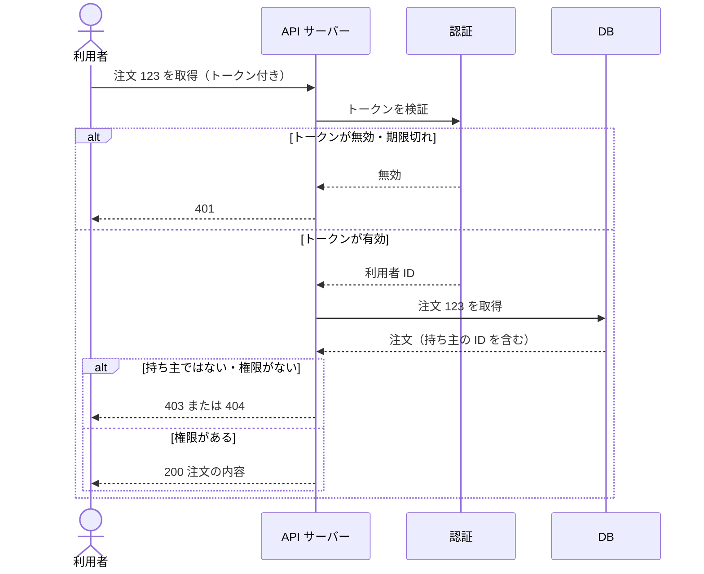
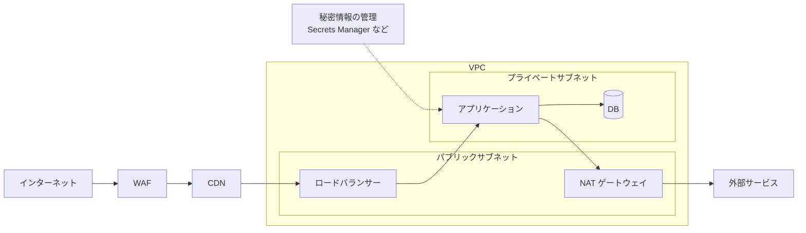

# セキュリティチェックリスト

Web サービス・API を開発・運用するときに確認するセキュリティのチェックリストです。
要件定義・設計・実装・リリース・運用の各段階で、このチェックリストを参照します。
OWASP Top 10:2025、OWASP の AI エージェント向けの Top 10（2026年版）、2025〜2026年に続いた開発の仕組み（CI/CD・パッケージ配布）への攻撃を踏まえて更新しています。

---

## 基本方針

1. **守るべき情報を先に特定する**
   - 個人情報、決済情報、認証情報、業務上の機密情報など、何を守るのかを明確にする
2. **最小権限を基本にする**
   - 利用者、システム、開発者のすべてに、必要な権限だけを与える
3. **フレームワークやクラウドの標準機能に任せる**
   - 独自の実装より、実績のある仕組みを使うほうが安全
4. **AI が生成したコードと依存パッケージを、特に注意して確認する**
   - 権限確認の漏れや、古い・存在しないパッケージの利用が起きやすい
5. **開発の仕組みと AI エージェントも、攻撃の入口として扱う**
   - CI/CD、パッケージの配布、AI エージェントが読む外部の文章や接続先のツール（MCP サーバーなど）も、守る対象に含める
6. **エラー時は安全側に止める**
   - 例外やタイムアウトのときに、確認を飛ばして処理を通してしまわないようにする

---

## 最新の動向（2026年11月時点）

**OWASP Top 10:2025 とこのチェックリストの対応**

| 順位 | 項目 | 対応する項目 |
|---|---|---|
| A01 | アクセス制御の不備（SSRF はここに統合） | 3. 認可、4. 入力と出力 |
| A02 | セキュリティ設定の誤り | 7. インフラとクラウド |
| A03 | ソフトウェアサプライチェーンの不備（新設） | 8. 依存パッケージと開発の仕組み |
| A04 | 暗号化の不備 | 5. 通信とデータの保護 |
| A05 | インジェクション | 4. 入力と出力 |
| A06 | 安全でない設計 | [設計チェックリスト](../design/checklist.md) 全体 |
| A07 | 認証の不備 | 2. 認証 |
| A08 | ソフトウェアとデータの完全性の不備 | 8. 依存パッケージと開発の仕組み |
| A09 | ログとアラートの不備 | 11. 検知と対応 |
| A10 | 例外的な状況の扱いの誤り（新設） | 4. 入力と出力 |

**押さえておきたい変化**

- **サプライチェーンへの攻撃**：パッケージの配布や GitHub Actions を経由した攻撃が続いています。盗まれたトークンや、外部からのプルリクエストで動く設定の不備が悪用され、正規の手順で公開されたパッケージにも不正なコードが入る事例が出ています
- **AI エージェントへの攻撃**：メール、文書、Issue、Web ページなどに埋め込まれた指示で、エージェントの目的が乗っ取られる（間接的なプロンプトインジェクション）ことが、最も大きなリスクとして挙げられています。接続先のツールや MCP サーバーが改ざん・なりすましされる事例もあります

---

## チェックリスト

### 1. 守るべき情報と法令

- [ ] 扱う個人情報・機密情報の種類と、保存する場所を一覧にしたか
- [ ] 個人情報保護法や業界のガイドラインなど、守るべき規制を確認したか
- [ ] 利用規約・プライバシーポリシーに、取得する情報と利用目的を記載したか
- [ ] 不要な情報を取得・保存していないか、保存期間を決めているか

### 2. 認証

- [ ] パスワードは、安全な方式（bcrypt、Argon2 など）でハッシュ化して保存しているか
- [ ] ログイン試行の回数制限や、アカウントロックがあるか
- [ ] 管理者や重要な操作に、多要素認証を導入しているか
- [ ] セッションやトークンの有効期限が適切で、ログアウトやパスワード変更時に失効するか
- [ ] パスワード再設定の仕組みで、他人のアカウントを乗っ取れないか

### 3. 認可（権限）

- [ ] すべての API で、ログインしているかだけでなく、そのデータを操作してよい利用者かを確認しているか
- [ ] URL やリクエストの ID を書き換えて、他人のデータにアクセスできないか
- [ ] 管理者機能が、一般利用者から使えないか
- [ ] 権限の確認を、画面側だけでなくサーバー側で行っているか

**認証と認可の確認の流れ**



ログインしているか（認証）だけでなく、そのデータを操作してよい利用者か（認可）を、すべての API でサーバー側で確認します。

### 4. 入力と出力

- [ ] SQL インジェクション対策として、プレースホルダや ORM を使っているか
- [ ] XSS 対策として、出力時のエスケープを行っているか
- [ ] CSRF 対策をしているか
- [ ] ファイルアップロードで、種類・サイズ・保存先を制限しているか
- [ ] 外部の URL を取得する機能で、内部ネットワークにアクセスされないか（SSRF）
- [ ] エラー画面や API のレスポンスに、内部情報を含めていないか
- [ ] 例外、タイムアウト、想定外の入力のときに、処理を安全側に止めているか（エラー時に権限確認を飛ばして通してしまわないか）

### 5. 通信とデータの保護

- [ ] すべての通信を HTTPS にしているか
- [ ] DB やストレージを暗号化しているか
- [ ] 個人情報・機密情報を、ログや分析ツールに出力していないか
- [ ] バックアップも、本番と同じ水準で保護しているか
- [ ] 開発環境やテストに、本番の個人情報をそのまま使っていないか

### 6. 秘密情報の管理

- [ ] API キー、パスワード、証明書を、コードやリポジトリに含めていないか
- [ ] 秘密情報を、Secrets Manager や Parameter Store などで管理しているか
- [ ] 秘密情報を定期的に、または漏えいの疑いがあるときにすぐ差し替えられるか
- [ ] リポジトリへの秘密情報の混入を、自動で検知しているか（GitHub の Secret scanning など）

### 7. インフラとクラウド

- [ ] IAM の権限が最小限になっているか、ルートアカウントを日常的に使っていないか
- [ ] DB や内部サービスを、インターネットから直接アクセスできない場所に置いているか
- [ ] セキュリティグループで、必要な通信だけを許可しているか
- [ ] S3 などのストレージが、意図せず公開されていないか
- [ ] 操作ログ（CloudTrail など）を記録し、保存しているか
- [ ] 必要に応じて WAF を導入しているか

**ネットワーク構成の例**



DB とアプリケーションはプライベートサブネットに置き、インターネットから直接アクセスできないようにします。

### 8. 依存パッケージと開発の仕組み（サプライチェーン）

**依存パッケージ**

- [ ] 依存パッケージの脆弱性を、自動で検知しているか（Dependabot など）
- [ ] 追加するパッケージが、広く使われていて保守されているか
- [ ] パッケージ名の打ち間違いや、似た名前の不正なパッケージでないか（AI が存在しないパッケージ名を提案し、それに似せた不正なパッケージが公開される例もある）
- [ ] ロックファイルで、バージョンを固定しているか。ロックファイルの差分を確認しているか
- [ ] 公開されたばかりのバージョンをすぐに取り込まない設定（一定期間たったものだけを使う）を検討したか
- [ ] CI では、パッケージのインストール時に実行されるスクリプトを、必要なものだけに限定しているか

**CI/CD（GitHub Actions など）**

- [ ] 外部のアクションを、タグではなくコミット SHA で固定しているか（更新は Dependabot などで行う）
- [ ] 外部からのプルリクエストで動くワークフローに、秘密情報や書き込みの権限が渡らないようにしているか（`pull_request_target` を避ける、キャッシュの扱いに注意する）
- [ ] ワークフローの権限（トークンの権限）を、必要最小限にしているか
- [ ] クラウドへのデプロイに、長期間有効なキーではなく、OIDC による一時的な権限を使っているか
- [ ] ワークフローの定義ファイルの変更に、決まった人の承認を必須にしているか

**アカウントと配布**

- [ ] GitHub、パッケージの公開先、クラウドのアカウントで、フィッシングに強い多要素認証（パスキーなど）を必須にしているか
- [ ] パッケージを公開する場合、長期間有効なトークンではなく、Trusted Publishing などの仕組みを使っているか
- [ ] 漏えいの疑いがあるときに、トークンやキーをすぐに無効化できるか

### 9. 開発体制と AI の利用

- [ ] リポジトリやクラウドへのアクセス権を、メンバーごとに必要最小限にしているか
- [ ] 退任・契約終了したメンバーの権限を、すぐに削除しているか
- [ ] AI ツールに、秘密情報や本番の個人情報を入力していないか
- [ ] 利用する AI ツールのデータの扱い（学習に使われるか、保存期間）を確認したか
- [ ] AI エージェントに与える権限（ファイル操作、コマンド実行、本番環境へのアクセス）を限定しているか
- [ ] AI エージェントへの指示ファイル（AGENTS.md など）に、Web などから取得した文章をそのまま入れていないか
- [ ] 開発者が使う AI ツールや MCP サーバーを把握し、承認したものだけを使っているか

### 10. AI エージェント・LLM を組み込む場合

- [ ] メール、文書、Issue、Web ページ、ツールの結果など、外部の文章を「指示」ではなく「データ」として扱っているか（間接的なプロンプトインジェクション対策）
- [ ] エージェントが使えるツールと権限を、目的に必要な最小限にしているか
- [ ] 送金、削除、外部への送信、本番環境の変更など、影響の大きい操作の前に、人の確認を挟んでいるか
- [ ] AI が生成したコードを実行する場合、隔離された環境（サンドボックス）で動かし、外部への通信を制限しているか
- [ ] 接続する MCP サーバーやツールを、承認したものに限定し、バージョンを固定しているか。説明や定義が変わったときに再確認しているか
- [ ] MCP サーバーなどが、自分宛てでないトークンを受け取って使い回していないか
- [ ] エージェントに、人とは別の識別子（ID）と権限を与え、操作を記録しているか
- [ ] エージェントをすぐに止める手段（停止スイッチ）を用意しているか
- [ ] プロンプトインジェクションや権限の悪用を想定した試験を、リリース前と、モデル・プロンプト・ツールを変えたときに行っているか

### 11. 検知と対応

- [ ] 不審なログインや大量アクセスを検知できるか
- [ ] 情報漏えいなどが起きた場合の連絡先、報告の手順、対応の流れを決めているか
- [ ] 必要に応じて、脆弱性診断を受けているか

---

## AI への依頼テンプレート

```markdown
あなたは Web アプリケーションとクラウドのセキュリティに詳しいレビュアーです。
以下のシステムのセキュリティを確認してください。

## システムの概要
{ サービスの内容、扱う情報、利用者の種類、構成、認証の方式など }

## 対象
{ 設計書、API 仕様、コードの差分、インフラ構成など }

## 依頼内容
1. 添付のチェックリストと照らし合わせ、対策が漏れている項目を洗い出してください。
2. 権限確認の漏れ（他人のデータへのアクセス、管理者機能の利用）がないか、
   API ごとに確認してください。
3. OWASP Top 10:2025 の各項目、特にサプライチェーン（CI/CD・依存パッケージ）と
   例外時の扱いについて、対策の漏れを確認してください。
   AI エージェントや LLM を組み込んでいる場合は、OWASP の AI エージェント向けの
   Top 10 の観点（目的の乗っ取り、ツールの悪用、接続先の改ざんなど）でも確認してください。
4. 秘密情報や個人情報が、コード・ログ・外部サービスに漏れる経路がないか確認してください。
5. 指摘ごとに、悪用された場合の影響、発生のしやすさ、対策案を書いてください。

## 出力形式
- 指摘一覧（項目、内容、影響度：高・中・低、発生のしやすさ、対策案）
- 要確認事項
```

---

## 人が判断すること

- [ ] 影響度「高」の指摘をすべて対応したか、対応しない場合のリスクを受け入れる判断をしたか
- [ ] 対策の費用（WAF、脆弱性診断、多要素認証など）が、守る情報の重要度に見合うか
- [ ] AI ツールに渡してよい情報の範囲

---

## 参考情報（2026年11月時点）

- [OWASP Top 10:2025 の変更点（Invicti）](https://www.invicti.com/fr/blog/web-security/owasp-top-10)
- [OWASP Top 10: Broken access control still tops app security list（The Register）](https://www.theregister.com/2025/11/11/new_owasp_top_ten_broken/)
- [OWASP Top 10 for Agentic Applications 2026（Aikido）](https://www.aikido.dev/blog/owasp-top-10-agentic-applications)
- [OWASP MCP Top 10（Cycode）](https://cycode.com/blog/owasp-mcp-top-10/)
- [Securing the open source supply chain across GitHub（GitHub Blog）](https://github.blog/security/supply-chain-security/securing-the-open-source-supply-chain-across-github/)
- [Shai-Hulud was the best thing to happen to supply chain security（Aikido）](https://www.aikido.dev/blog/shai-hulud-trusted-publishing)
