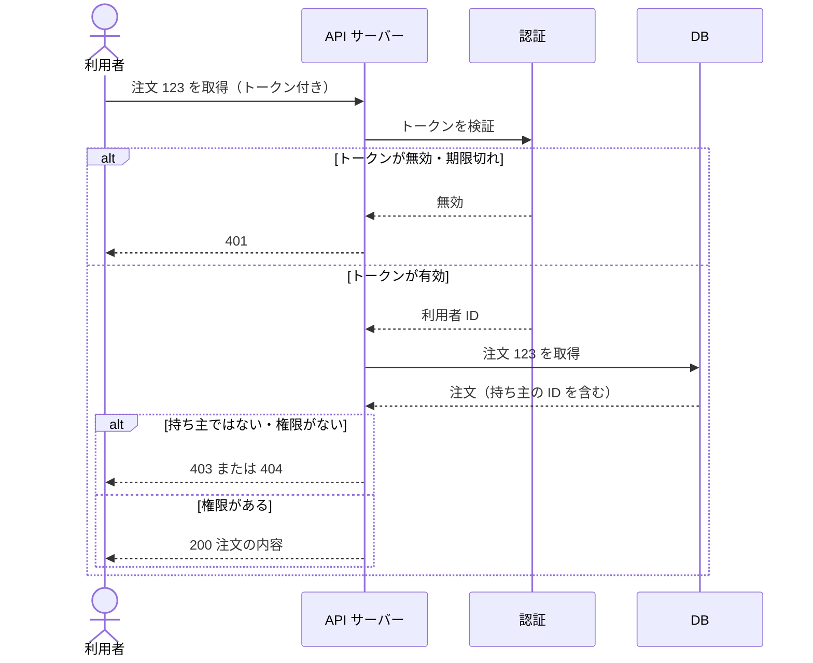
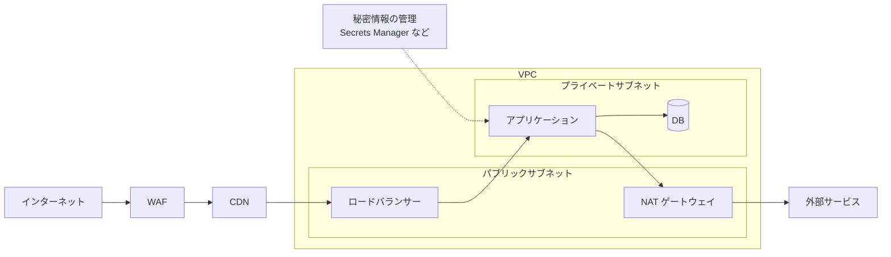

# セキュリティチェックリスト

Web サービス・API を開発・運用するときに確認するセキュリティのチェックリストです。
要件定義・設計・実装・リリース・運用の各段階で、このチェックリストを参照します。

---

## 基本方針

1. **守るべき情報を先に特定する**
   - 個人情報、決済情報、認証情報、業務上の機密情報など、何を守るのかを明確にする
2. **最小権限を基本にする**
   - 利用者、システム、開発者のすべてに、必要な権限だけを与える
3. **フレームワークやクラウドの標準機能に任せる**
   - 独自の実装より、実績のある仕組みを使うほうが安全
4. **AI が生成したコードと依存パッケージを、特に注意して確認する**
   - 権限確認の漏れや、古い・存在しないパッケージの利用が起きやすい

---

## チェックリスト

### 1. 守るべき情報と法令

- [ ] 扱う個人情報・機密情報の種類と、保存する場所を一覧にしたか
- [ ] 個人情報保護法や業界のガイドラインなど、守るべき規制を確認したか
- [ ] 利用規約・プライバシーポリシーに、取得する情報と利用目的を記載したか
- [ ] 不要な情報を取得・保存していないか、保存期間を決めているか

### 2. 認証

- [ ] パスワードは、安全な方式（bcrypt、Argon2 など）でハッシュ化して保存しているか
- [ ] ログイン試行の回数制限や、アカウントロックがあるか
- [ ] 管理者や重要な操作に、多要素認証を導入しているか
- [ ] セッションやトークンの有効期限が適切で、ログアウトやパスワード変更時に失効するか
- [ ] パスワード再設定の仕組みで、他人のアカウントを乗っ取れないか

### 3. 認可（権限）

- [ ] すべての API で、ログインしているかだけでなく、そのデータを操作してよい利用者かを確認しているか
- [ ] URL やリクエストの ID を書き換えて、他人のデータにアクセスできないか
- [ ] 管理者機能が、一般利用者から使えないか
- [ ] 権限の確認を、画面側だけでなくサーバー側で行っているか

**認証と認可の確認の流れ**



ログインしているか（認証）だけでなく、そのデータを操作してよい利用者か（認可）を、すべての API でサーバー側で確認します。

### 4. 入力と出力

- [ ] SQL インジェクション対策として、プレースホルダや ORM を使っているか
- [ ] XSS 対策として、出力時のエスケープを行っているか
- [ ] CSRF 対策をしているか
- [ ] ファイルアップロードで、種類・サイズ・保存先を制限しているか
- [ ] 外部の URL を取得する機能で、内部ネットワークにアクセスされないか（SSRF）
- [ ] エラー画面や API のレスポンスに、内部情報を含めていないか

### 5. 通信とデータの保護

- [ ] すべての通信を HTTPS にしているか
- [ ] DB やストレージを暗号化しているか
- [ ] 個人情報・機密情報を、ログや分析ツールに出力していないか
- [ ] バックアップも、本番と同じ水準で保護しているか
- [ ] 開発環境やテストに、本番の個人情報をそのまま使っていないか

### 6. 秘密情報の管理

- [ ] API キー、パスワード、証明書を、コードやリポジトリに含めていないか
- [ ] 秘密情報を、Secrets Manager や Parameter Store などで管理しているか
- [ ] 秘密情報を定期的に、または漏えいの疑いがあるときにすぐ差し替えられるか
- [ ] リポジトリへの秘密情報の混入を、自動で検知しているか（GitHub の Secret scanning など）

### 7. インフラとクラウド

- [ ] IAM の権限が最小限になっているか、ルートアカウントを日常的に使っていないか
- [ ] DB や内部サービスを、インターネットから直接アクセスできない場所に置いているか
- [ ] セキュリティグループで、必要な通信だけを許可しているか
- [ ] S3 などのストレージが、意図せず公開されていないか
- [ ] 操作ログ（CloudTrail など）を記録し、保存しているか
- [ ] 必要に応じて WAF を導入しているか

**ネットワーク構成の例**



DB とアプリケーションはプライベートサブネットに置き、インターネットから直接アクセスできないようにします。

### 8. 依存パッケージ

- [ ] 依存パッケージの脆弱性を、自動で検知しているか（Dependabot など）
- [ ] 追加するパッケージが、広く使われていて保守されているか
- [ ] パッケージ名の打ち間違いや、似た名前の不正なパッケージでないか
- [ ] ロックファイルで、バージョンを固定しているか

### 9. 開発体制と AI の利用

- [ ] リポジトリやクラウドへのアクセス権を、メンバーごとに必要最小限にしているか
- [ ] 退任・契約終了したメンバーの権限を、すぐに削除しているか
- [ ] AI ツールに、秘密情報や本番の個人情報を入力していないか
- [ ] 利用する AI ツールのデータの扱い（学習に使われるか、保存期間）を確認したか
- [ ] AI エージェントに与える権限（ファイル操作、コマンド実行、本番環境へのアクセス）を限定しているか

### 10. 検知と対応

- [ ] 不審なログインや大量アクセスを検知できるか
- [ ] 情報漏えいなどが起きた場合の連絡先、報告の手順、対応の流れを決めているか
- [ ] 必要に応じて、脆弱性診断を受けているか

---

## AI への依頼テンプレート

```markdown
あなたは Web アプリケーションとクラウドのセキュリティに詳しいレビュアーです。
以下のシステムのセキュリティを確認してください。

## システムの概要
{ サービスの内容、扱う情報、利用者の種類、構成、認証の方式など }

## 対象
{ 設計書、API 仕様、コードの差分、インフラ構成など }

## 依頼内容
1. 添付のチェックリストと照らし合わせ、対策が漏れている項目を洗い出してください。
2. 権限確認の漏れ（他人のデータへのアクセス、管理者機能の利用）がないか、
   API ごとに確認してください。
3. 秘密情報や個人情報が、コード・ログ・外部サービスに漏れる経路がないか確認してください。
4. 指摘ごとに、悪用された場合の影響、発生のしやすさ、対策案を書いてください。

## 出力形式
- 指摘一覧（項目、内容、影響度：高・中・低、発生のしやすさ、対策案）
- 要確認事項
```

---

## 人が判断すること

- [ ] 影響度「高」の指摘をすべて対応したか、対応しない場合のリスクを受け入れる判断をしたか
- [ ] 対策の費用（WAF、脆弱性診断、多要素認証など）が、守る情報の重要度に見合うか
- [ ] AI ツールに渡してよい情報の範囲
