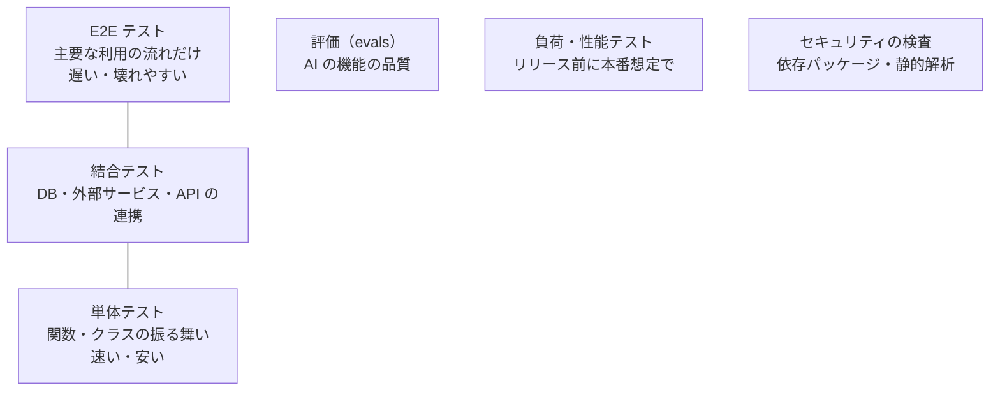

# テスト戦略

> 最終確認日：2026年11月15日

どのテストを、どれだけ、どの段階で自動化するかを決めるためのノートです。
AI がコードを速く書けるようになった今、品質を支えるのは「AI が書いたものを機械で検証できる仕組み」です。テストが信頼できなければ、AI のレビューも人の判断も成り立たないため、テストそのものの信頼性を確かめることを重視しています。

---

## 基本方針

1. **速くて安いテストを多く、遅くて高いテストを少なく**
   - 単体テストを土台にし、結合テストで連携を、E2E テストで主要な流れだけを確かめる
2. **受け入れ条件からテストを作る**
   - テストは実装の確認ではなく、要件を満たしているかの確認として作る
3. **テストそのものが効いているかを確かめる**
   - 実装と同じ AI がテストを書くと、実装に合わせた期待値になりやすい。期待値の変更を検出し、必要に応じてミューテーションテストで確かめる
4. **AI が自分で実行できるテストを用意する**
   - 手元で短時間に動くテストがあると、AI が自分で検証して修正できる
5. **AI の機能は、通常のテストとは別に評価（evals）で確かめる**
   - 出力が毎回変わる機能は、正解の一致ではなく、評価用のデータと基準で品質を測る

---

## テストの種類と配分



| 種類 | 確かめること | いつ動かすか |
|---|---|---|
| 単体テスト | 関数やクラスの振る舞い、境界値、例外 | 保存時・プルリクエストごと |
| 結合テスト | DB、外部サービス、API との連携 | プルリクエストごと |
| E2E テスト | ログインから主要な操作までの流れ | マージ前・ステージング |
| 契約テスト | API の提供側と利用側の取り決め | プルリクエストごと |
| 評価（evals） | AI の機能の出力の質 | プロンプト・モデルの変更ごと、定期的に |
| 負荷・性能テスト | 本番を想定した応答時間と処理量 | リリース前（[リリース前パフォーマンス・インフラチェックリスト](../performance/release-checklist.md)） |
| セキュリティの検査 | 脆弱性、秘密情報の混入 | プルリクエストごと |

---

## チェックリスト

### 1. 方針

- [ ] テストの種類ごとに、何を確かめるかと、どこまで自動化するかを決めたか
- [ ] 重要な業務（決済、認証、データの更新など）を、優先してテストしているか
- [ ] テストが CI で自動的に動き、失敗したらマージできないようにしているか
- [ ] テストの実行時間が長くなりすぎていないか（遅いテストは分けて実行する）

### 2. テストの中身

- [ ] 受け入れ条件ごとに、対応するテストがあるか
- [ ] 正常系だけでなく、異常系・境界値・権限のない利用者のケースがあるか
- [ ] 不具合の修正では、その不具合を再現するテストを追加しているか
- [ ] テストが、実行順序・時刻・外部環境に依存していないか
- [ ] 不安定なテスト（実行ごとに結果が変わる）を放置せず、原因を直しているか

### 3. テストの信頼性

- [ ] 受け入れ条件のテストを、実装より先に作るか、別のエージェントに作らせているか
- [ ] 既存テストの期待値の変更・削除・スキップを、CI で検出して確認しているか
- [ ] カバレッジを、目標ではなく「テストされていない箇所を見つける手がかり」として使っているか
- [ ] 重要な部分で、ミューテーションテスト（わざとコードを壊して、テストが失敗するかを確かめる）を行っているか

### 4. テストデータと環境

- [ ] 本番相当の件数のテストデータを、必要なテストで使えるか
- [ ] テストデータに、本番の個人情報をそのまま使っていないか
- [ ] 外部サービスとの連携を、モックやサンドボックス環境で確かめられるか
- [ ] AI が手元で、短時間にテストを実行できる環境があるか

### 5. AI の機能の評価（evals）

- [ ] 実際の利用に近い入力（失敗した事例や境界のケースを含む）を集めた、評価用のデータがあるか
- [ ] 確かめ方を使い分けているか（形式の一致・スキーマの検証・ルールによる確認・AI による採点）
- [ ] AI に採点させる場合、基準を明確にし、人の判定と一致するかを定期的に確かめているか
- [ ] 出力は毎回変わるため、1回ではなく複数回実行して比べているか
- [ ] 評価の結果を、プロンプト・モデル・評価データのバージョンと一緒に記録しているか
- [ ] 評価の結果が基準を下回ったら、リリースしないようにしているか
- [ ] 評価に使わない検証用のデータを分けて持ち、評価データに合わせすぎていないか確かめているか

---

## AI への依頼テンプレート

```markdown
あなたはテストの設計に詳しいエンジニアです。
以下の機能のテストを設計してください。

## 機能と受け入れ条件
{ 機能の説明、受け入れ条件 }

## 現在のテスト
{ 既存のテスト、使っているテストのツール }

## 依頼内容
1. 受け入れ条件ごとに、必要なテスト（単体・結合・E2E）を挙げてください。
2. 正常系・異常系・境界値・権限のケースを網羅したテストケースの一覧を作ってください。
3. 既存のテストで不足している箇所と、壊れやすい・不安定になりやすい箇所を挙げてください。
4. AI の機能が含まれる場合は、評価用のデータの作り方と、確かめ方（形式の一致、
   ルール、AI による採点）の組み合わせを提案してください。
5. テストを実装に合わせただけのものにしないため、期待値の根拠を受け入れ条件に結びつけてください。

## 出力形式
- テストケースの一覧（受け入れ条件、種類、内容、期待する結果）
- 不足・不安定な箇所
- AI の機能の評価方法（該当する場合）
```

---

## 人が判断すること

- [ ] どこまでテストに投資するか（重要な業務と、そうでない部分の線引き）
- [ ] 評価の合格基準と、基準を下回ったときにリリースを止めるか
- [ ] 不安定なテストを直すか、一時的に外すか

---

## 参考情報（2026年11月時点）

- [How to Build Prompt Evals for LLM Apps（PromptLayer）](https://blog.promptlayer.com/how-to-build-prompt-evals-for-llm-apps/)
- [LLM Evaluation Frameworks, Metrics & Best Practices（BigData Boutique）](https://bigdataboutique.com/blog/llm-evaluation-frameworks-metrics-best-practices)
- [LLM Evals in 2026: A Practitioner's Field Guide（DEV Community）](https://dev.to/lamingsrb/llm-evals-in-2026-a-practitioners-field-guide-26if)
